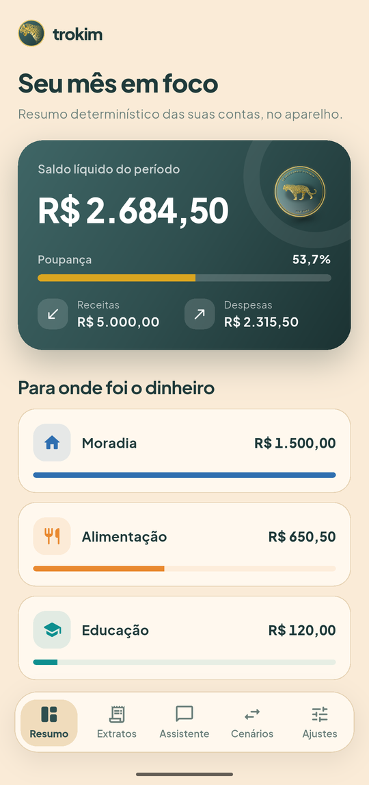
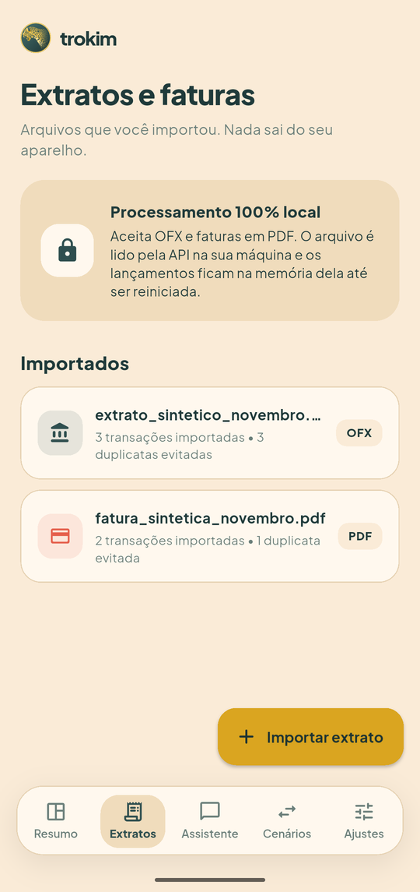

<p align="center">
  
</p>

<p align="center">
  <a href="https://github.com/moonshinerd/trokim/actions/workflows/ci.yml"></a>
  <a href="https://github.com/moonshinerd/trokim/actions/workflows/docs.yml"></a>
  
  
</p>

<p align="center">
  <a href="https://moonshinerd.github.io/trokim/">Documentação</a> ·
  <a href="docs/guia-de-uso.md">Guia de uso</a> ·
  <a href="docs/pesquisa/resultados.md">Resultados</a> ·
  <a href="https://github.com/moonshinerd/trokim/issues">Roadmap e issues</a>
</p>

## Finanças mais claras, sob seu controle

O **Trokim** é um assistente financeiro pessoal para Android. Reúne lançamentos de extratos e faturas para ajudar você a compreender receitas, despesas e hábitos de consumo — com processamento local e orientações apoiadas em materiais do **BCB, CVM e CFPB**.

<p align="center">
  
  &nbsp;&nbsp;
  
</p>
<p align="center"><sub>Telas reais do aplicativo com dados sintéticos. Resumo financeiro e importação de extratos.</sub></p>

| Organize | Compreenda | Aprenda |
| :--- | :--- | :--- |
| Importe OFX e faturas PDF e identifique lançamentos duplicados. | Consulte saldo, receitas, despesas e categorias calculados pelo backend. | Converse com o assistente, consulte as fontes e mantenha o histórico no aparelho. |

## Engenharia por trás da experiência

- **Cálculos determinísticos:** totais e indicadores financeiros são computados em Python; a LLM atua na explicação.
- **Respostas com evidências:** busca híbrida semântica e textual, citações e abstenção quando falta evidência ou o tema está fora do escopo.
- **Privacidade por arquitetura:** API na máquina do usuário, embeddings locais e inferência via Ollama. Provedores de nuvem são opcionais e enviam conteúdo ao serviço escolhido.
- **Evolução com rastreabilidade:** backend em camadas, provedores de LLM desacoplados, prompts versionados, testes e decisões registradas em ADRs.

| Camada | Stack e versões |
| :--- | :--- |
| Aplicativo | **Flutter 3.50.0** no CI · Dart **≥3.13.0 e <4.0.0** |
| Backend | Python **≥3.12** · FastAPI **0.162.0** · Pydantic **2.14.2** · Uvicorn **0.54.0** |
| Dados | SQLite (embutido no ambiente Python) · sqlite-vec **0.1.9** · SQLAlchemy **2.1.8** |
| IA e recuperação | FastEmbed **0.9.1** · LiteLLM **1.108.0** · Ollama (versão não fixada) |
| Qualidade | pytest **9.2.0** · Ruff **0.17.3** |

Versões das bibliotecas fixadas em [`api/uv.lock`](api/uv.lock); requisitos dos SDKs em [`api/pyproject.toml`](api/pyproject.toml) e [`mobile/pubspec.yaml`](mobile/pubspec.yaml). O gerenciador **uv** não tem versão fixada no projeto.

[Arquitetura e fluxo de dados](docs/arquitetura/mapa-do-sistema.md) · [Decisões técnicas](docs/adr/index.md) · [Benchmarks reproduzíveis](docs/pesquisa/resultados.md)

## Execute localmente

**Pré-requisitos:** Python **3.12+**, [uv](https://docs.astral.sh/uv/) e, para o app Android, Flutter **3.50.0** (mesma versão do CI), JDK **17** e Android SDK **36**. Veja a [configuração completa](docs/guia-de-uso.md#1-pré-requisitos).

```bash
git clone https://github.com/moonshinerd/trokim.git
cd trokim
make setup
make api-run
```

Em outro terminal, na raiz do projeto:

```bash
make mobile-run
```

A API oferece [Swagger](http://127.0.0.1:8000/docs) e [health check](http://127.0.0.1:8000/v1/health). O emulador Android usa `http://10.0.2.2:8000/v1`.

Para respostas generativas, configure o Ollama conforme o [guia de uso](docs/guia-de-uso.md#3-síntese-generativa-local-litellm-e-ollama). A primeira consulta RAG pode baixar o modelo de embeddings. Use `make synthetic-data` para gerar arquivos de demonstração; configuração, conexão com aparelho físico e importação estão no guia.

> **Estágio atual:** protótipo em desenvolvimento, voltado à execução local. Os lançamentos importados ficam na memória da API e são perdidos ao reiniciá-la; a base vetorial usa SQLite. Persistência financeira e operação com múltiplas instâncias exigem evolução da arquitetura. Veja o [planejamento](docs/planejamento.md) e a [ADR de importação](docs/adr/0015-dados-reais-importacao-e-endereco-da-api.md).

## Qualidade e contribuição

O CI verifica API, pesquisa, aplicativo e documentação. Para validar alterações:

```bash
make lint          # Ruff e análise Flutter, quando instalado
make test          # API, pesquisa e benchmark RAG
make docs-build    # Documentação em modo estrito
(cd mobile && flutter test)
```

Consulte as [issues](https://github.com/moonshinerd/trokim/issues), siga as [regras de contribuição](AGENTS.md) e abra uma PR vinculada à issue, com testes e documentação atualizados. Utilize somente dados sintéticos nos exemplos e testes.

---

Desenvolvido no **Challenge 2 · TIC-IA 2026**, com foco em qualidade de vida e educação financeira. [Equipe e contribuições](https://github.com/moonshinerd/trokim/graphs/contributors) · [Créditos de arte e referências](docs/referencias.md#5-créditos-de-arte).

<sub>O repositório ainda não contém um arquivo LICENSE; os créditos e as licenças dos recursos visuais estão documentados separadamente.</sub>
