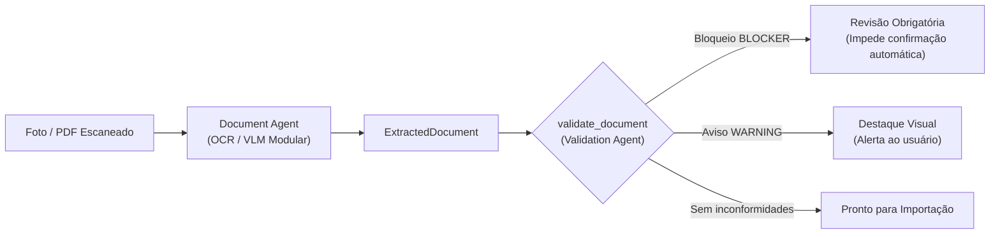

# Document Agent

!!! info "Status: Em Desenvolvimento (Semana 5 — Multimodalidade)"
    Épico [#86](https://github.com/moonshinerd/trokim/issues/86), Issues [#88](https://github.com/moonshinerd/trokim/issues/88) e [#89](https://github.com/moonshinerd/trokim/issues/89). O agente multimodal realiza a extração e estruturação de documentos financeiros a partir de imagens e PDFs escaneados (faturas, boletos e comprovantes de Pix), com validação determinística de campos e conciliação com a biblioteca.

O **DocumentAgent** é responsável pela ingestão e extração multimodal do Trokim. Ele processa arquivos visuais (fotos de comprovantes ou faturas em PDF), identifica o tipo documental, extrai campos estruturados (datas, valores, favorecidos, linhas de itens) e submete o resultado à validação do [Validation Agent](validation-agent.md#6-validacao-de-documentos-multimodais-e-conciliacao-semana-5).

---

## Contrato HTTP

Envie JPEG, PNG ou PDF (até 20 MiB) como `file` multipart para
`POST /v1/documents/extract`. O campo opcional `account_id` restringe a conciliação.
O campo `engine` escolhe o motor: `ocr` (padrão, só o OCR local) ou `vision` (OCR mais o modelo de
visão configurado, que recebe a imagem com CPF, CNPJ, agência e conta tarjados). Com modelo de visão
remoto, envie também `allow_remote=true`, e só depois do consentimento do usuário.
`GET /v1/documents/engines` informa o que o servidor tem: `{"ocr": "rapidocr", "vision": null}` ou
`{"ocr": "rapidocr", "vision": {"model": "...", "remote": false}}`
([ADR 0021](../adr/0021-visao-e-ocr-modulares.md)).
O objeto `document` contém `kind`, qualidade, campos, linhas, motor e indicação de abstenção.
O envelope inclui `validation_issues`, `can_confirm`, `steps` e `total_ms`.
Por exemplo, um Pix legível retorna um campo como
`{"key":"amount","value":"12.50","confidence":0.98,"source":"ocr"}`.
O modelo interno da validação recebe esses dados por adaptador.

Na revisão, confira data, estabelecimento, valor, conta e vencimento de boleto ou fatura.
Envie o resultado para `POST /v1/documents/confirm`. Para várias compras, envie
`transactions` com data, descrição e valor de cada linha e o total em `amount`.
A resposta contém `outcome` (`criado` ou `repetido`), `uid`, `uids`, conta, categoria e mensagem.
Somente a confirmação altera a biblioteca persistida. Sem `account_id`, faturas vão para
`documentos:cartao` e os demais documentos para `documentos:sem_conta`.
A confirmação valida o documento inteiro contra a biblioteca antes de inserir o lote;
sem conta escolhida, a busca de duplicatas alcança todas as contas. O reenvio exato
retorna `repetido`, mas datas, vencimento e total continuam sujeitos à validação.
O campo `origin` do `/confirm` vale `documento` (padrão: o usuário revisou o que foi lido) ou
`manual` (digitou sem leitura bem-sucedida) e vira a procedência do lançamento, enquanto `source_kind` continua indicando
`conta` ou `cartao`, preservando as visões de caixa e competência. As regras de categoria
aprendidas também valem para o estabelecimento revisado de um Pix. Consulte os [exemplos HTTP](../guia-de-uso.md#documentos-por-foto-ou-pdf).

Compras idênticas no mesmo dia dentro de um documento são válidas: cada ocorrência recebe seu
próprio identificador, e o reenvio do mesmo documento continua retornando `repetido` linha a
linha. Uma fatura de cartão só pode ser lançada em conta de cartão (`ACCOUNT_KIND_MISMATCH`,
`422`). A abstenção do `/extract` não cria nada; o `/confirm` aceita os campos digitados à mão
depois dela, com `origin="manual"`, e o chat descreve esse lançamento como digitado, não como lido.
Se o extrato do mesmo Pix ou compra for importado depois, o lançamento do documento vira duplicata
e o do banco prevalece ([ADR 0026](../adr/0026-confirmacao-e-consulta-de-documentos.md)).
No `steps` da extração, o passo `validation` fica `failed` quando há bloqueio.

| HTTP | Motivo |
|---|---|
| 413 | Limite de upload, páginas ou resolução excedido |
| 415 | Conteúdo diferente de JPEG, PNG e PDF |
| 400 | Envio interrompido (o cliente desconectou durante o upload) |
| 403 | `REMOTE_CONSENT_REQUIRED`: visão remota sem `allow_remote=true` |
| 422 | Documento inválido ou confirmação bloqueada |
| 503 | Motor indisponível (`OCR_UNAVAILABLE`, `VISION_UNAVAILABLE`...) ou tempo de leitura excedido |

## 2. Pipeline de Validação e Conciliação

Todo documento extraído pelo Document Agent passa imediatamente pela função pura `validate_document(doc, library)` implementada no [Validation Agent](validation-agent.md#6-validacao-de-documentos-multimodais-e-conciliacao-semana-5) (`api/app/services/document_validation.py`):



1. **Validação de Campos:** O documento é submetido às regras determinísticas (`DATE_INVALID`, `AMOUNT_FORMAT`, `TOTAL_MISMATCH`, `DUE_BEFORE_ISSUE`, `FIELD_MISSING` e `LOW_CONFIDENCE`).
2. **Conciliação com a Biblioteca:** Em conformidade com a [ADR 0018](../adr/0018-contas-periodos-transferencias-e-visoes.md), o validador compara o documento com os lançamentos já importados na biblioteca para detectar duplicidades (`POSSIBLE_DUPLICATE`) e pagamentos de fatura já conciliados (`ALREADY_RECONCILED`).
3. **Revisão Humana:** Se houver qualquer bloqueador (`BLOCKER`), a confirmação retorna `422` e não altera a biblioteca. O usuário precisa corrigir os campos e reenviar; a ação de confirmar não ignora bloqueios.

## Validação financeira (#89)

A saída do agente passa pela validação determinística do [Validation Agent](validation-agent.md)
(`validate_document`), que aceita o `ExtractedDocument` do agente diretamente. Os dois
contratos têm formatos diferentes (campos por chave e lançamentos no agente; campos nomeados e
linhas na validação), e o adaptador `app/services/document_adapter.py` os liga sem inventar dado:
campo ausente continua ausente e a confiança global é a **menor** entre os campos e lançamentos.

No ensaio com OCR real sobre o dataset sintético da #90, os documentos legíveis seguiram sem
bloqueio, os parciais foram barrados por `FIELD_MISSING` e os ilegíveis ficaram em abstenção.
Esse resultado vale como verificação de integração, não como medida de acurácia (#98).


## Exemplos completos de requisição e resposta

Exemplos capturados com um PDF sintético que contém “Comprovante Pix”, data
20/11/2026, valor R$ 12,50 e favorecido Padaria Sintética. Tempos variam por execução.
Nenhum arquivo é persistido pela extração.

```bash
curl -F 'file=@comprovante-sintetico.pdf' http://localhost:8000/v1/documents/extract
```

??? example "Extração — HTTP 200"

    ```json
    {
      "document": {
        "kind": "pix_receipt",
        "bank": null,
        "quality": {
          "quality": "legible",
          "sharpness": 0.0,
          "resolution": [
            0,
            0
          ],
          "mean_ocr_confidence": null,
          "reasons": []
        },
        "fields": [
          {
            "key": "date",
            "value": "2026-11-20",
            "confidence": 0.95,
            "source": "text_layer"
          },
          {
            "key": "amount",
            "value": "12.50",
            "confidence": 0.95,
            "source": "text_layer"
          },
          {
            "key": "counterparty",
            "value": "Padaria Sintética",
            "confidence": 0.95,
            "source": "text_layer"
          }
        ],
        "transactions": [],
        "issues": [],
        "needs_review": true,
        "abstained": false,
        "reason": null,
        "engine": "text_layer"
      },
      "validation_issues": [],
      "can_confirm": true,
      "steps": [
        {
          "agent": "document",
          "status": "ok",
          "summary": "Leitura encerrada; confira os avisos antes de confirmar.",
          "duration_ms": 6,
          "detail": {
            "engine": "text_layer",
            "pages": [
              {
                "page": 1,
                "status": "text_layer"
              }
            ],
            "fields": 3,
            "issues": []
          }
        },
        {
          "agent": "validation",
          "status": "ok",
          "summary": "Validação do documento: 0 bloqueio(s), 0 aviso(s).",
          "duration_ms": 1,
          "detail": {
            "issues": []
          }
        }
      ],
      "total_ms": 7
    }
    ```

Após revisar os campos:

```bash
curl -H 'Content-Type: application/json' http://localhost:8000/v1/documents/confirm \
  -d '{"kind":"pix_receipt","date":"2026-11-20","description":"Padaria Sintética","amount":"12.50"}'
```

```json
{
  "uids": [
    "eea38f673be2"
  ],
  "outcome": "criado",
  "uid": "eea38f673be2",
  "account_id": "documentos:sem_conta",
  "category": "alimentacao",
  "message": "Lançamentos revisados confirmados."
}
```

Reenviar a mesma requisição retorna HTTP 200 com os mesmos identificadores:

```json
{
  "uids": [
    "eea38f673be2"
  ],
  "outcome": "repetido",
  "uid": "eea38f673be2",
  "account_id": "documentos:sem_conta",
  "category": "alimentacao",
  "message": "Este lançamento já existe; nada foi criado de novo."
}
```

Reenviar com `due_date="2026-11-01"` é recusado mesmo após uma confirmação válida:

```json
{
  "detail": {
    "code": "CONFIRMATION_BLOCKED",
    "message": "O validador bloqueou este lançamento; corrija os campos.",
    "issues": [
      {
        "code": "DUE_BEFORE_ISSUE",
        "severity": "blocker",
        "message": "Inconsistência de datas: data de vencimento (2026-11-01) é anterior à data de emissão (2026-11-20)."
      }
    ]
  }
}
```

Essa última resposta usa HTTP 422. Nenhuma conta ou linha do lote é criada se houver bloqueio.

## Consulta do lançamento confirmado

```bash
curl -H 'Content-Type: application/json' http://localhost:8000/v1/agents/ask \
  -d '{"message":"Quanto gastei nessa loja?","document_uid":"eea38f673be2"}'
```

??? example "Consulta — HTTP 200"

    ```json
    {
      "query": "Quanto gastei nessa loja?",
      "status": "answered",
      "answer": "Gasto no estabelecimento: R$ 12,50. Lançamento(s): eea38f673be2. Lido de foto ou PDF, confirmado por você. [1]",
      "model": null,
      "evidences": [
        {
          "id": "confirmed_documents",
          "document_id": "",
          "source_name": "Biblioteca local",
          "source_url": null,
          "document_title": "Lançamentos confirmados",
          "section": "Origem dos dados",
          "content": "Lançamento(s): eea38f673be2. Lido de foto ou PDF, confirmado por você.",
          "score": 0.0
        }
      ],
      "calculations": [
        {
          "key": "document_expenses",
          "label": "Gasto no estabelecimento",
          "value": 12.5,
          "unit": "BRL",
          "source": "CalculationService.calculate_summary"
        }
      ],
      "validation_issues": [],
      "steps": [
        {
          "agent": "analysis",
          "status": "ok",
          "summary": "Lido de foto ou PDF, confirmado por você.",
          "duration_ms": 1,
          "detail": {
            "document_uids": [
              "eea38f673be2"
            ],
            "transaction_uids": [
              "eea38f673be2"
            ],
            "source": "CalculationService.calculate_summary"
          }
        },
        {
          "agent": "validation",
          "status": "ok",
          "summary": "Validação aprovada: resposta em conformidade com as regras de integridade (0 avisos).",
          "duration_ms": 1,
          "detail": {
            "issues_count": 0,
            "blockers_count": 0,
            "warnings_count": 0,
            "issues": []
          }
        }
      ],
      "total_ms": 1
    }
    ```

`AgentQueryService` reconhece a consulta local, usa `CalculationService` e submete a
resposta ao `ValidationAgent`. A trilha contém cálculo e validação; a evidência vem da
biblioteca local, sem enviar os lançamentos ao LLM. Sem referência válida, pede esclarecimento.
O nome exato do estabelecimento também pode ser informado na pergunta, sem distinção de
acentos ou maiúsculas. Consultas educacionais continuam no orquestrador de quatro agentes.
Filtros por conta, dono e período continuam no escopo das #94 e #95.
