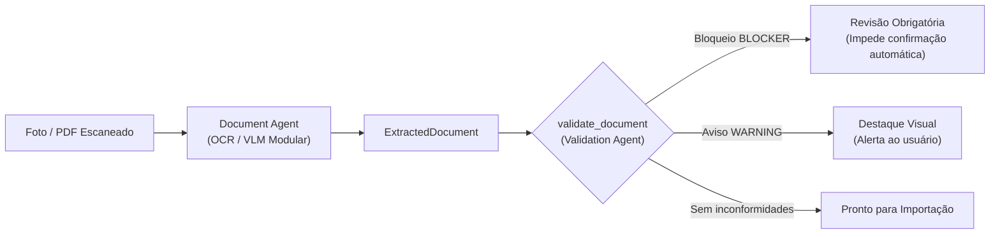

# Document Agent

!!! info "Status: Em Desenvolvimento (Semana 5 — Multimodalidade)"
    Épico [#86](https://github.com/moonshinerd/trokim/issues/86), Issues [#88](https://github.com/moonshinerd/trokim/issues/88) e [#89](https://github.com/moonshinerd/trokim/issues/89). O agente multimodal realiza a extração e estruturação de documentos financeiros a partir de imagens e PDFs escaneados (faturas, boletos e comprovantes de Pix), com validação determinística de campos e conciliação com a biblioteca.

O **DocumentAgent** é responsável pela ingestão e extração multimodal do Trokim. Ele processa arquivos visuais (fotos de comprovantes ou faturas em PDF), identifica o tipo documental, extrai campos estruturados (datas, valores, favorecidos, linhas de itens) e submete o resultado à validação do [Validation Agent](validation-agent.md#6-validacao-de-documentos-multimodais-e-conciliacao-semana-5).

---

## 1. Contrato de Extração (`ExtractedDocument`)

O resultado da extração multimodal é padronizado pelo modelo puro `ExtractedDocument` (`api/app/domain/document.py`), garantindo que todos os valores monetários sejam manipulados com precisão em centavos via `Decimal`:

| Campo | Tipo | Descrição |
|---|---|---|
| `document_type` | `DocumentType` | Tipo do documento: `fatura`, `pix`, `boleto` ou `outro`. |
| `amount` | `Decimal` | Valor principal do documento ou transação. |
| `total_amount` | `Decimal` | Valor total consolidado (em faturas com múltiplos lançamentos). |
| `raw_amount` | `str` | Valor textual bruto extraído da imagem (usado para checagem de formato). |
| `currency` | `str` | Moeda corrente (padrão: `"BRL"`). |
| `date` | `date` | Data da operação ou comprovante. |
| `issue_date` | `date` | Data de emissão do documento. |
| `due_date` | `date` | Data de vencimento (obrigatória em boletos e faturas). |
| `recipient` | `str` | Favorecido, recebedor ou beneficiário. |
| `merchant` | `str` | Nome do estabelecimento comercial. |
| `institution` | `str` | Banco ou instituição financeira emissora. |
| `account_id` | `str` | Conta associada na biblioteca para conciliação. |
| `barcode` | `str` | Linha digitável ou código de barras de boletos. |
| `confidence` | `float` | Índice global de confiança da extração OCR/VLM (0.0 a 1.0). |
| `lines` | `list[ExtractedLine]` | Lista de itens/lançamentos individuais da fatura. |
| `is_invoice_payment` | `bool` | Sinaliza se o documento é comprovante de pagamento de fatura. |

---

## 2. Pipeline de Validação e Conciliação

Todo documento extraído pelo Document Agent passa imediatamente pela função pura `validate_document(doc, library)` implementada no [Validation Agent](validation-agent.md#6-validacao-de-documentos-multimodais-e-conciliacao-semana-5) (`api/app/services/document_validation.py`):

1. **Validação de Campos:** O documento é submetido às regras determinísticas (`DATE_INVALID`, `AMOUNT_FORMAT`, `TOTAL_MISMATCH`, `DUE_BEFORE_ISSUE`, `FIELD_MISSING` e `LOW_CONFIDENCE`).
2. **Conciliação com a Biblioteca:** Em conformidade com a [ADR 0018](../adr/0018-contas-periodos-transferencias-e-visoes.md), o validador compara o documento com os lançamentos já importados na biblioteca para detectar duplicidades (`POSSIBLE_DUPLICATE`) e pagamentos de fatura já conciliados (`ALREADY_RECONCILED`).
3. **Revisão Humana:** Se houver qualquer bloqueador (`BLOCKER`), o sistema exige que o usuário revise e confirme os dados no aplicativo antes de criar transações na biblioteca local.

## Validação financeira (#89)

A saída do agente passa pela validação determinística do [Validation Agent](validation-agent.md)
(`validate_document`), que aceita o `ExtractedDocument` do agente diretamente. Os dois
contratos têm formatos diferentes (campos por chave e lançamentos no agente; campos nomeados e
linhas na validação), e o adaptador `app/services/document_adapter.py` os liga sem inventar dado:
campo ausente continua ausente e a confiança global é a **menor** entre os campos e lançamentos.

No ensaio com OCR real sobre o dataset sintético da #90, os documentos legíveis seguiram sem
bloqueio, os parciais foram barrados por `FIELD_MISSING` e os ilegíveis ficaram em abstenção.
Esse resultado vale como verificação de integração, não como medida de acurácia (#98).
