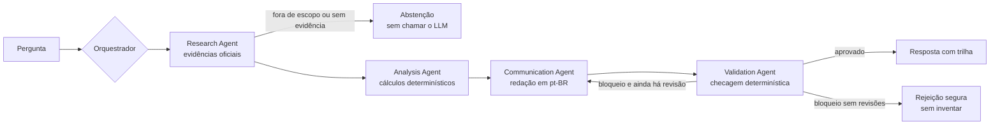

# Sistema Multiagente (Semanas 4 e 5)

O primeiro protótipo multiagente do Trokim: quatro agentes com papéis separados, coordenados por um
orquestrador determinístico, com a **trilha** de cada resposta visível no app. A decisão está na
[ADR 0016](../adr/0016-arquitetura-multiagente.md); o planejamento, em [Planejamento](../planejamento.md).

!!! success "Status: Implementado e integrado (Fase 2)"
    A integração dos quatro agentes e a exposição HTTP via `POST /v1/agents/ask` foi concluída na issue [#58](https://github.com/moonshinerd/trokim/issues/58). O endpoint conta com suite completa de testes de integração em `api/tests/test_agents_api.py` executando com mocks determinísticos e embeddings sem requisições externas no CI.

## Por que multiagente

Na Semana 3 o Trokim errou os casos C27, C29 e C30 porque o mesmo passo recupera, calcula, escreve e
se auto-avalia. Separar os papéis dá cálculo determinístico, recuperação auditável e uma checagem
independente antes de qualquer resposta sair. No fluxo de chat, só o agente de comunicação usa LLM. A leitura de documentos pode usar
visão opcional, com consentimento remoto e proteção de dados.

## Fluxo



## Os agentes

| Agente | Página | Issue | LLM |
|---|---|:---:|:---:|
| Orquestrador e contratos | [Orquestrador](orquestrador.md) | [#51](https://github.com/moonshinerd/trokim/issues/51) | Não |
| Research | [Research Agent](research-agent.md) | [#52](https://github.com/moonshinerd/trokim/issues/52) | Não |
| Analysis | [Analysis Agent](analysis-agent.md) | [#53](https://github.com/moonshinerd/trokim/issues/53) | Não |
| Validation | [Validation Agent](validation-agent.md) | [#54](https://github.com/moonshinerd/trokim/issues/54) | Não |
| Communication | [Communication Agent](communication-agent.md) | [#55](https://github.com/moonshinerd/trokim/issues/55) | Sim |

## Contrato de mensagens

Os modelos ficam em `api/app/domain/agents.py` (domínio puro) e o protocolo `Agent` em
`api/app/services/agents/base.py`. O contrato completo, com todos os campos, está no épico
[#50](https://github.com/moonshinerd/trokim/issues/50) e é a fonte de verdade da semana.

| Modelo | Para que serve |
|---|---|
| `AgentContext` | Estado compartilhado: pergunta, lançamentos, evidências, motivo de abstenção, cálculos, premissas, rascunho, problemas e tentativa |
| `AgentStep` | Uma linha da trilha: agente, estado (`ok`, `abstained`, `skipped`, `failed`), resumo, duração e detalhes |
| `CalculationResult` | Um resultado de cálculo com chave, rótulo, valor, unidade e origem |
| `ValidationIssue` | Um problema encontrado, com código estável, severidade (`blocker` ou `warning`) e mensagem em pt-BR |
| `MultiAgentResponse` | Resposta final: estado (`answered`, `abstained`, `rejected`), texto, evidências, cálculos, problemas e trilha |

## Endpoint: POST /v1/agents/ask

O endpoint `POST /v1/agents/ask` recebe uma consulta em linguagem natural e processa a requisição sequencialmente através da orquestração dos quatro agentes: **Research Agent** (recuperação e análise de escopo) $\to$ **Analysis Agent** (cálculos determinísticos sobre transações) $\to$ **Communication Agent** (redação em pt-BR com LLM local) $\to$ **Validation Agent** (auditoria defensiva e barreira de segurança).

### Requisição

- **URL:** `/v1/agents/ask`
- **Método:** `POST`
- **Cabeçalhos:** `Content-Type: application/json`
- **Corpo:** JSON contendo o campo `message` (entre 1 e 1000 caracteres).

```json
{
  "message": "Como montar uma reserva de emergência e quanto tempo leva com meu saldo atual?"
}
```

### Resposta de Sucesso (`200 OK`)

A resposta segue rigorosamente o contrato de `MultiAgentResponse` com a trilha de auditoria completa:

```json
{
  "status": "answered",
  "answer": "De acordo com o [Banco Central do Brasil](https://www.bcb.gov.br), a reserva de emergência ideal deve cobrir de 3 a 6 meses das despesas essenciais do seu orçamento familiar. Com base nos seus lançamentos importados, suas despesas mensais somam R$ 1.500,00 e o seu saldo líquido atual é de R$ 3.500,00.",
  "evidences": [
    {
      "id": "chunk_bcb_01",
      "document_title": "Caderno de Educação Financeira - Gestão de Finanças Pessoais",
      "section": "Reserva de Emergência",
      "content": "A reserva de emergência deve cobrir de 3 a 6 meses dos seus gastos essenciais...",
      "source_name": "Banco Central do Brasil",
      "source_url": "https://www.bcb.gov.br/cidadaniafinanceira",
      "score": 0.89
    }
  ],
  "calculations": [
    {
      "key": "net_balance",
      "label": "Saldo líquido",
      "value": 3500.0,
      "unit": "reais",
      "source": "Lançamentos importados"
    },
    {
      "key": "total_expenses",
      "label": "Total de despesas",
      "value": 1500.0,
      "unit": "reais",
      "source": "Lançamentos importados"
    }
  ],
  "issues": [],
  "steps": [
    {
      "agent": "research",
      "status": "ok",
      "summary": "1 evidência(s) recuperada(s).",
      "duration_ms": 32,
      "detail": {"chunks_count": 1}
    },
    {
      "agent": "analysis",
      "status": "ok",
      "summary": "2 cálculo(s) realizado(s).",
      "duration_ms": 2,
      "detail": {"keys": ["net_balance", "total_expenses"]}
    },
    {
      "agent": "communication",
      "status": "ok",
      "summary": "Rascunho de resposta redigido com base em evidências e cálculos.",
      "duration_ms": 412,
      "detail": {"model": "qwen2.5:1.5b", "attempt": 1}
    },
    {
      "agent": "validation",
      "status": "ok",
      "summary": "Validação aprovada sem bloqueios (0 avisos informativos).",
      "duration_ms": 4,
      "detail": {"issues_count": 0}
    }
  ]
}
```

### Códigos de Retorno e Tratamento de Erros

| Código HTTP | Significado | Condição e Comportamento |
|:---:|---|---|
| `200 OK` | Sucesso | Retorna `MultiAgentResponse` com `status: answered`, `abstained` (abstenção defensiva quando a pergunta for fora de escopo ou sem evidências oficiais) ou `rejected` (rejeição segura quando a validação detecta alucinação sem suporte após as tentativas de revisão). |
| `422 Unprocessable Entity` | Erro de Validação | Corpo inválido, campo `message` em branco, tipo incompatível ou consulta excedendo 1000 caracteres. |
| `503 Service Unavailable` | Serviço Indisponível | O provedor de modelo local (Ollama) está offline/indisponível ou a conexão HTTP com o cliente foi cancelada durante a geração (`run_while_connected`). O corpo contém `{"detail": "O modelo de linguagem está indisponível no momento. Tente novamente."}`. |

## Avaliação

O sistema multiagente foi medido como quarta abordagem nos 30 casos da comparação e nos 20
cenários do [gabarito multiagente](../pesquisa/gabarito-multiagente.md) (issues
[#56](https://github.com/moonshinerd/trokim/issues/56) e [#60](https://github.com/moonshinerd/trokim/issues/60)),
com o Qwen 2.5 de 1,5 B local e o GPT-6 Luna. Os números, os gráficos e a comparação com o
Trokim estruturado estão no [Histórico de Resultados](../pesquisa/resultados.md#8-semana-4-multiagente-nos-30-casos-da-comparacao).
Em resumo: os rascunhos inválidos injetados foram todos barrados, o C30 foi retido, o C29 saiu
com os números do sistema (protocolo corrigido de 19/11) e o C27 continua respondido, porque a política de escopo do Research não reconhece previsões de preço.


## Agente de documento (Semana 5)

O quinto agente tem contexto próprio, distinto do chat: lê documentos e devolve campos
para revisão. Veja [Agente de documento](document-agent.md) para escopo, abstenção,
privacidade, exemplos HTTP e erros de extração e confirmação. O [dataset multimodal](../pesquisa/gabarito-multimodal.md) da #90 verifica os limites visuais
em famílias separadas e fornece o ensaio reproduzível de OCR real.
