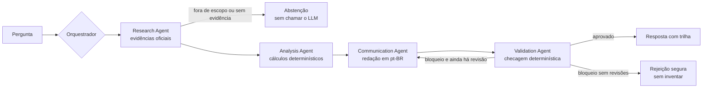

# Sistema Multiagente (Semana 4)

O primeiro protótipo multiagente do Trokim: quatro agentes com papéis separados, coordenados por um
orquestrador determinístico, com a **trilha** de cada resposta visível no app. A decisão está na
[ADR 0016](../adr/0016-arquitetura-multiagente.md); o planejamento, em [Planejamento](../planejamento.md).

!!! info "Status: Planejado; endpoint na Fase 2"
    Issue [#58](https://github.com/moonshinerd/trokim/issues/58). Esta página é preenchida no mesmo PR da implementação (regra: o MkDocs nunca fica defasado).

## Por que multiagente

Na Semana 3 o Trokim errou os casos C27, C29 e C30 porque o mesmo passo recupera, calcula, escreve e
se auto-avalia. Separar os papéis dá cálculo determinístico, recuperação auditável e uma checagem
independente antes de qualquer resposta sair. Só o agente de comunicação usa LLM.

## Fluxo

## Os agentes

| Agente | Página | Issue | LLM |
|---|---|:---:|:---:|
| Orquestrador e contratos | [Orquestrador](orquestrador.md) | [#51](https://github.com/moonshinerd/trokim/issues/51) | Não |
| Research | [Research Agent](research-agent.md) | [#52](https://github.com/moonshinerd/trokim/issues/52) | Não |
| Analysis | [Analysis Agent](analysis-agent.md) | [#53](https://github.com/moonshinerd/trokim/issues/53) | Não |
| Validation | [Validation Agent](validation-agent.md) | [#54](https://github.com/moonshinerd/trokim/issues/54) | Não |
| Communication | [Communication Agent](communication-agent.md) | [#55](https://github.com/moonshinerd/trokim/issues/55) | Sim |

## Contrato de mensagens

Os modelos ficam em `api/app/domain/agents.py` (domínio puro) e o protocolo `Agent` em
`api/app/services/agents/base.py`. O contrato completo, com todos os campos, está no épico
[#50](https://github.com/moonshinerd/trokim/issues/50) e é a fonte de verdade da semana.

| Modelo | Para que serve |
|---|---|
| `AgentContext` | Estado compartilhado: pergunta, lançamentos, evidências, motivo de abstenção, cálculos, premissas, rascunho, problemas e tentativa |
| `AgentStep` | Uma linha da trilha: agente, estado (`ok`, `abstained`, `skipped`, `failed`), resumo, duração e detalhes |
| `CalculationResult` | Um resultado de cálculo com chave, rótulo, valor, unidade e origem |
| `ValidationIssue` | Um problema encontrado, com código estável, severidade (`blocker` ou `warning`) e mensagem em pt-BR |
| `MultiAgentResponse` | Resposta final: estado (`answered`, `abstained`, `rejected`), texto, evidências, cálculos, problemas e trilha |

## Endpoint

`POST /v1/agents/ask` com `{"message": "..."}` devolve `MultiAgentResponse`; `503` com mensagem clara se
o modelo estiver indisponível. *(Exemplo real de requisição e resposta: preenchido pela issue [#58](https://github.com/moonshinerd/trokim/issues/58).)*

## Avaliação

O benchmark do sistema multiagente contra o Trokim estruturado entra no
[Histórico de Resultados](../pesquisa/resultados.md) como uma nova execução (issue [#60](https://github.com/moonshinerd/trokim/issues/60)), com o
[gabarito multiagente](../pesquisa/gabarito-multiagente.md) (issue [#56](https://github.com/moonshinerd/trokim/issues/56)).
