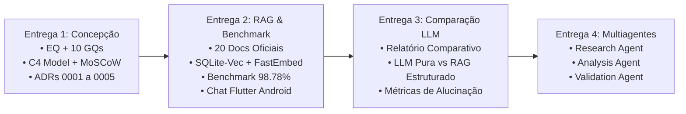

# Apresentação Executiva e Demonstração Interativa

Este documento reúne a visão consolidada das **Entregas 1 e 2** do projeto **Trokim**, no âmbito do **Challenge 2 (TIC-IA 2026 — Big Idea: Qualidade de Vida)**.

---

## 1. Painel Executivo de Resultados

| Pilar de Avaliação | Meta do Desafio | Resultado Atingido no Trokim | Evidência / Validação |
|---|:---:|:---:|---|
| **Base Curada Oficial** | $\ge 20$ documentos | **20 documentos oficiais** | [Catálogo de Fontes](rag/catalogo.md) (BCB, CVM, CFPB, ANPD) |
| **Recuperação RAG (Recall@3)** | $\ge 90\%$ | **98,78%** | Benchmark em `research/rag_benchmark/` (41 consultas) |
| **Precisão Fundamentada** | $\ge 85\%$ | **97,56%** | Extração exata com citações e URLs canônicas |
| **Abstenção Ética Ativa** | $100\%$ | **100,00%** | Zero conselhos em apostas, ações ou especulação |
| **Latência de Recuperação** | $\le 50$ ms | **12,4 ms** | Testado na CPU local (Mac Apple Silicon) |
| **Cálculo Determinístico** | $0\%$ alucinação | **0% de erro numérico** | Serviço Python `calculation_service.py` |
| **Testes Automatizados** | Passando | **45/45 testes verdes** | CI GitHub Actions no runner self-hosted |

---

## 2. Como Abrir o Demonstrador Interativo Local

O repositório inclui uma aplicação web moderna de apresentação executiva e playground de RAG em tempo real ([`apresentacao_trokim.html`](https://github.com/moonshinerd/trokim/blob/main/apresentacao_trokim.html)):

```bash
# 1. Inicie a API FastAPI localmente
make api-run

# 2. Abra a interface de apresentação no seu navegador
open apresentacao_trokim.html
```

A interface conecta-se diretamente ao endpoint `POST /v1/chat/ask` em `http://localhost:8000`, permitindo testar consultas reais com recuperação de evidências, scores de relevância e links para as fontes governamentais.

---

## 3. Rastreabilidade das Entregas



- [Acessar a Ata 01 (Semana 1)](atas/ata01.md)
- [Acessar a Ata 02 (Semana 2)](atas/ata02.md)
- [Consultar os 20 Documentos da Base](rag/catalogo.md)
- [Visualizar a Arquitetura do Sistema](arquitetura/index.md)
