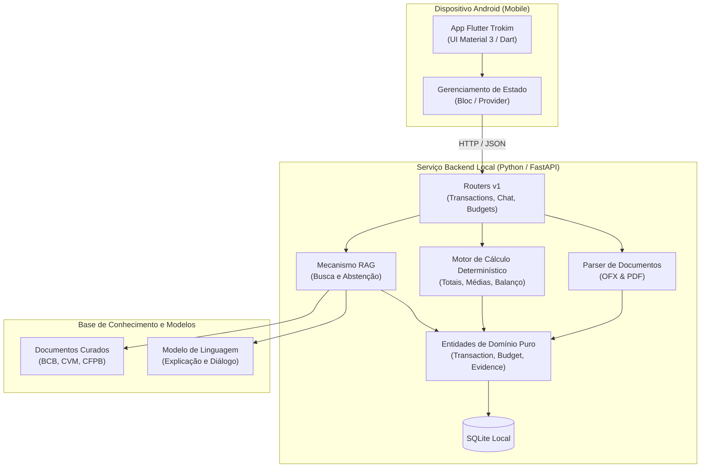
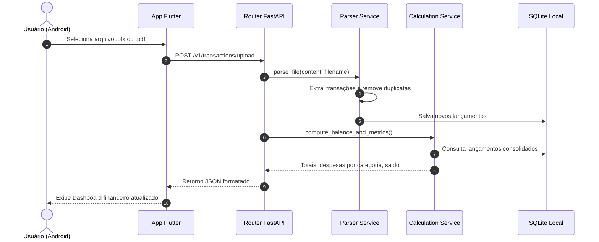
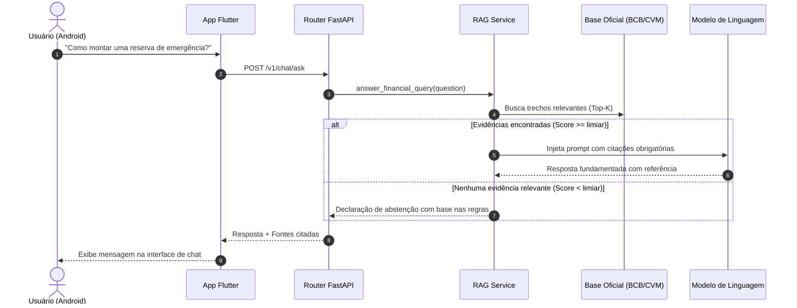

# Mapa do Sistema

Visão visual das interações, componentes e fluxos de dados no **Trokim**.

---

## 1. Diagrama de Componentes C4 (Nível 2)

---

## 2. Fluxo de Importação e Cálculo de Extratos

---

## 3. Fluxo de Pergunta Pedagógica via RAG (Semana 2)

