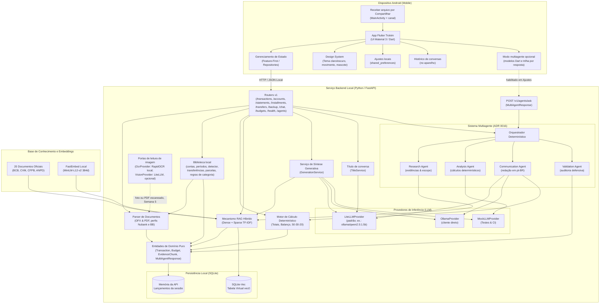
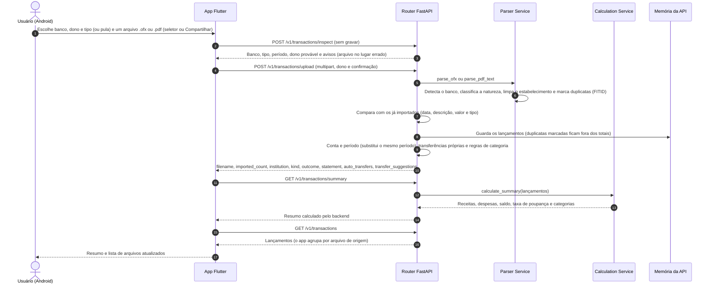
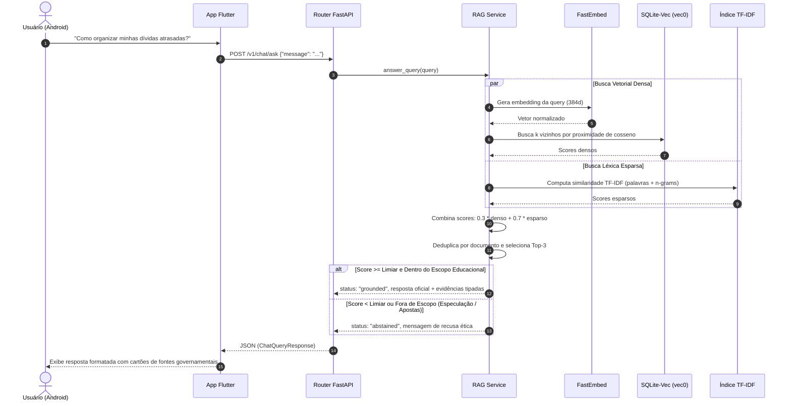
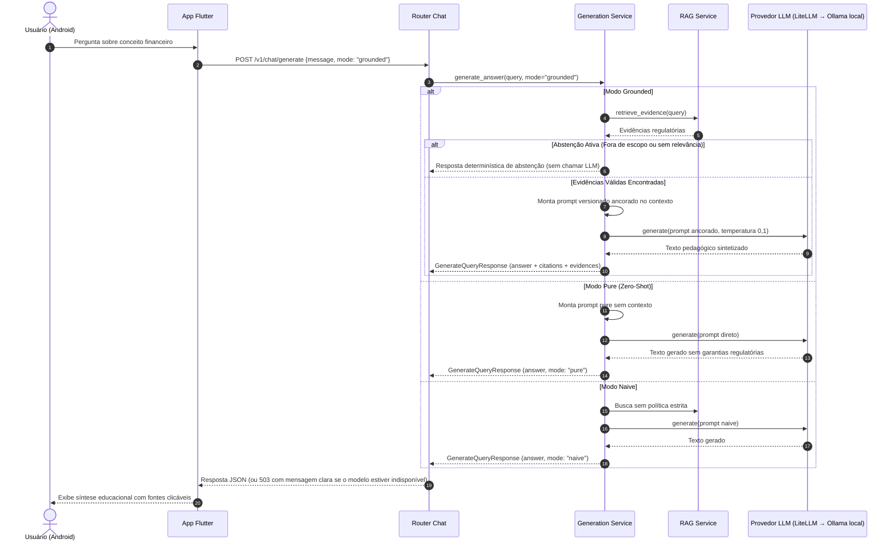
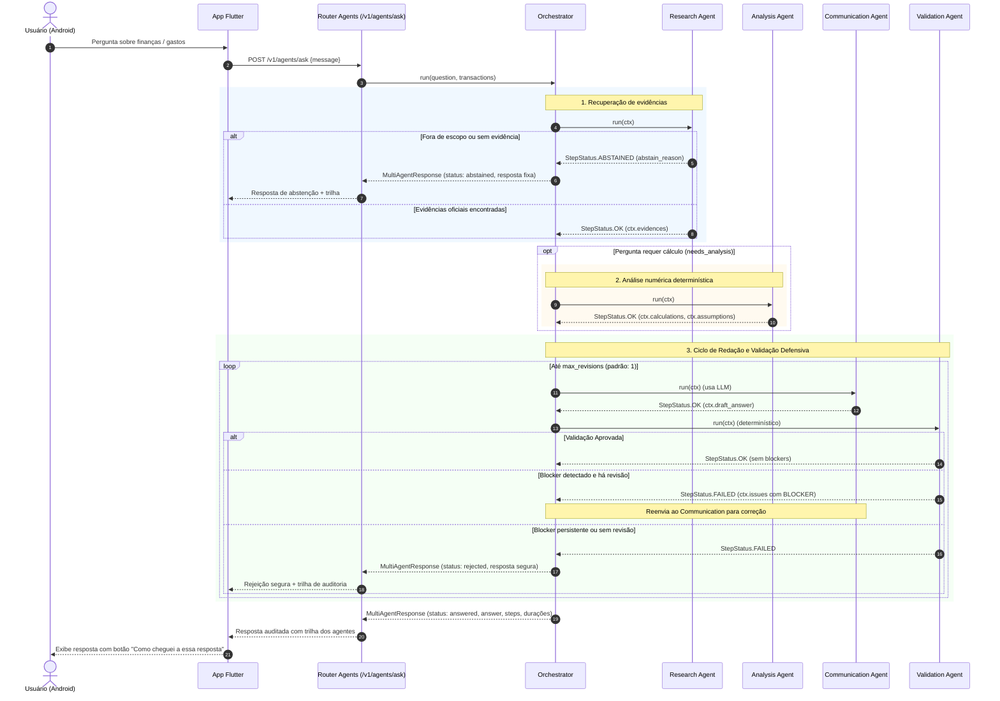
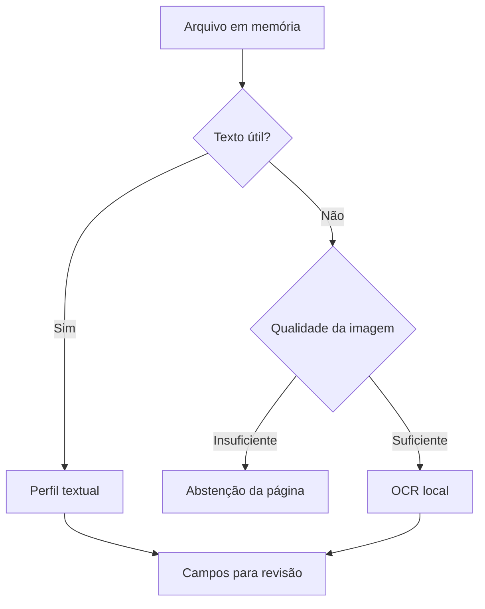

# Mapa do Sistema

Visão visual das interações, componentes e fluxos de dados no **Trokim**.

---

## 1. Diagrama de Componentes C4 (Nível 2)



---

## 2. Fluxo de Importação de Extratos e Resumo

Pagamento de fatura, resgates e transferências próprias ficam fora dos totais e o estorno abate a despesa ([ADR 0017](../adr/0017-perfis-de-banco-e-natureza-do-lancamento.md)). Contas, situação do período, transferências entre contas próprias, parcelamentos e regras de categoria seguem a [ADR 0018](../adr/0018-contas-periodos-transferencias-e-visoes.md). A biblioteca do usuário vive **no aparelho**, em arquivo cifrado (AES-256-GCM, chave no Keystore); o app a devolve à API ao abrir e a API a mantém só em memória ([ADR 0025](../adr/0025-armazenamento-no-aparelho-e-api-sem-estado.md)). O SQLite local da API, atrás de uma porta de repositório, segue como opção sem o app, e o backup criptografado `.trokim` leva os dados a outro aparelho ([ADR 0024](../adr/0024-persistencia-local-e-backup-criptografado.md)). O app só exibe o que o backend calculou. A categoria de cada gasto segue a ordem descrita em [Categorias](categorias.md): regras por palavra, dicionário de redes e atividade econômica (CNAE) pelo CNPJ do recebedor, com o índice local da [ADR 0020](../adr/0020-categorizacao-por-cnae.md). Os bancos SQLite (aplicação e base vetorial) usam SQLAlchemy e migrações numeradas do Alembic, aplicadas ao abrir cada banco ([ADR 0019](../adr/0019-orm-e-migracoes-numeradas.md)).



---

## 3. Fluxo de Pergunta Pedagógica via RAG Local



---

## 4. Fluxo de Síntese Generativa Contextualizada (`POST /v1/chat/generate`)



---

## 5. Título da Conversa (`POST /v1/chat/title`)

```mermaid
sequenceDiagram
    autonumber
    actor User as Usuário (Android)
    participant Mobile as App Flutter
    participant API as Router Chat
    participant Title as TitleService
    participant LLM as Provedor LLM (LiteLLM → Ollama local)

    User->>Mobile: Envia a primeira pergunta da conversa
    Mobile->>Mobile: Salva a conversa no aparelho com título provisório (pergunta encurtada)
    Mobile->>API: POST /v1/chat/title {message, answer?}
    API->>Title: Gera o título (prompt versionado, 3 a 6 palavras)
    alt Modelo responde a tempo
        Title->>LLM: generate(prompt de título)
        LLM-->>Title: Título curto
        Title-->>API: title, source = "llm"
    else Modelo indisponível, lento ou em modo mock
        Title-->>API: Primeiras palavras da pergunta, source = "fallback"
    end
    API-->>Mobile: Título
    Mobile-->>User: Atualiza o título (uma renomeação manual nunca é sobrescrita)
```

---

## 6. Fluxo Multiagente (`POST /v1/agents/ask`)

O sistema multiagente separa as responsabilidades entre agentes especializados com uma trilha de auditoria transparente:




## Leitura de documento (componente da #88)



O [agente de documento](../agentes/document-agent.md) devolve campos e trilha sanitizada.
Visão opcional exige proteção dos pixels e política de confiança; permanece bloqueada
sem essas garantias. A extração chama a validação financeira (#89) em memória. A confirmação (#96) revalida os campos revisados, verifica duplicatas e grava a biblioteca no SQLite.
