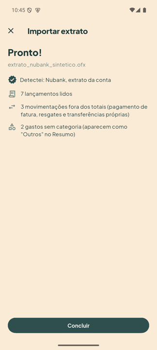
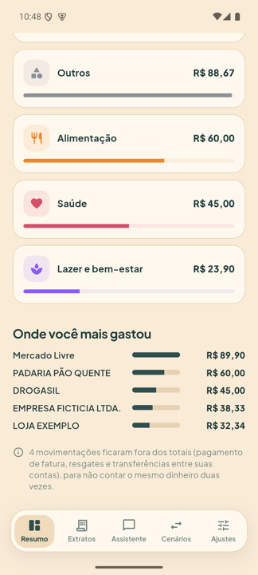
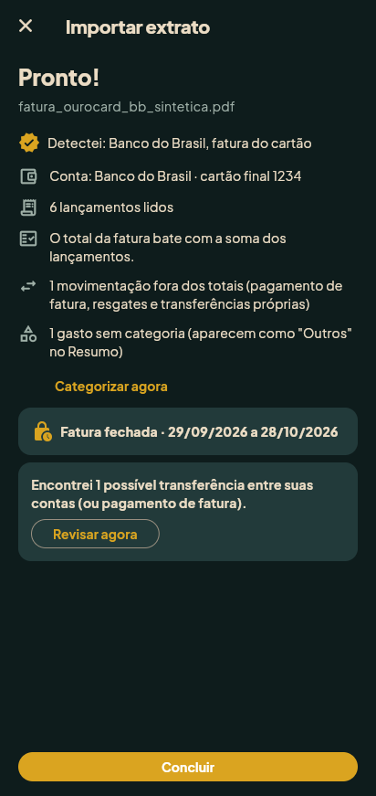
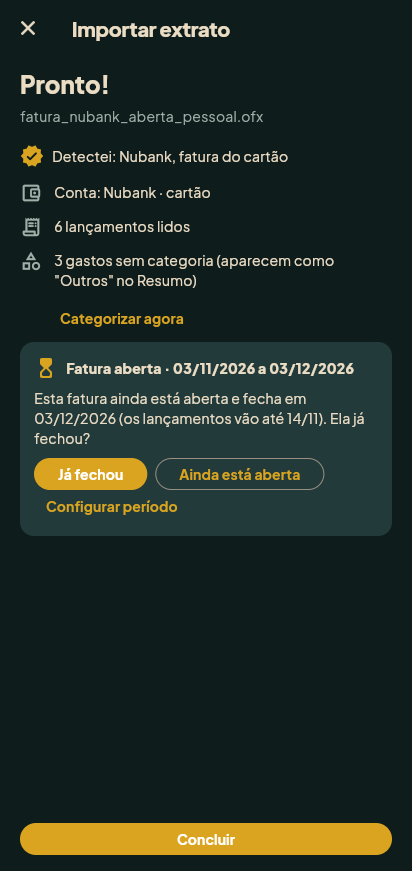
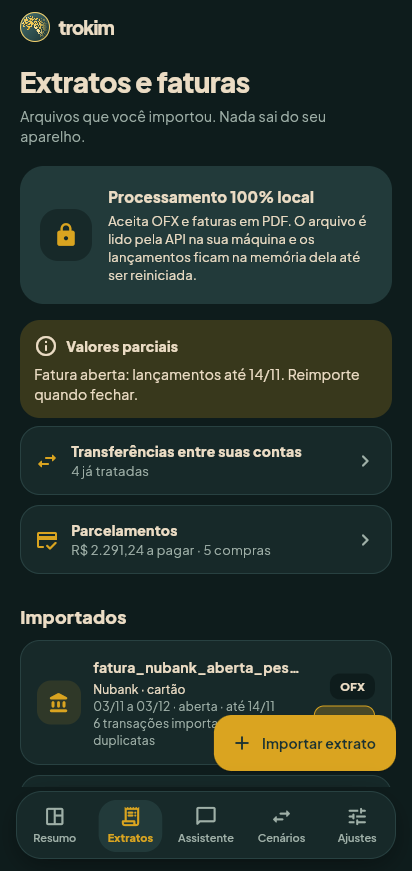
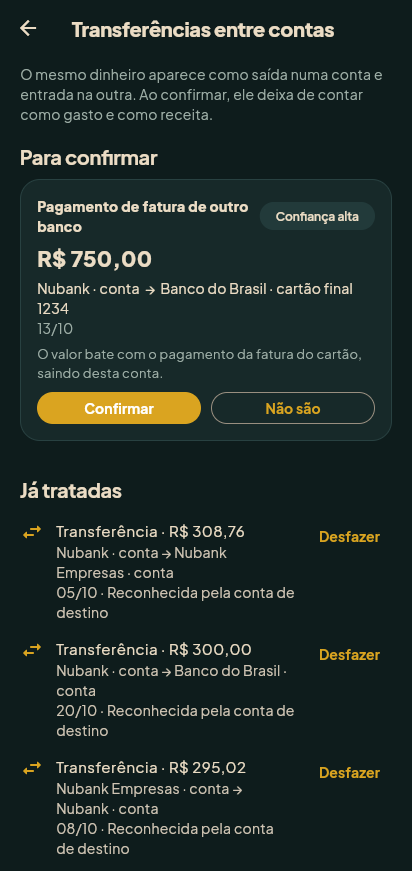
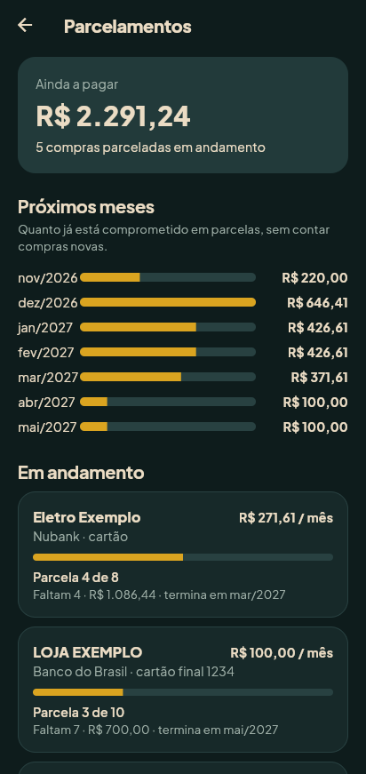
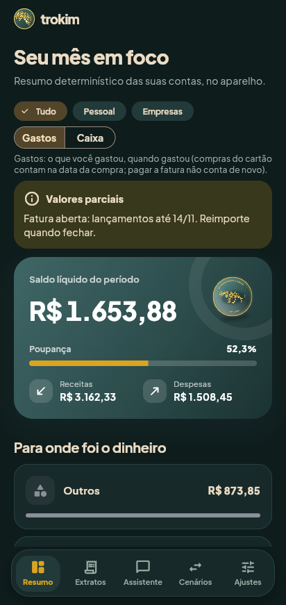
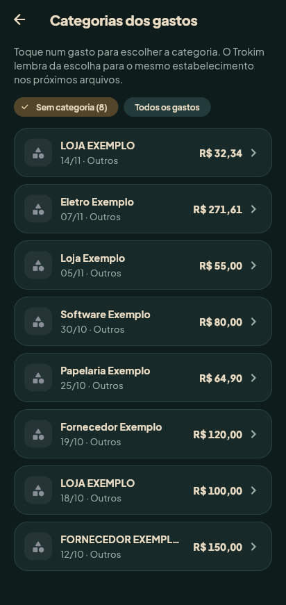
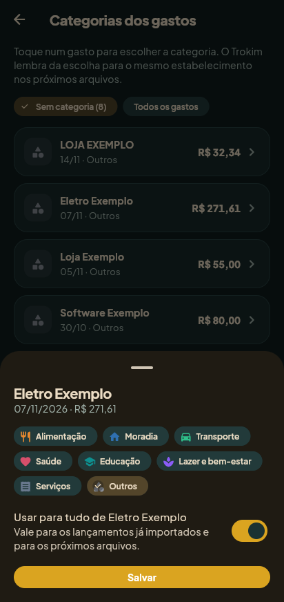

# Guia de Uso e Primeiros Passos

Instruções para configurar, executar e testar o ambiente de desenvolvimento completo do **Trokim**.

---

## 1. Pré-Requisitos

- **Python 3.12+** e gerenciador ultra-rápido [uv](https://docs.astral.sh/uv/) instalado.
- **Flutter SDK 3.50.0** (a mesma versão do CI), JDK 17 e Android SDK 36 para desenvolvimento Android.
- Navegador moderno ou cliente HTTP (como curl, Insomnia ou Postman).

---

## 2. Configuração do Backend e Dependências

Clone o repositório e execute a automação inicial:

```bash
# Prepara a aplicação: dependências (uv) e índice CNPJ descomprimido
make build

# Executa a bateria de testes automatizados (418 da API e 161 de pesquisa)
make test

# Lint (ruff) e build estrito da documentação
make lint
make docs-build

# Inicia a API FastAPI localmente na porta 8000
make api-run
```

A API estará disponível em:
- **Endpoints e Swagger interativo:** `http://127.0.0.1:8000/docs`
- **Health check:** `http://127.0.0.1:8000/v1/health`
- **Consulta RAG Extrativa:** `POST http://127.0.0.1:8000/v1/chat/ask`
- **Síntese Generativa Contextualizada:** `POST http://127.0.0.1:8000/v1/chat/generate`

### Referência rápida da API

Todos os caminhos começam em `/v1`. O contrato completo e interativo fica no Swagger (`/docs`).

| Grupo | Endpoint | Para quê |
|---|---|---|
| Saúde | `GET /health` | Confere se a API está no ar |
| Chat | `POST /chat/ask`, `POST /chat/generate`, `POST /chat/title` | Busca extrativa, síntese fundamentada e título da conversa |
| Multiagente | `POST /agents/ask` | Pergunta pelo sistema de quatro agentes, com a trilha |
| Lançamentos | `POST /transactions/inspect`, `POST /transactions/upload` | Inspeciona (sem gravar) e importa OFX ou PDF |
| Lançamentos | `GET /transactions`, `GET /transactions/summary` | Lista e resumo (filtros `owner` e `view`) |
| Categorias | `PATCH /transactions/{uid}/category`, `GET /transactions/category-rules`, `DELETE /transactions/category-rules/{merchant}` | Corrige categoria e gerencia as regras por estabelecimento |
| Lançamentos | `DELETE /transactions/clear` | Apaga os dados importados |
| Biblioteca | `GET /accounts`, `PATCH /accounts/{id}` | Contas e dono (pessoal ou empresa) |
| Biblioteca | `GET /statements`, `PATCH /statements/{id}` | Arquivos importados e situação do período |
| Biblioteca | `GET /installments` | Parcelamentos agrupados |
| Biblioteca | `GET /transfers`, `GET /transfers/suggestions`, `POST /transfers/{confirm,reject,unmark,undo}` | Transferências entre contas próprias |
| Cenários | `POST /budgets/compare` | Compara dois cenários de orçamento |
| Backup | `POST /backup/export`, `POST /backup/import` | Exporta e restaura a biblioteca em arquivo `.trokim` criptografado |

### Backup e persistência

A biblioteca (lançamentos, contas, arquivos, transferências e regras de categoria) é gravada no
SQLite local (`trokim.db`) depois de cada alteração e restaurada quando a API inicia
([ADR 0024](adr/0024-persistencia-local-e-backup-criptografado.md)). `LIBRARY_PERSISTENCE=false`
desliga a gravação. O arquivo `trokim.db` não é criptografado; o **backup é sempre cifrado**
(AES-256-GCM, chave derivada da sua senha por scrypt) e não pode ser aberto sem ela, nem
recuperado se a senha for esquecida.

```bash
# Exportar (a senha tem pelo menos 8 caracteres e nunca é gravada)
curl -X POST http://127.0.0.1:8000/v1/backup/export \
  -H "Content-Type: application/json" -d '{"passphrase": "minha-senha-longa"}' \
  -o meu-backup.trokim

# Restaurar em outro aparelho: "substituir" apaga o que existe, "mesclar" só acrescenta o que falta
curl -X POST http://127.0.0.1:8000/v1/backup/import \
  -F "file=@meu-backup.trokim" -F "passphrase=minha-senha-longa" -F "mode=mesclar"
```

Senha errada ou arquivo adulterado devolvem `400` com a mensagem "Senha incorreta ou arquivo
corrompido". No app, em **Ajustes > Backup**, informe a senha e toque em **Exportar backup** ou **Restaurar backup** (com a opção de substituir ou só mesclar).

---

## 3. Síntese Generativa Local (LiteLLM e Ollama)

A camada generativa usa a porta `LLMProvider` ([ADR 0009](adr/0009-sintese-generativa-local.md)). O provedor padrão é o **LiteLLM**, que aceita qualquer modelo definido por configuração. Com um modelo local no **Ollama**, nenhum dado sai da sua máquina.

### Configuração do modelo local

```bash
# Instala o Ollama (https://ollama.com), sobe o servidor e baixa um modelo leve
ollama serve
ollama pull qwen2.5:1.5b

# A API lê api/.env (copie de api/.env.example)
cp api/.env.example api/.env
```

| Variável (`api/.env`) | Função | Padrão |
|---|---|---|
| `LLM_PROVIDER` | `litellm` (padrão), `ollama` (cliente direto) ou `mock` (testes e CI) | `litellm` |
| `LLM_MODEL` | Modelo no formato do LiteLLM, por exemplo `ollama/qwen2.5:1.5b` | `ollama/qwen2.5` |
| `LLM_API_BASE` | Endereço do servidor do modelo (vazio usa o Ollama local, `http://localhost:11434`) | vazio |
| `LLM_API_KEY` | Só para modelos de nuvem (uma escolha explícita, fora da premissa local-first) | vazio |
| `LLM_TIMEOUT` | Tempo limite da geração, em segundos | `120` |
| `LLM_MAX_TOKENS` | Teto de tokens da redação do Communication Agent (multiagente) | `500` |
| `LLM_THINKING` | Raciocínio estendido de modelos que o suportam (desligado: evita respostas vazias) | `false` |
| `LLM_TITLE_TIMEOUT` | Tempo limite do título da conversa, em segundos | `25` |
| `LLM_TITLE_MODEL` | Modelo leve só para dar título às conversas (vazio usa `LLM_MODEL`) | `ollama/qwen2.5:1.5b` |

Um modelo grande rodando na CPU leva dezenas de segundos por resposta (o `gemma4:26b` levou cerca de 50 s); para o dia a dia, prefira um modelo menor. Em ambientes sem modelo, use `LLM_PROVIDER=mock`.

### Exemplos de requisições HTTP

#### Modo Grounded (fundamentado no RAG, com abstenção ativa):
```bash
curl -X POST http://127.0.0.1:8000/v1/chat/generate \
  -H "Content-Type: application/json" \
  -d '{"message": "Como funciona o rotativo do cartao de credito?", "mode": "grounded"}'
```

#### Modo Pure (base de comparação, sem RAG):
```bash
curl -X POST http://127.0.0.1:8000/v1/chat/generate \
  -H "Content-Type: application/json" \
  -d '{"message": "Como funciona o rotativo do cartao de credito?", "mode": "pure"}'
```

#### Modo Naive (base de comparação, RAG ingênuo sem política de abstenção):
```bash
curl -X POST http://127.0.0.1:8000/v1/chat/generate \
  -H "Content-Type: application/json" \
  -d '{"message": "Como funciona o rotativo do cartao de credito?", "mode": "naive"}'
```

#### Sistema Multiagente (quatro agentes com cálculos determinísticos e trilha de auditoria):
```bash
curl -X POST http://127.0.0.1:8000/v1/agents/ask \
  -H "Content-Type: application/json" \
  -d '{"message": "Como montar uma reserva de emergencia e quanto tempo leva com meus gastos?"}'
```

#### Título de uma conversa:
```bash
curl -X POST http://127.0.0.1:8000/v1/chat/title \
  -H "Content-Type: application/json" \
  -d '{"message": "Como montar uma reserva de emergencia?"}'
```

Se o modelo estiver indisponível, `/v1/chat/generate` devolve `503` com uma mensagem clara e `/v1/chat/title` devolve as primeiras palavras da pergunta (`source = "fallback"`). No app, o interruptor **Respostas com IA** (em Ajustes) alterna entre `/v1/chat/generate` e a busca extrativa `/v1/chat/ask`.

### Benchmark comparativo e gráficos

```bash
make comparison-validate                                   # valida gabarito, prompts e fontes (sem chamar o modelo)
make comparison-run RUN=2026-11-20-qwen2.5-1.5b MODEL=ollama/qwen2.5:1.5b   # execução completa e registrada
make report-charts                                         # regenera os gráficos do MkDocs
```

O `comparison-run` roda as quatro abordagens (LLM pura, RAG ingênuo, Trokim estruturado e
multiagente) nos 30 casos e os 20 cenários multiagente, e grava sozinho o `run.json` e os
formulários de revisão humana (`audit_pending.json`). Ele recusa um `RUN` já usado: uma execução
publicada nunca é sobrescrita. Para um modelo de nuvem pelo LiteLLM, exporte a chave do provedor
antes (por exemplo, `LLM_API_KEY` para `openrouter/...`) e use só perguntas e dados sintéticos.

O passo a passo para registrar uma execução está em [Histórico de Resultados](pesquisa/resultados.md#6-como-registrar-uma-nova-execucao).

---

## 3.1. Aplicativo Mobile no Emulador

Para rodar o app Android (Flutter) com o backend local:

```bash
# Terminal 1: backend (a partir da raiz do repositório)
DEBUG=false ENVIRONMENT=development make api-run

# Terminal 2: app (requer Flutter estável, JDK 17 e Android SDK 36)
cd mobile
flutter pub get
flutter test          # 238 testes
flutter run           # emulador Android; a API fica em http://10.0.2.2:8000/v1
```

No app, a aba **Ajustes** permite escolher o tema (por padrão segue o claro/escuro do aparelho), reduzir animações, desligar a abertura animada e **testar a conexão** com a API. Para apontar para outro endereço, use `--dart-define=API_BASE_URL=http://<ip>:8000/v1`.

### Modo multiagente experimental

Em **Ajustes → Assistente**, ative **Modo multiagente (experimental)**. A opção
fica salva apenas no aparelho e, quando ligada, direciona as próximas perguntas
ao endpoint `POST /v1/agents/ask`. Desligada, o chat segue o modo de resposta
selecionado em **Respostas com IA**.

Nas respostas multiagente, toque em **Como cheguei a essa resposta** para abrir
a linha do tempo de Pesquisa, Análise, Comunicação e Validação, com estado,
resumo e duração. O painel também lista os cálculos (em reais, no formato brasileiro), as fontes consultadas e os avisos da validação; os
cartões de evidência aparecem junto à resposta. Abstenções e respostas retidas
explicam em linguagem simples por que não foram fornecidas orientações.

Para conferir o fluxo, use dados sintéticos, ligue o modo, envie uma pergunta
com evidência no corpus e abra a trilha:


*Captura no emulador Android conectado à API local; consulta sintética sobre
reserva de emergência.*

Veja também o [protótipo navegável do aplicativo](prototipo.md), com telas demonstrativas para Resumo, Extratos, Assistente, Cenários e Ajustes.

---

## 4. Apresentação Executiva e Demonstração

O painel de resultados e as perguntas de demonstração validadas pelo benchmark estão em [Apresentação Executiva](apresentacao.md).

---

## 5. Testes e Avaliação do Motor RAG (Benchmark)

Para rodar a suíte de avaliação empírica contra o gabarito oficial de 61 consultas:

```bash
# Executa a bateria completa de testes de research e benchmark
make test

# Ou execute diretamente a avaliação com métricas detalhadas:
cd research/rag_benchmark
uv run python eval_rag.py
```

O script reporta **Recall@3**, precisão de recuperação fundamentada e taxa de abstenção.

---

## 6. Geração de Dados Sintéticos (LGPD)

Para gerar novos extratos bancários `.ofx` e faturas `.pdf` sintéticas e reproduzíveis:

```bash
make synthetic-data
```

Os arquivos serão criados em `research/synthetic_data/`, garantindo 100% de privacidade sem dados financeiros reais.

---

## 7. Documentação Viva com Zensical

Para compilar e servir localmente o site de documentação:

```bash
make docs-serve
```

Acesse no navegador: `http://127.0.0.1:8000` (ou porta alternativa exibida no terminal).

---

## 8. Execução do Aplicativo Mobile (Flutter)

Com um emulador Android ou dispositivo físico conectado:

```bash
cd mobile
flutter pub get
flutter run
```

### 8.1. Importar extratos e ver o resumo

Com a API no ar (`make api-run`), abra a aba **Extratos**, toque em **Importar extrato** e escolha
um arquivo `.ofx` ou `.pdf` (os de teste estão em `research/synthetic_data/`; no emulador, copie o
arquivo para a pasta Downloads com `adb push`). O app envia o arquivo à API local, que lê os
lançamentos, marca as duplicatas e calcula os totais. A aba **Resumo** mostra só o que a API
calculou.

| Resumo | Extratos |
|---|---|
| { width="240" } | { width="240" } |

Para usar a API em outro endereço (por exemplo, um aparelho físico na mesma rede), edite o
**endereço da API** em **Ajustes** e toque em **Salvar endereço**; **Testar conexão** confere se
ela responde. Os lançamentos ficam gravados no SQLite local e voltam quando a API reinicia (veja [Backup](#backup-e-persistencia)).

### 8.2. Importar do Nubank (conta e cartão)

O Trokim reconhece o OFX do Nubank pelo conteúdo do arquivo (não pelo nome) e trata cada tipo:

- **Fatura do cartão:** *Cartão de crédito → Acessar fatura →* escolha o mês *→* ícone de
  compartilhar (seta saindo de uma caixa) *→* **OFX**. A fatura aberta não tem PDF; peça sempre o
  OFX. O arquivo chega por e-mail.
- **Extrato da conta:** tela inicial *→ Saldo em conta →* três pontinhos *→ Pedir extrato →*
  escolha mês e ano. O e-mail traz OFX, PDF e CSV; use o **OFX**.

No app, o caminho é **Extratos → Importar extrato**. O fluxo é guiado, mas **nunca obriga**: em qualquer
tela dá para **Pular tutorial** ou tocar em **Já tenho o arquivo** para ir direto ao seletor. No
último passo, **Não mostrar este tutorial de novo** desliga o passo a passo (e **Ajustes → Tutorial
ao importar extratos** o reativa); com ele desligado, **Importar extrato** abre o seletor de arquivos
na hora. Ao terminar, o app mostra o que detectou (banco e tipo), quantos lançamentos leu, quantos
repetidos ignorou, quantas movimentações ficaram fora dos totais e quantos gastos ficaram sem
categoria.

| Banco | Passo a passo (cartão) | Último passo |
|---|---|---|
| { width="200" } | { width="200" } | { width="200" } |

O que o Trokim faz com esses arquivos:

| Situação | Tratamento |
|---|---|
| Pagamento da fatura, resgate/aplicação, valor adicionado por cartão | Ficam **fora** dos totais (não são receita nem despesa), sem contagem dobrada com a fatura |
| Estorno | **Abate** a despesa, em vez de virar receita |
| Pix | Só o nome e o tipo (pessoa ou empresa) aparecem; CPF, banco, agência e conta são descartados |
| `Parcela 3/10` | Vira parcela 3 de 10 |
| Reenviar o mesmo arquivo | Não altera os totais (deduplicação pelo identificador do banco) |

Depois da importação, o **Resumo** ganha **Onde você mais gastou** (maiores estabelecimentos, com Pix
para pessoas agrupados e sem nomes) e o aviso de quantas movimentações ficaram fora dos totais. Tudo
vem calculado pela API.

| Resumo da importação | Resumo com estabelecimentos |
|---|---|
| { width="240" } | { width="240" } |

A resposta de `POST /v1/transactions/upload` informa `institution`, `kind` (`cartao` ou
`conta`), `by_nature`, `uncategorized_count` e `ledger_balance` (saldo declarado no arquivo, só
para consulta). Arquivos de exemplo sintéticos, no mesmo formato, saem de
`python research/synthetic_data/generate_nubank_datasets.py`.

### 8.3. Várias contas: Nubank Empresas e Banco do Brasil

O OFX não diz se a conta é pessoal ou da empresa. Antes de importar, o app pede à API uma análise
do arquivo (`POST /v1/transactions/inspect`, que não grava nada): banco, tipo, período e dono
provável. Quando a API não consegue decidir, o app pergunta **uma vez** e lembra; quando o arquivo
parece estar no lugar errado (pessoal × Empresas, conta × cartão ou já importado noutra conta), ele
avisa e deixa escolher entre importar mesmo assim ou trocar o arquivo.

- **Nubank Empresas:** o arquivo que baixa direto no celular é sempre PDF; o **OFX só vem por
  e-mail**, e o tutorial avisa disso.
- **Banco do Brasil, cartão Ourocard:** a fatura só existe em **PDF**. O Trokim lê o sinal
  invertido do banco, as parcelas `PARC NN/MM`, as categorias do próprio banco e o final do
  cartão, e confere a soma dos lançamentos com o total da fatura.
- **Banco do Brasil, conta corrente:** extrato em **OFX** (tipo "Money 2000+"), onde o campo
  `NAME` é o tipo do lançamento e `MEMO` a contraparte.

Na aba **Extratos**, a seção **Contas** lista cada conta e cartão com o dono, que pode ser trocado a
qualquer momento.

| Banco | Dono da conta | Fatura do BB |
|---|---|---|
| { width="200" } | { width="200" } | { width="200" } |

### 8.4. Fatura aberta, fechada e extrato parcial

O período sai do próprio arquivo. Uma fatura baixada antes de fechar fica **aberta** e só traz os
lançamentos até aquele dia; o resumo da importação pergunta **"Ela já fechou?"** e permite
**Configurar período**. Reimportar o arquivo do mesmo período **substitui** os lançamentos dele, sem
somar de novo ("Atualizei o arquivo deste período"). Enquanto houver arquivo aberto ou um mês sem
arquivo, o Resumo e Extratos mostram o aviso **Valores parciais**; no Resumo, o aviso segue o filtro
de dono. Tocar na situação de um arquivo em Extratos abre a folha para marcá-lo como fechado (ou
reabri-lo) e ajustar o período.

| Fatura aberta | Extratos |
|---|---|
| { width="240" } | { width="240" } |

### 8.5. Transferências entre suas contas

O Pix da conta pessoal para a conta da empresa é saída numa conta e entrada na outra: não é gasto
nem receita. O Trokim tira esse dinheiro dos totais assim:

- **Reconhecida sozinha:** o Pix cita a conta de destino e ela é uma conta que você importou. A
  transferência aparece **uma vez**, com as duas pontas.
- **Para confirmar:** sem a conta no texto, o app sugere pares de mesmo valor e data próxima;
  **Confirmar** tira dos totais e **Não são** descarta a sugestão.
- **Pagamento de fatura de outro banco:** o Pix que paga a fatura do BB a partir do Nubank vira
  pagamento de fatura, e a fatura não conta duas vezes.
- **Desfazer** devolve o valor aos totais.

### 8.6. Parcelamentos

A mesma compra parcelada é reconhecida entre faturas. A tela **Parcelamentos** (atalho em Extratos
e card no Resumo) mostra quanto ainda falta pagar, a parcela atual de cada compra e quanto já está
comprometido em cada um dos próximos meses.

| Transferências | Parcelamentos |
|---|---|
| { width="240" } | { width="240" } |

### 8.7. Gastos ou caixa, por dono

O Resumo tem dois filtros:

- **Tudo, Pessoal, Empresas:** aparece quando há contas de mais de um dono.
- **Gastos × Caixa:** em **Gastos** (competência), a compra do cartão conta na data da compra e
  pagar a fatura não conta de novo. Em **Caixa**, só conta o que entrou e saiu das contas: o
  pagamento da fatura aparece no lugar das compras.

A seção **Por conta** mostra entradas e saídas de cada conta. Os números vêm prontos da API
(`GET /v1/transactions/summary?owner=…&view=…`).

### 8.8. Corrigir categorias

Gastos que as regras locais não reconhecem ficam em **Outros**. Toque em qualquer categoria do
Resumo, ou em **Categorizar agora** no resumo da importação, para abrir **Categorias dos gastos**.
Ao escolher a categoria de um gasto, a opção **Usar para tudo de …** (ligada por padrão) aplica a
escolha a todos os lançamentos do mesmo estabelecimento e aos próximos arquivos. Desligada, muda só
aquele lançamento. Pagamento de fatura, investimentos e transferências entre suas contas não têm
categoria. A LLM não participa: a regra é sua e fica na API local
(`PATCH /v1/transactions/{uid}/category`, `GET` e `DELETE /v1/transactions/category-rules`).

Antes de cair em **Outros**, a API tenta, nesta ordem: as regras por palavra (marcas e termos no
formato de vários bancos e adquirentes, inclusive **Impostos e taxas** para DARF, DAS, IPVA e
IPTU), o **dicionário de redes** gerado dos dados abertos do CNPJ e, quando o banco traz o CNPJ do
recebedor (Pix do Nubank), a **atividade econômica (CNAE)** da empresa. As convenções e as medições
estão em [Categorias](arquitetura/categorias.md).

O índice CNPJ → categoria vem no repositório, comprimido (14 MB), e é consultado só na sua
máquina. `make build` o descomprime em `api/data/cnpj/`; a API também faz isso sozinha no
primeiro uso. Para atualizar com o mês mais recente da Receita Federal:

```bash
make cnpj-atualizar               # mostra o aviso e pede para digitar SIM
make cnpj-atualizar CONFIRMAR=sim # sem perguntar (CI, scripts)
make cnpj-atualizar MANTER_DOWNLOAD=1 MES=2026-11 CNPJ_BASE=/outro/disco
```

Antes de começar, ele mostra quanto vai baixar (cerca de 5 GB), o espaço livre no disco, o tempo
esperado (de 1 a 3 horas de download e cerca de 40 minutos de geração), a memória (até 1,5 GB) e
os arquivos versionados que vai substituir. No fim, apaga os arquivos baixados. Se o índice já é do
mês mais recente, não faz nada. Depois, confira com `git diff --stat api/app/data`, rode
`make test` e registre o mês na [ADR 0020](adr/0020-categorizacao-por-cnae.md).

| Resumo com filtros | Gastos sem categoria | Escolha da categoria |
|---|---|---|
| { width="200" } | { width="200" } | { width="200" } |

### 8.9. Receber o arquivo por "Compartilhar" (Android)

No app do banco, no e-mail ou no gerenciador de arquivos, toque em **Compartilhar** (ou **Abrir
com**) e escolha o **Trokim**. O app abre a aba Extratos e vai direto para a leitura do arquivo, sem
passar pelo seletor. Vale para `.ofx` e `.pdf`; o arquivo é lido no aparelho e enviado só para a sua
API local.

As capturas desta seção usam o cenário sintético completo
(`python research/synthetic_data/generate_nubank_datasets.py`), com dados fictícios.
