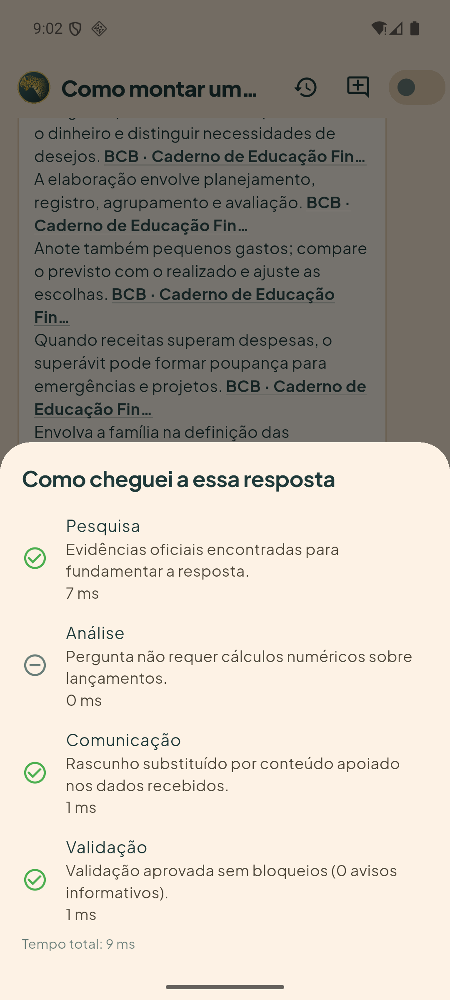
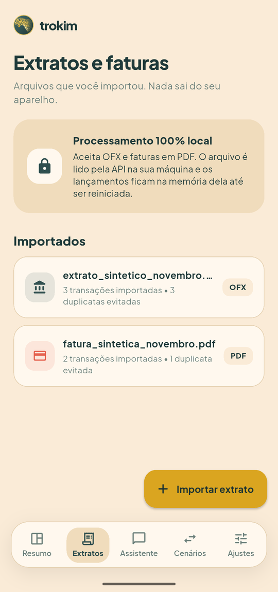
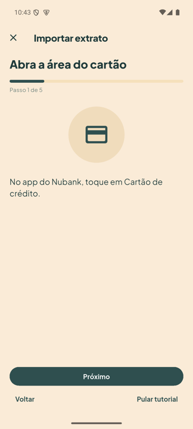
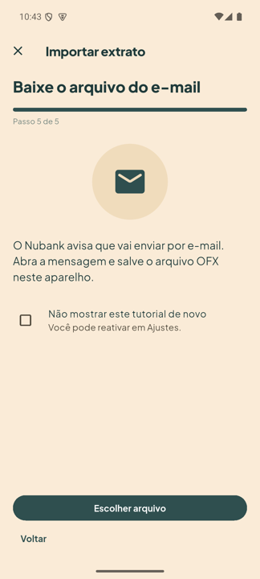
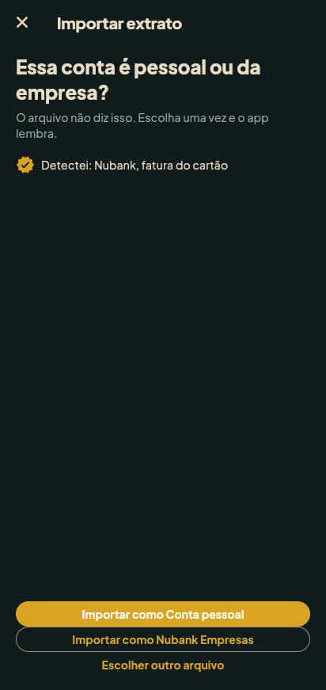

# Guia de Uso e Primeiros Passos

Instruções para configurar, executar e testar o ambiente de desenvolvimento completo do **Trokim**.

---

## 1. Pré-Requisitos

- **Python 3.12+** e gerenciador ultra-rápido [uv](https://docs.astral.sh/uv/) instalado.
- **Flutter SDK 3.50.0** (a mesma versão do CI), JDK 17 e Android SDK 36 para desenvolvimento Android.
- Navegador moderno ou cliente HTTP (como curl, Insomnia ou Postman).

---

## 2. Configuração do Backend e Dependências

Clone o repositório e execute a automação inicial:

```bash
# Prepara a aplicação: dependências (uv) e índice CNPJ descomprimido
make build

# Executa a bateria de testes automatizados (418 da API e 161 de pesquisa)
make test

# Lint (ruff) e build estrito da documentação
make lint
make docs-build

# Inicia a API FastAPI localmente na porta 8000
make api-run
```

A API estará disponível em:
- **Endpoints e Swagger interativo:** `http://127.0.0.1:8000/docs`
- **Health check:** `http://127.0.0.1:8000/v1/health`
- **Consulta RAG Extrativa:** `POST http://127.0.0.1:8000/v1/chat/ask`
- **Síntese Generativa Contextualizada:** `POST http://127.0.0.1:8000/v1/chat/generate`

### Backend em Docker (com OCR)

O `deploy/` empacota só o **backend**, com o OCR local e o modelo de embeddings já baixados (a
API roda sem internet depois da construção). O app Flutter não entra no contêiner: ele é
instalado no aparelho e aponta para este endereço em **Ajustes > Conexão**.

```bash
docker compose -f deploy/docker-compose.yml up --build -d   # sobe em 127.0.0.1:8000
docker compose -f deploy/docker-compose.yml down            # para; os dados ficam no volume
docker compose -f deploy/docker-compose.yml down -v         # para e APAGA os dados do usuário
```

Os dados (SQLite e índice vetorial) ficam no volume `trokim-data`, nunca na imagem. O Ollama
(texto e visão) roda na sua máquina e o contêiner o encontra por `host.docker.internal:11434`.
Para o celular acessar, publique a porta na rede local editando `ports` (por exemplo
`"0.0.0.0:8000:8000"`) e use o IP do computador; por padrão só a própria máquina alcança a API.

### Leitura de imagem: OCR e modelo de visão

O OCR é local (RapidOCR) e vem ligado. O modelo de visão é opcional e vem **desligado**
([ADR 0021](adr/0021-visao-e-ocr-modulares.md)). Tudo se troca por variável de ambiente
(`api/.env` ou o ambiente do contêiner):

| Variável | Padrão | Para quê |
|---|---|---|
| `OCR_PROVIDER` | `rapidocr` | Motor de OCR (`rapidocr`, `tesseract` ou `mock`). Fora do Docker, `rapidocr` pede `uv sync --extra ocr`; `tesseract` pede o programa instalado (`tesseract-ocr` e o idioma `por`) |
| `TESSERACT_LANG` | `por` | Idioma do Tesseract |
| `VISION_PROVIDER` | `none` | `none`, `litellm` ou `mock` |
| `VISION_MODEL` | `ollama/qwen2.5vl` | Modelo no formato do LiteLLM; `openrouter/...` é remoto |
| `VISION_API_BASE` | vazio | Endereço do servidor do modelo |
| `VISION_API_KEY` | vazio | Chave, só em variável de ambiente |
| `VISION_TIMEOUT` | `120` | Segundos |
| `VISION_ALLOW_REMOTE` | `false` | Consentimento para enviar a imagem para fora do aparelho |

Um modelo remoto, como o do OpenRouter, é **recusado** enquanto `VISION_ALLOW_REMOTE` não for
`true`: a imagem de um documento financeiro sairia do aparelho. O consentimento é seu, e só
material sintético vai à nuvem nos testes do projeto.

### Referência rápida da API

Todos os caminhos começam em `/v1`. O contrato completo e interativo fica no Swagger (`/docs`).

| Grupo | Endpoint | Para quê |
|---|---|---|
| Saúde | `GET /health` | Confere se a API está no ar |
| Chat | `POST /chat/ask`, `POST /chat/generate`, `POST /chat/title` | Busca extrativa, síntese fundamentada e título da conversa |
| Multiagente | `POST /agents/ask` | Pergunta pelo sistema de quatro agentes, com a trilha (filtros `account_id`, `owner`, `period`, `document_uid`) |
| Documentos | `GET /documents/engines`, `POST /documents/extract`, `POST /documents/confirm` | Motores de leitura disponíveis, leitura de foto/PDF (campos `engine` e `allow_remote`) e confirmação dos campos revisados (com `origin`) |
| Lançamentos | `POST /transactions/inspect`, `POST /transactions/upload` | Inspeciona (sem gravar) e importa OFX ou PDF |
| Lançamentos | `GET /transactions`, `GET /transactions/summary` | Lista e resumo (filtros `owner` e `view`) |
| Categorias | `PATCH /transactions/{uid}/category`, `GET /transactions/category-rules`, `DELETE /transactions/category-rules/{merchant}` | Corrige categoria e gerencia as regras por estabelecimento |
| Lançamentos | `DELETE /transactions/clear` | Apaga os dados importados |
| Biblioteca | `GET /accounts`, `PATCH /accounts/{id}` | Contas e dono (pessoal ou empresa) |
| Biblioteca | `GET /statements`, `PATCH /statements/{id}` | Arquivos importados e situação do período |
| Biblioteca | `GET /installments` | Parcelamentos agrupados |
| Biblioteca | `GET /transfers`, `GET /transfers/suggestions`, `POST /transfers/{confirm,reject,unmark,undo}` | Transferências entre contas próprias |
| Cenários | `POST /budgets/compare` | Compara dois cenários de orçamento |
| Biblioteca no aparelho | `GET` e `PUT /library/snapshot` | O app lê o retrato para guardá-lo cifrado e o devolve à API ao abrir |
| Backup | `POST /backup/export`, `POST /backup/import` | Exporta e restaura a biblioteca em arquivo `.trokim` criptografado |

### Backup e persistência

**No app, o aparelho guarda seus dados.** A biblioteca (lançamentos, contas, arquivos,
transferências e regras de categoria) fica em um arquivo **cifrado** (AES-256-GCM) na pasta
privada do app, com a chave no armazenamento seguro do Android. Ao abrir, o app devolve esse
retrato à API, que o mantém só em memória; depois de cada alteração o app regrava o arquivo
([ADR 0025](adr/0025-armazenamento-no-aparelho-e-api-sem-estado.md)). Por isso a API pode ser
reiniciada ou recriada sem perder nada. A API só deve ser a **sua**: o retrato inclui dados
privados e é enviado a ela inteiro. O backup automático do Android fica desligado, porque
levaria o arquivo sem a chave. Se o arquivo for alterado ou a chave se perder, o app não mostra
dado errado: guarda o arquivo à parte (`biblioteca.trokim.corrompido`), avisa em **Ajustes >
Backup** e você recupera pelo backup `.trokim`.

Quem usa a API sem o app ainda tem o SQLite local (`trokim.db`, não cifrado), controlado por
`LIBRARY_PERSISTENCE` ([ADR 0024](adr/0024-persistencia-local-e-backup-criptografado.md)). O
**backup é sempre cifrado** (AES-256-GCM, chave derivada da sua senha por scrypt) e não pode ser
aberto sem ela, nem recuperado se a senha for esquecida; é o caminho para trocar de aparelho.
Perder o aparelho sem backup é perder os dados.

```bash
# Exportar (a senha tem pelo menos 8 caracteres e nunca é gravada)
curl -X POST http://127.0.0.1:8000/v1/backup/export \
  -H "Content-Type: application/json" -d '{"passphrase": "minha-senha-longa"}' \
  -o meu-backup.trokim

# Restaurar em outro aparelho: "substituir" apaga o que existe, "mesclar" só acrescenta o que falta
curl -X POST http://127.0.0.1:8000/v1/backup/import \
  -F "file=@meu-backup.trokim" -F "passphrase=minha-senha-longa" -F "mode=mesclar"
```

Senha errada ou arquivo adulterado devolvem `400` com a mensagem "Senha incorreta ou arquivo
corrompido". No app, em **Ajustes > Backup**, informe a senha e toque em **Exportar backup** ou **Restaurar backup** (com a opção de substituir ou só mesclar).

---

## 3. Síntese Generativa Local (LiteLLM e Ollama)

A camada generativa usa a porta `LLMProvider` ([ADR 0009](adr/0009-sintese-generativa-local.md)). O provedor padrão é o **LiteLLM**, que aceita qualquer modelo definido por configuração. Com um modelo local no **Ollama**, nenhum dado sai da sua máquina.

### Configuração do modelo local

```bash
# Instala o Ollama (https://ollama.com), sobe o servidor e baixa um modelo leve
ollama serve
ollama pull qwen2.5:1.5b

# A API lê api/.env (copie de api/.env.example)
cp api/.env.example api/.env
```

| Variável (`api/.env`) | Função | Padrão |
|---|---|---|
| `LLM_PROVIDER` | `litellm` (padrão), `ollama` (cliente direto) ou `mock` (testes e CI) | `litellm` |
| `LLM_MODEL` | Modelo no formato do LiteLLM, por exemplo `ollama/qwen2.5:1.5b` | `ollama/qwen2.5` |
| `LLM_API_BASE` | Endereço do servidor do modelo (vazio usa o Ollama local, `http://localhost:11434`) | vazio |
| `LLM_API_KEY` | Só para modelos de nuvem (uma escolha explícita, fora da premissa local-first) | vazio |
| `LLM_TIMEOUT` | Tempo limite da geração, em segundos | `120` |
| `LLM_MAX_TOKENS` | Teto de tokens da redação do Communication Agent (multiagente) | `500` |
| `LLM_THINKING` | Raciocínio estendido de modelos que o suportam (desligado: evita respostas vazias) | `false` |
| `LLM_TITLE_TIMEOUT` | Tempo limite do título da conversa, em segundos | `25` |
| `LLM_TITLE_MODEL` | Modelo leve só para dar título às conversas (vazio usa `LLM_MODEL`) | `ollama/qwen2.5:1.5b` |

Um modelo grande rodando na CPU leva dezenas de segundos por resposta (o `gemma4:26b` levou cerca de 50 s); para o dia a dia, prefira um modelo menor. Em ambientes sem modelo, use `LLM_PROVIDER=mock`.

### Exemplos de requisições HTTP

#### Modo Grounded (fundamentado no RAG, com abstenção ativa):
```bash
curl -X POST http://127.0.0.1:8000/v1/chat/generate \
  -H "Content-Type: application/json" \
  -d '{"message": "Como funciona o rotativo do cartao de credito?", "mode": "grounded"}'
```

#### Modo Pure (base de comparação, sem RAG):
```bash
curl -X POST http://127.0.0.1:8000/v1/chat/generate \
  -H "Content-Type: application/json" \
  -d '{"message": "Como funciona o rotativo do cartao de credito?", "mode": "pure"}'
```

#### Modo Naive (base de comparação, RAG ingênuo sem política de abstenção):
```bash
curl -X POST http://127.0.0.1:8000/v1/chat/generate \
  -H "Content-Type: application/json" \
  -d '{"message": "Como funciona o rotativo do cartao de credito?", "mode": "naive"}'
```

#### Sistema Multiagente (quatro agentes com cálculos determinísticos e trilha de auditoria):
```bash
curl -X POST http://127.0.0.1:8000/v1/agents/ask \
  -H "Content-Type: application/json" \
  -d '{"message": "Como montar uma reserva de emergencia e quanto tempo leva com meus gastos?"}'
```

#### Consultar os dados importados por dono e período

```bash
curl -X POST http://127.0.0.1:8000/v1/agents/ask \
  -H 'Content-Type: application/json' \
  -d '{"message":"Quanto gastei?","owner":"empresa","period":"2026-10"}'
```

Também é possível enviar `account_id` obtido em `GET /v1/accounts`. Sem filtros, pergunte por
exemplo “Quanto falta pagar das minhas parcelas?” ou “Qual minha fatura fechada pessoal do
Nubank?”. Banco ou ano ambíguo gera pedido de esclarecimento; ausência de dados informa o arquivo
que falta importar. Conflito entre texto e filtros também pede esclarecimento, sem escolher um
recorte silenciosamente. Veja os [formatos e limites dos filtros](agentes/orquestrador.md#filtros-do-endpoint).
O chat considera somente os dados importados e avisa sobre períodos incompletos, datas estimadas
de parcelas e limitações para identificar pagamentos. No aplicativo, a seleção desse contexto é
feita pelo seletor de conta e período do próprio chat (veja
[Conversar com o contexto das contas](#811-conversar-com-o-contexto-das-contas)).

#### Título de uma conversa:
```bash
curl -X POST http://127.0.0.1:8000/v1/chat/title \
  -H "Content-Type: application/json" \
  -d '{"message": "Como montar uma reserva de emergencia?"}'
```

Se o modelo estiver indisponível, `/v1/chat/generate` devolve `503` com uma mensagem clara e `/v1/chat/title` devolve as primeiras palavras da pergunta (`source = "fallback"`). No app, o interruptor **Respostas com IA** (em Ajustes) alterna entre `/v1/chat/generate` e a busca extrativa `/v1/chat/ask`.

### Benchmark comparativo e gráficos

```bash
make comparison-validate                                   # valida gabarito, prompts e fontes (sem chamar o modelo)
make comparison-run RUN=2026-11-20-qwen2.5-1.5b MODEL=ollama/qwen2.5:1.5b   # execução completa e registrada
make report-charts                                         # regenera os gráficos do MkDocs
```

O `comparison-run` roda as quatro abordagens (LLM pura, RAG ingênuo, Trokim estruturado e
multiagente) nos 30 casos e os 20 cenários multiagente, e grava sozinho o `run.json` e os
formulários de revisão humana (`audit_pending.json`). Ele recusa um `RUN` já usado: uma execução
publicada nunca é sobrescrita. Para um modelo de nuvem pelo LiteLLM, exporte a chave do provedor
antes (por exemplo, `LLM_API_KEY` para `openrouter/...`) e use só perguntas e dados sintéticos.

O passo a passo para registrar uma execução está em [Histórico de Resultados](pesquisa/resultados.md#6-como-registrar-uma-nova-execucao).

---

## 3.1. Aplicativo Mobile no Emulador

Para rodar o app Android (Flutter) com o backend local:

```bash
# Terminal 1: backend (a partir da raiz do repositório)
DEBUG=false ENVIRONMENT=development make api-run

# Terminal 2: app (requer Flutter estável, JDK 17 e Android SDK 36)
cd mobile
flutter pub get
flutter test          # testes unitários e de widget
flutter run           # emulador Android; a API fica em http://10.0.2.2:8000/v1
```

No app, a aba **Ajustes** permite escolher o tema (por padrão segue o claro/escuro do aparelho), reduzir animações, desligar a abertura animada e **testar a conexão** com a API. Para apontar para outro endereço, use `--dart-define=API_BASE_URL=http://<ip>:8000/v1`.

### Modo multiagente experimental

Em **Ajustes → Assistente**, ative **Modo multiagente (experimental)**. A opção
fica salva apenas no aparelho e, quando ligada, direciona as próximas perguntas
ao endpoint `POST /v1/agents/ask`. Desligada, o chat segue o modo de resposta
selecionado em **Respostas com IA**.

Nas respostas multiagente, toque em **Como cheguei a essa resposta** para abrir
a linha do tempo de Pesquisa, Análise, Comunicação e Validação, com estado,
resumo e duração. O painel também lista os cálculos (em reais, no formato brasileiro), as fontes consultadas e os avisos da validação; os
cartões de evidência aparecem junto à resposta. Abstenções e respostas retidas
explicam em linguagem simples por que não foram fornecidas orientações. Com o modo
ligado, o chat também oferece os seletores de conta e período, os cartões de cálculo
com link para os lançamentos de origem e as perguntas sugeridas a partir dos dados
importados — veja
[Conversar com o contexto das contas](#811-conversar-com-o-contexto-das-contas).

Para conferir o fluxo, use dados sintéticos, ligue o modo, envie uma pergunta
com evidência no corpus e abra a trilha:



*Captura no emulador Android conectado à API local; consulta sintética sobre
reserva de emergência.*

Veja também o [protótipo navegável do aplicativo](prototipo.md), com telas demonstrativas para Resumo, Extratos, Assistente, Cenários e Ajustes.

---

## 4. Apresentação Executiva e Demonstração

O painel de resultados e as perguntas de demonstração validadas pelo benchmark estão em [Apresentação Executiva](apresentacao.md).

---

## 5. Testes e Avaliação do Motor RAG (Benchmark)

Para rodar a suíte de avaliação empírica contra o gabarito oficial de 61 consultas:

```bash
# Executa a bateria completa de testes de research e benchmark
make test

# Ou execute diretamente a avaliação com métricas detalhadas:
cd research/rag_benchmark
uv run python eval_rag.py
```

O script reporta **Recall@3**, precisão de recuperação fundamentada e taxa de abstenção.

---

## 6. Geração de Dados Sintéticos (LGPD)

Para gerar novos extratos bancários `.ofx` e faturas `.pdf` sintéticas e reproduzíveis:

```bash
make synthetic-data
```

Os arquivos serão criados em `research/synthetic_data/`, garantindo 100% de privacidade sem dados financeiros reais.

---

## 7. Documentação Viva com Zensical

Para compilar e servir localmente o site de documentação:

```bash
make docs-serve
```

Acesse no navegador: `http://127.0.0.1:8000` (ou porta alternativa exibida no terminal).

---

## 8. Execução do Aplicativo Mobile (Flutter)

Com um emulador Android ou dispositivo físico conectado:

```bash
cd mobile
flutter pub get
flutter run
```

### 8.1. Importar extratos e ver o resumo

Com a API no ar (`make api-run`), abra a aba **Extratos**, toque em **Importar extrato** e escolha
um arquivo `.ofx` ou `.pdf` (os de teste estão em `research/synthetic_data/`; no emulador, copie o
arquivo para a pasta Downloads com `adb push`). O app envia o arquivo à API local, que lê os
lançamentos, marca as duplicatas e calcula os totais. A aba **Resumo** mostra só o que a API
calculou.

| Resumo | Extratos |
|---|---|
| { width="240" } | { width="240" } |

Para usar a API em outro endereço (por exemplo, um aparelho físico na mesma rede), edite o
**endereço da API** em **Ajustes** e toque em **Salvar endereço**; **Testar conexão** confere se
ela responde. A biblioteca fica cifrada no aparelho e a API a mantém só em memória enquanto o app
está aberto, então os dados voltam mesmo que a API seja reiniciada ou recriada (veja
[Backup e persistência](#backup-e-persistencia)).

### 8.2. Importar por banco e bancos suportados (RF29)

No aplicativo, o caminho é **Extratos → Importar extrato**, que abre a tela **Bancos suportados**. A tela apresenta as instituições financeiras cadastradas com seus respectivos selos de suporte (**Validado** ou **Experimental**), os formatos aceitos (OFX, PDF) e o botão **Ver como exportar** para abrir o tutorial guiado.

O fluxo é flexível e respeita o tempo do usuário:
- Em qualquer tela de tutorial, você pode tocar em **Pular tutorial** para ir direto ao seletor de arquivos.
- Na tela de bancos, o botão **Já tenho o arquivo** pula todas as etapas e abre o seletor imediatamente.
- No último passo do tutorial, a opção **Não mostrar este tutorial de novo** desliga o passo a passo (podendo ser reativado a qualquer momento em **Ajustes → Tutorial ao importar extratos**).
- Caso o seu banco não esteja listado, a opção **Outro banco** permite importar qualquer arquivo `.ofx` ou `.pdf` pelo parser genérico do Trokim. O bloco inferior de ajuda traz ainda o link **Pedir suporte a um banco**, direcionando para o repositório GitHub.

#### Tabela de bancos suportados

| Banco | Nível de suporte | Formato aceito | O que importar | Observações |
|---|:---:|:---:|---|---|
| **Nubank** | <span class="badge-must">Validado</span> | OFX | Cartão de crédito e conta (pessoa física ou Empresas) | Fatura aberta não tem PDF; OFX vem por e-mail ou app. |
| **Banco do Brasil** | <span class="badge-must">Validado</span> | PDF (cartão) e OFX (conta) | Fatura Ourocard (PDF) e extrato da conta corrente (OFX) | Fatura sai pelo app Ourocard em PDF; extrato da conta sai pelo app BB em OFX (Money 2000+). |
| **PicPay** | <span class="badge-should">Experimental</span> | PDF | Fatura do PicPay Card e extrato da conta | Fatura lida pelo layout de parsers públicos (`Picpay Card final`, `PARC NN/NN`, vencimento `DD-MM-AAAA`); sem arquivo real para conciliar. |
| **Mercado Pago** | <span class="badge-should">Experimental</span> | PDF | Extrato de movimentações (fatura do cartão ainda não) | Layout publicado (Data, Descrição, ID, Valor, Saldo); fecha com o saldo final do arquivo. |
| **Banco Inter** | <span class="badge-should">Experimental</span> | OFX (conta) e PDF (fatura) | Fatura do cartão (PDF) e extrato da conta (OFX) | Baseado na ajuda oficial do banco; ainda não testado em conta real. |
| **C6 Bank** | <span class="badge-should">Experimental</span> | OFX (conta) e CSV (fatura) | Fatura do cartão (CSV, separador `;`) e extrato da conta (OFX) | Colunas lidas por nome; aceita `1.234,56` e `1234.56`; sem arquivo real para conciliar. |
| **Itaú** | <span class="badge-should">Experimental</span> | OFX (conta) e PDF (fatura) | Fatura do cartão (PDF) e extrato da conta (OFX) | Baseado na ajuda oficial do banco; ainda não testado em conta real. |

> [!NOTE] Níveis de suporte e transparência ([ADR 0022](adr/0022-registro-de-perfis-e-niveis-de-suporte.md))
> Bancos com selo **Validado** foram testados com arquivos e extratos de contas reais pela equipe. Bancos com selo **Experimental** tiveram seus tutoriais criados a partir das centrais de ajuda oficiais das instituições, mas ainda não foram testados em contas reais. O Trokim nunca promete validação em bancos experimentais; ao importar, confira o resumo dos lançamentos.

#### Passo a passo de exportação por banco

- **Nubank (Validado):**
  - *Fatura do cartão:* no app Nubank, toque em *Cartão de crédito → Acessar fatura →* escolha o mês *→* ícone de compartilhar (seta saindo de uma caixa) *→* escolha **OFX**. A fatura aberta não tem PDF; use sempre o OFX, que chega por e-mail.
  - *Extrato da conta pessoal:* toque em *Saldo em conta →* três pontinhos *→ Pedir extrato →* selecione mês e ano. O e-mail traz OFX, PDF e CSV; salve e use o **OFX**.
  - *Nubank Empresas:* toque em *Saldo → Exportar extrato → Exportar agora → Extrato da conta Nu Empresas → Outro período →* marque as datas e envie por e-mail. Use o arquivo **OFX que chega por e-mail** (o arquivo baixado direto no celular é sempre PDF).

- **Banco do Brasil (Validado):**
  - *Cartão Ourocard:* no app Ourocard, toque em *Ver faturas →* escolha o mês *→ Salvar ou Compartilhar →* selecione o arquivo em formato **PDF**. Você pode compartilhar direto com o Trokim pela lista de aplicativos do Android.
  - *Extrato da conta corrente:* no app do Banco do Brasil, toque em *Extrato → Download extrato →* escolha o período *→* selecione o tipo **OFX (Money 2000+)**.

- **PicPay (Experimental):**
  - *Fatura do PicPay Card:* no app PicPay, acesse a aba *Carteira* (ou atalho *Cartões*) *→ PicPay Card → Faturas →* escolha a fatura fechada *→* toque em exportar e selecione o formato **PDF**. Compartilhe com o Trokim ou salve no aparelho.
  - *Extrato da conta:* toque sobre o saldo da conta ou acesse *Extrato →* toque no ícone de exportar no topo *→* defina o período *→* exporte em formato **PDF**.

- **Mercado Pago (Experimental):**
  - *Fatura do cartão de crédito:* no app Mercado Pago, vá até a seção *Cartões → Cartão Mercado Pago → Faturas →* selecione a fatura do mês fechado *→ Baixar fatura* em formato **PDF**.
  - *Extrato da conta:* na tela inicial, toque em *Extrato* (ou *Ver extrato completo*) *→* toque no ícone de download/exportar no canto superior direito *→* escolha o período *→* baixe o relatório em **PDF**.

- **Banco Inter (Experimental — ajuda oficial, não testado em conta real):**
  - *Fatura do cartão:* no app do Banco Inter, acesse *Cartões → Fatura →* escolha a fatura fechada *→ Baixar fatura* em **PDF**.
  - *Extrato da conta:* acesse *Extrato →* toque no ícone de exportação no topo *→* defina o período e selecione o formato **OFX**.

- **C6 Bank (Experimental — ajuda oficial, não testado em conta real):**
  - *Fatura do cartão:* no app C6 Bank, toque em *Cartão → Fatura →* escolha a fatura fechada *→ Baixar fatura / Enviar por e-mail* em **PDF**.
  - *Extrato da conta:* toque em *Extrato →* toque no ícone de compartilhar/exportar no topo direito *→* defina o período e selecione o formato **OFX**.

- **Itaú (Experimental — ajuda oficial, não testado em conta real):**
  - *Fatura do cartão:* no app Itaú ou Itaú Cartões, toque em *Cartões → Faturas →* escolha a fatura fechada *→ Visualizar / Compartilhar* em formato **PDF**.
  - *Extrato da conta:* toque em *Extrato → Exportar extrato →* selecione o período e o formato **OFX (Money 2000+)**.

| Banco | Passo a passo (cartão) | Último passo |
|---|---|---|
| { width="200" } | { width="200" } | { width="200" } |

O que o Trokim faz com esses arquivos:

| Situação | Tratamento |
|---|---|
| Pagamento da fatura, resgate/aplicação, valor adicionado por cartão | Ficam **fora** dos totais (não são receita nem despesa), sem contagem dobrada com a fatura |
| Estorno | **Abate** a despesa, em vez de virar receita |
| Pix | Só o nome e o tipo (pessoa ou empresa) aparecem; CPF, banco, agência e conta são descartados |
| `Parcela 3/10` | Vira parcela 3 de 10 |
| Reenviar o mesmo arquivo | Não altera os totais (deduplicação pelo identificador do banco) |

Depois da importação, o **Resumo** ganha **Onde você mais gastou** (maiores estabelecimentos, com Pix
para pessoas agrupados e sem nomes) e o aviso de quantas movimentações ficaram fora dos totais. Tudo
vem calculado pela API.

| Resumo da importação | Resumo com estabelecimentos |
|---|---|
| { width="240" } | { width="240" } |

A resposta de `POST /v1/transactions/upload` informa `institution`, `kind` (`cartao` ou
`conta`), `by_nature`, `uncategorized_count` e `ledger_balance` (saldo declarado no arquivo, só
para consulta). Arquivos de exemplo sintéticos, no mesmo formato, saem de
`python research/synthetic_data/generate_nubank_datasets.py`.

### 8.3. Várias contas, detecção e conciliação

O OFX não diz se a conta é pessoal ou da empresa. Antes de importar, o app pede à API uma análise
do arquivo (`POST /v1/transactions/inspect`, que não grava nada): banco, tipo, período e dono
provável. Quando a API não consegue decidir, o app pergunta **uma vez** e lembra; quando o arquivo
parece estar no lugar errado (pessoal × Empresas, conta × cartão ou já importado noutra conta), ele
avisa e deixa escolher entre importar mesmo assim ou trocar o arquivo.

- **Nubank Empresas:** o arquivo que baixa direto no celular é sempre PDF; o **OFX só vem por
  e-mail**, e o tutorial avisa disso.
- **Banco do Brasil, cartão Ourocard:** a fatura só existe em **PDF**. O Trokim lê o sinal
  invertido do banco, as parcelas `PARC NN/MM`, as categorias do próprio banco e o final do
  cartão, e confere a soma dos lançamentos com o total da fatura.
- **Banco do Brasil, conta corrente:** extrato em **OFX** (tipo "Money 2000+"), onde o campo
  `NAME` é o tipo do lançamento e `MEMO` a contraparte.
- **PicPay e Mercado Pago:** experimentais. Os leitores foram escritos a partir de layouts públicos e testados só com arquivos sintéticos; vire "Validado" quando um arquivo real fechar com o total.
- **Inter, C6 Bank e Itaú:** perfis experimentais gerados a partir dos manuais oficiais de ajuda, combinando extratos de conta em OFX e faturas de cartão em PDF (no C6, CSV). Os layouts vêm dos [parsers públicos citados nas referências](referencias.md#5-parsers-e-exemplos-publicos-de-faturas-e-extratos).

Na aba **Extratos**, a seção **Contas** lista cada conta e cartão com o dono, que pode ser trocado a
qualquer momento.

| Banco | Dono da conta | Fatura do BB |
|---|---|---|
| { width="200" } | { width="200" } | { width="200" } |

### 8.4. Fatura aberta, fechada e extrato parcial

O período sai do próprio arquivo. Uma fatura baixada antes de fechar fica **aberta** e só traz os
lançamentos até aquele dia; o resumo da importação pergunta **"Ela já fechou?"** e permite
**Configurar período**. Reimportar o arquivo do mesmo período **substitui** os lançamentos dele, sem
somar de novo ("Atualizei o arquivo deste período"). Enquanto houver arquivo aberto ou um mês sem
arquivo, o Resumo e Extratos mostram o aviso **Valores parciais**; no Resumo, o aviso segue o filtro
de dono. Tocar na situação de um arquivo em Extratos abre a folha para marcá-lo como fechado (ou
reabri-lo) e ajustar o período.

| Fatura aberta | Extratos |
|---|---|
| { width="240" } | { width="240" } |

### 8.5. Transferências entre suas contas

O Pix da conta pessoal para a conta da empresa é saída numa conta e entrada na outra: não é gasto
nem receita. O Trokim tira esse dinheiro dos totais assim:

- **Reconhecida sozinha:** o Pix cita a conta de destino e ela é uma conta que você importou. A
  transferência aparece **uma vez**, com as duas pontas.
- **Para confirmar:** sem a conta no texto, o app sugere pares de mesmo valor e data próxima;
  **Confirmar** tira dos totais e **Não são** descarta a sugestão.
- **Pagamento de fatura de outro banco:** o Pix que paga a fatura do BB a partir do Nubank vira
  pagamento de fatura, e a fatura não conta duas vezes.
- **Desfazer** devolve o valor aos totais.

### 8.6. Parcelamentos

A mesma compra parcelada é reconhecida entre faturas. A tela **Parcelamentos** (atalho em Extratos
e card no Resumo) mostra quanto ainda falta pagar, a parcela atual de cada compra e quanto já está
comprometido em cada um dos próximos meses.

| Transferências | Parcelamentos |
|---|---|
| { width="240" } | { width="240" } |

### 8.7. Gastos ou caixa, por dono

O Resumo tem dois filtros:

- **Tudo, Pessoal, Empresas:** aparece quando há contas de mais de um dono.
- **Gastos × Caixa:** em **Gastos** (competência), a compra do cartão conta na data da compra e
  pagar a fatura não conta de novo. Em **Caixa**, só conta o que entrou e saiu das contas: o
  pagamento da fatura aparece no lugar das compras.

A seção **Por conta** mostra entradas e saídas de cada conta. Os números vêm prontos da API
(`GET /v1/transactions/summary?owner=…&view=…`).

### 8.8. Corrigir categorias

Gastos que as regras locais não reconhecem ficam em **Outros**. Toque em qualquer categoria do
Resumo, ou em **Categorizar agora** no resumo da importação, para abrir **Categorias dos gastos**.
Ao escolher a categoria de um gasto, a opção **Usar para tudo de …** (ligada por padrão) aplica a
escolha a todos os lançamentos do mesmo estabelecimento e aos próximos arquivos. Desligada, muda só
aquele lançamento. Pagamento de fatura, investimentos e transferências entre suas contas não têm
categoria. A LLM não participa: a regra é sua e fica na API local
(`PATCH /v1/transactions/{uid}/category`, `GET` e `DELETE /v1/transactions/category-rules`).

Antes de cair em **Outros**, a API tenta, nesta ordem: as regras por palavra (marcas e termos no
formato de vários bancos e adquirentes, inclusive **Impostos e taxas** para DARF, DAS, IPVA e
IPTU), o **dicionário de redes** gerado dos dados abertos do CNPJ e, quando o banco traz o CNPJ do
recebedor (Pix do Nubank), a **atividade econômica (CNAE)** da empresa. As convenções e as medições
estão em [Categorias](arquitetura/categorias.md).

O índice CNPJ → categoria vem no repositório, comprimido (14 MB), e é consultado só na sua
máquina. `make build` o descomprime em `api/data/cnpj/`; a API também faz isso sozinha no
primeiro uso. Para atualizar com o mês mais recente da Receita Federal:

```bash
make cnpj-atualizar               # mostra o aviso e pede para digitar SIM
make cnpj-atualizar CONFIRMAR=sim # sem perguntar (CI, scripts)
make cnpj-atualizar MANTER_DOWNLOAD=1 MES=2026-11 CNPJ_BASE=/outro/disco
```

Antes de começar, ele mostra quanto vai baixar (cerca de 5 GB), o espaço livre no disco, o tempo
esperado (de 1 a 3 horas de download e cerca de 40 minutos de geração), a memória (até 1,5 GB) e
os arquivos versionados que vai substituir. No fim, apaga os arquivos baixados. Se o índice já é do
mês mais recente, não faz nada. Depois, confira com `git diff --stat api/app/data`, rode
`make test` e registre o mês na [ADR 0020](adr/0020-categorizacao-por-cnae.md).

| Resumo com filtros | Gastos sem categoria | Escolha da categoria |
|---|---|---|
| { width="200" } | { width="200" } | { width="200" } |

### 8.9. Receber o arquivo por "Compartilhar" (Android)

No app do banco, no e-mail ou no gerenciador de arquivos, toque em **Compartilhar** (ou **Abrir
com**) e escolha o **Trokim**. O app abre a aba Extratos e vai direto para a leitura do arquivo, sem
passar pelo seletor. Vale para `.ofx` e `.pdf`; o arquivo é lido no aparelho e enviado só para a sua
API local.

As capturas desta seção usam o cenário sintético completo
(`python research/synthetic_data/generate_nubank_datasets.py`), com dados fictícios.

### 8.10. Fotografar ou escolher documento

Na tela **Extratos** ou no primeiro passo de **Importar extrato**, toque em **Fotografar
ou escolher documento**. Fotografe, selecione uma imagem ou escolha um PDF. A câmera é
aberta somente após essa ação; a seleção usa os seletores do sistema. Confira a pré-
visualização e toque em **Ler documento**. O app envia o arquivo à sua API em
`POST /v1/documents/extract`, junto com o motor escolhido nos Ajustes (`engine`) e, só
com consentimento salvo, `allow_remote=true`.

A revisão apresenta valor, data, favorecido, banco e vencimento, com seus níveis de
confiança, e a **trilha da leitura**: qual motor foi usado (por exemplo, "lido por OCR
local") e os passos registrados pela API (`document.engine` e `steps`). Edite os campos
destacados e remova linhas de fatura se necessário. Um bloqueio exige a correção
explícita do campo; valores positivos e datas válidas são verificados no formulário.
Campos opcionais podem ficar vazios. Bloqueios gerais ou sem campo editável mantêm a
confirmação desabilitada.

**Confirmar** exige ação explícita e grava os lançamentos na biblioteca por
`POST /v1/documents/confirm`: o app envia `origin: "documento"` quando você revisou o
que foi lido e `origin: "manual"` quando digitou os campos depois de uma abstenção.
**Descartar** abandona a leitura sem criar nada. Se a API se abstiver por documento
ilegível, o app pede uma nova captura (**Tirar outra foto**) e nenhum lançamento é
criado. Erros de arquivo (muito grande, formato não aceito), documento inválido, motor
indisponível e falha de rede aparecem com mensagem clara e a ação **Tentar novamente**,
que repete o envio do mesmo arquivo.

<!-- captura: revisão de documento lido pela API, com trilha do motor e campos editáveis -->

O **motor de leitura** é escolhido em Ajustes. O **OCR local** (RapidOCR, na API) é o
padrão e mantém a imagem no seu ambiente. O **modelo de visão** só aparece como opção
quando a API o oferece (`GET /v1/documents/engines`); se o provedor for remoto, o app
exige um **consentimento explícito** — texto claro de que a imagem sai do aparelho —
antes de habilitá-lo. Sem consentimento salvo, o app nunca envia `allow_remote=true` e a
API responde `403 REMOTE_CONSENT_REQUIRED` se o remoto for pedido mesmo assim.

O app não adiciona a imagem à biblioteca; fotos capturadas podem permanecer no cache
temporário do sistema. O documento confirmado vira lançamento comum: entra nos totais do
Resumo e pode ser consultado no chat (veja a seção
[Documentos por foto ou PDF](#documentos-por-foto-ou-pdf)).

### 8.11. Conversar com o contexto das contas

Na aba **Assistente**, com o [Modo multiagente](#modo-multiagente-experimental) ativado,
o chat do Trokim responde sobre **os seus dados**, não só sobre
educação financeira. Acima da conversa, dois seletores definem o recorte da pergunta:

- **Conta e dono:** **Tudo**, **Pessoal**, **Empresas** ou uma conta específica (a lista
  vem de `GET /v1/accounts`, com o nome do banco e o dono de cada conta).
- **Período:** o mês (por exemplo, "outubro de 2026"), a **fatura aberta** ou a
  **fatura fechada** de um cartão.

O recorte escolhido viaja na pergunta como `account_id`, `owner` e `period` de
`POST /v1/agents/ask`. A resposta mostra:

- **Cartões de cálculo** com os números exatos devolvidos em `calculations` (em reais,
  no formato brasileiro), cada um com link para os **lançamentos de origem** usados
  na conta.
- **Perguntas sugeridas** a partir do que já foi importado, como "quanto falta das
  parcelas?" ou "quanto vence nos próximos 30 dias?".
- A trilha **Como cheguei a essa resposta**, agora também com os cálculos que
  sustentam cada número.

Sem nenhum dado importado, o chat não manda a pergunta: ele explica o que importar e
oferece o atalho direto para o fluxo de importação (**Importar extrato** ou
**Fotografar documento**).

<!-- captura: chat com os seletores de conta e período e um cartão de cálculo -->
<!-- captura: estado vazio do chat com o atalho para importação -->


## Conferir um arquivo real de banco

Para um banco experimental virar **Validado**, alguém precisa testar com um arquivo **real** da própria conta:

```bash
make validar-banco ARQUIVO=/caminho/do/arquivo.pdf   # ou .ofx, .csv
```

O comando roda no seu computador e imprime só números agregados (banco reconhecido, quantidade, período, somas, naturezas e se o total do arquivo fecha). Não imprime descrições, nomes nem número de conta (só os 4 últimos dígitos). Compare as somas com o app do banco; se fecharem, abra uma issue com **esses números**, nunca com o arquivo.

## Documentos por foto ou PDF

Com a API local em execução, envie um comprovante sintético. A extração mostra os campos
para revisão, junto com o motor usado (`document.engine`), os passos da leitura (`steps`),
os problemas de validação e `can_confirm`. O campo `engine` aceita `ocr` (padrão, local)
ou `vision`; `allow_remote` só vale `"true"` quando o usuário consentiu com o provedor
remoto — sem ele, um motor remoto responde `403 REMOTE_CONSENT_REQUIRED`.
`GET /v1/documents/engines` informa quais motores estão disponíveis.

```bash
curl -F 'file=@comprovante.png' -F 'engine=ocr' -F 'allow_remote=false' \
  http://localhost:8000/v1/documents/extract
```

Após revisar os campos, confirme o lançamento. O corpo aceita `origin`: `"documento"`
(padrão, quando a pessoa revisou o que foi lido) ou `"manual"` (quando digitou tudo após
uma abstenção ou sem leitura). Informe `account_id` para escolher uma conta cadastrada.
Quando omitido, faturas vão para a conta de cartão `documentos:cartao`; os demais
documentos vão para `documentos:sem_conta`. Sem conta explícita, a conciliação procura
duplicatas em toda a biblioteca. Qualquer bloqueio retorna `422` sem aplicar parte do lote,
inclusive no reenvio de um documento já confirmado.

Nos erros de documento, `detail` é um objeto `{code, message}`: `413` (`FILE_LIMIT`,
`PIXEL_LIMIT`, `PAGE_LIMIT`), `415` (`UNSUPPORTED_TYPE`), `422` (validação), `503`
(`OCR_UNAVAILABLE`, `OCR_TIMEOUT`, `PDF_RENDERER_UNAVAILABLE`, `VISION_UNAVAILABLE`) e
`403` (`REMOTE_CONSENT_REQUIRED`). O app traduz cada um em mensagem clara com a opção de
tentar de novo.

```bash
curl -H 'Content-Type: application/json' http://localhost:8000/v1/documents/confirm \
  -d '{"kind":"pix_receipt","date":"2026-11-20","description":"Padaria Sintética","amount":"12.50","origin":"manual"}'
curl -H 'Content-Type: application/json' http://localhost:8000/v1/agents/ask \
  -d '{"message":"Quanto gastei na Padaria Sintética?"}'
```

A consulta por nome exato soma só as despesas dos documentos confirmados daquele estabelecimento (o total, a citação e a origem falam dos mesmos lançamentos) e identifica na trilha esses documentos. Perguntas que não casam com um estabelecimento de documento, como “quanto gastei em janeiro?”, seguem para o assistente normal.

Para perguntar “quanto gastei nessa loja?”, envie também `document_uid` com o `uid` retornado pela confirmação.

A consulta tem passos de cálculo e validação e cita a biblioteca local; ela não precisa de
redação por LLM. Sem referência válida para “nessa loja”, o sistema pede esclarecimento.
Veja [respostas completas, reenvio e exemplo de bloqueio](agentes/document-agent.md#exemplos-completos-de-requisicao-e-resposta).
