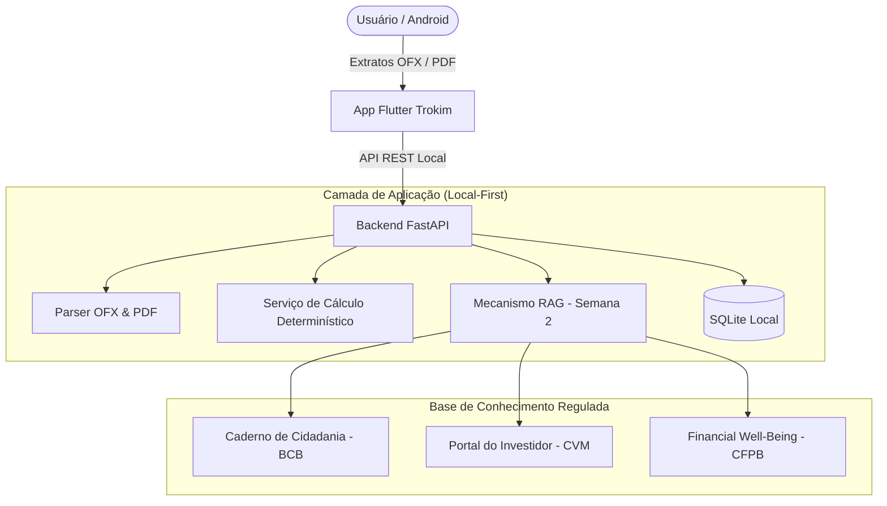

# Trokim — Assistente Financeiro Pessoal com IA

> **Challenge 2 — Big Idea: Qualidade de Vida**  
> *"Empoderando pessoas com IA para compreender melhor, decidir melhor e viver melhor."*

O **Trokim** é um assistente financeiro de código aberto (*open-source*) projetado com foco em privacidade (*local-first*), explicabilidade determinística e fundamentação em educação financeira oficial.

---

## O Problema

Pessoas que utilizam múltiplas contas bancárias e cartões de crédito enfrentam atrito constante para:
1. Reunir e consolidar transações financeiras dispersas;
2. Compreender padrões reais de despesas sem comprometer horas em planilhas complexas;
3. Antecipar fechamentos de fatura e compromissos futuros;
4. Escolher conscientemente entre metas de poupança/investimento e despesas que promovem qualidade de vida.

---

## Essential Question

> **"Como a inteligência artificial pode ajudar as pessoas a compreender e planejar suas finanças pessoais, tomando decisões informadas sem comprometer sua qualidade de vida?"**

---

## Princípios Arquiteturais e de Projeto

- **Privacidade Local-First (LGPD):** O processamento de extratos bancários (arquivos OFX e faturas PDF) ocorre no ambiente do próprio usuário, armazenado em banco de dados local SQLite sem exposição de dados sensíveis na nuvem.
- **Cálculo Determinístico:** Valores numéricos, totais, saldos e projeções são computados com precisão por código matemático estrito. Modelos de Linguagem (LLMs) atuam apenas como camada de síntese, explicação pedagógica e interação em linguagem natural.
- **RAG com Fontes Oficiais:** Todas as orientações orçamentárias e conceitos de planejamento baseiam-se em referências consagradas de órgãos reguladores e de defesa do consumidor (**Banco Central do Brasil**, **CVM** e **CFPB**). Quando não há evidência empírica, o agente se abstém.
- **Transparência e Rastreabilidade:** Cada requisito e decisão técnica possui vínculo direto com uma *Guiding Question* (GQ) e um registro de decisão arquitetural (*ADR*).

---

## Estrutura do Sistema

---

## Navegação Rápida

- [Planejamento e Roadmap do CBL](planejamento.md)
- [Perguntas Norteadoras (Guiding Questions)](pesquisa/guiding-questions.md)
- [Requisitos do Sistema e MoSCoW](requisitos.md)
- [Arquitetura e Mapa do Sistema](arquitetura/mapa-do-sistema.md)
- [Base RAG da Semana 2](rag/index.md)
- [Decisões Arquiteturais (ADRs)](adr/index.md)
