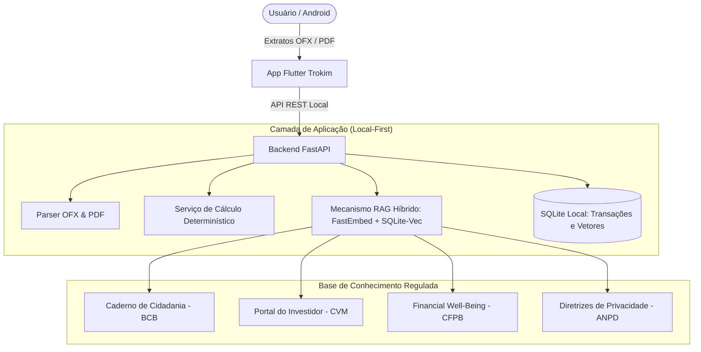

# Entenda seu dinheiro. Decida com calma.

Assistente financeiro pessoal de código aberto, **local-first**: seus extratos ficam no seu aparelho, os números são calculados por código e as orientações vêm de fontes oficiais (BCB, CVM e CFPB).

[Conhecer a solução](apresentacao.md){ .md-button .md-button--primary }
[Guia de uso](guia-de-uso.md){ .md-button }

*Challenge 2 — Big Idea: Qualidade de Vida. "Empoderando pessoas com IA para compreender melhor, decidir melhor e viver melhor."*

O **Trokim** é um assistente financeiro de código aberto (*open-source*) projetado com foco em privacidade (*local-first*), explicabilidade determinística e fundamentação estrita em educação financeira oficial.

---

## Destaques do Projeto (Entregas 1 & 2 Concluídas)

-   :material-database-search:{ .lg .middle } **Base RAG Oficial com 20 Documentos**

    ---

    Acervo curado com metadados e hashes de órgãos reguladores: **BCB**, **CVM**, **CFPB** e **ANPD**.
    [:octicons-arrow-right-24: Ver Catálogo de Fontes](rag/catalogo.md)

-   :material-chart-line-variant:{ .lg .middle } **Benchmark RAG Auditado**

    ---

    **98,78%** de Recall@3, **97,56%** de precisão fundamentada e **100% de abstenção ativa** em casos fora de escopo.
    [:octicons-arrow-right-24: Ver Métricas e Calibração](rag/index.md)

-   :material-calculator:{ .lg .middle } **Cálculos 100% Determinísticos**

    ---

    Zero alucinação matemática. Lançamentos, balanços e médias são computados por motor estrito em Python.
    [:octicons-arrow-right-24: Ver ADR 0004](adr/0004-calculos-deterministicos.md)

-   :material-cellphone:{ .lg .middle } **Mobile Flutter & Local-First**

    ---

    App Android integrado à API local em SQLite + `sqlite-vec`. Extratos OFX e faturas PDF processados no aparelho.
    [:octicons-arrow-right-24: Ver Guia de Uso](guia-de-uso.md)

---

## O Problema

Pessoas que utilizam múltiplas contas bancárias e cartões de crédito enfrentam atrito constante para:
1. Reunir e consolidar transações financeiras dispersas;
2. Compreender padrões reais de despesas sem comprometer horas em planilhas complexas;
3. Antecipar fechamentos de fatura e compromissos futuros;
4. Escolher conscientemente entre metas de poupança/investimento e despesas que promovem qualidade de vida.

---

## Essential Question

> **"Como a inteligência artificial pode ajudar as pessoas a compreender e planejar suas finanças pessoais, tomando decisões informadas sem comprometer sua qualidade de vida?"**

---

## Princípios Arquiteturais e de Projeto

- **Privacidade Local-First (LGPD):** O processamento de extratos bancários (arquivos OFX e faturas PDF) ocorre no ambiente do próprio usuário, armazenado em banco de dados local SQLite sem exposição de dados sensíveis na nuvem.
- **Cálculo Determinístico:** Valores numéricos, totais, saldos e projeções são computados com precisão por código matemático estrito (`calculation_service.py`). Modelos de Linguagem (LLMs) atuam apenas como camada de síntese e explicação pedagógica.
- **RAG com Fontes Oficiais:** Todas as orientações orçamentárias baseiam-se em referências consagradas de órgãos reguladores (**Banco Central do Brasil**, **CVM** e **CFPB**). Quando não há evidência empírica ou o tema envolve especulação, o agente se abstém ativamente.
- **Transparência e Rastreabilidade:** Cada requisito e decisão técnica possui vínculo direto com uma *Guiding Question* (GQ) e um registro de decisão arquitetural (*ADR*).

---

## Estrutura do Sistema

---

## Navegação Rápida

- [Apresentação Executiva e Resultados](apresentacao.md)
- [Planejamento e Roadmap do CBL (Semanas 1 a 7)](planejamento.md)
- [Perguntas Norteadoras (Guiding Questions)](pesquisa/guiding-questions.md)
- [Requisitos do Sistema e MoSCoW](requisitos.md)
- [Arquitetura e Mapa do Sistema](arquitetura/mapa-do-sistema.md)
- [Base RAG e Benchmark da Semana 2](rag/index.md)
- [Catálogo dos 20 Documentos Oficiais](rag/catalogo.md)
- [Atas de Reunião da Equipe](atas/index.md)
- [Decisões Arquiteturais (ADRs)](adr/index.md)
