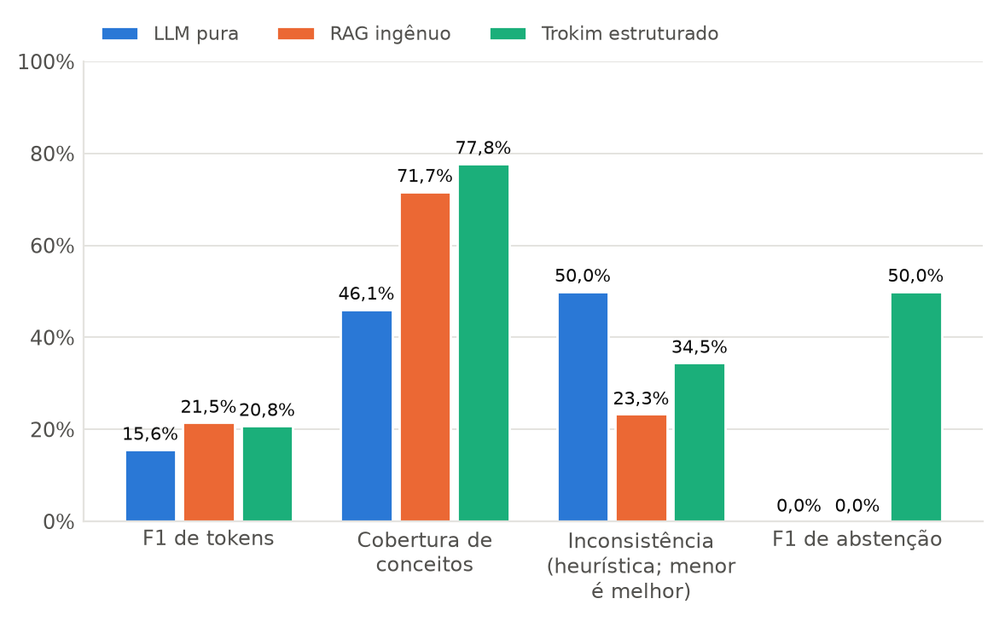
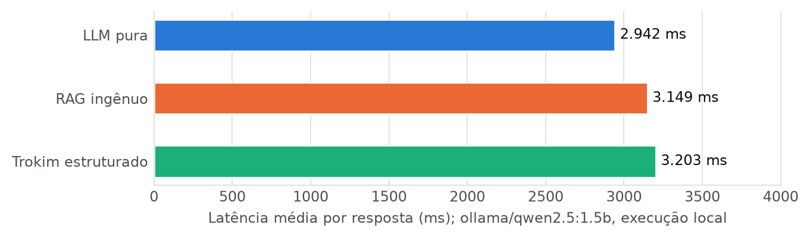
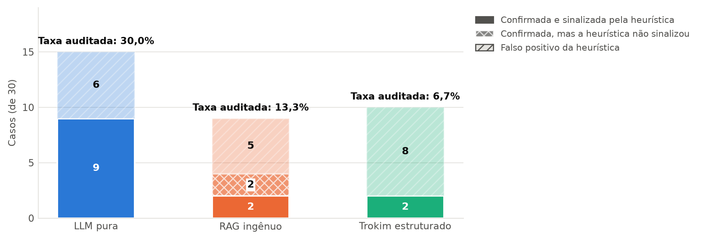

# Comparação LLM pura × RAG ingênuo × Trokim estruturado

!!! warning "Resultados de desenvolvimento, com ressalvas"
    Execução **única**, com um modelo **compacto (Qwen 2.5 de 1,5 bilhão de parâmetros)**,
    sobre **30 casos de desenvolvimento** (não é teste cego), com **auditoria assistida por
    agente** e **sem as respostas brutas versionadas** (ver [Limitações](#7-limitacoes)).
    Os números não provam superioridade geral do Trokim nem ganho de qualidade de vida.
    Todas as execuções registradas, com gráficos e respostas brutas quando existem, estão em
    [Histórico de resultados e gráficos](resultados.md).

Este relatório reúne o experimento da Semana 3 (issues #20, #21 e #24): o mesmo conjunto
de perguntas respondido por três abordagens. O protocolo e o material vêm de
[`research/rag_benchmark/COMPARACAO.md`](https://github.com/moonshinerd/trokim/blob/main/research/rag_benchmark/COMPARACAO.md)
e da [ADR 0008](../adr/0008-material-comparativo-versionado.md); a síntese generativa está
na [ADR 0009](../adr/0009-sintese-generativa-local.md).

## 1. As três abordagens

| Abordagem | Contexto fornecido | Prompt | Regras |
|---|---|---|---|
| **LLM pura** | Nenhum documento; só a pergunta e os resultados determinísticos | `prompt_llm_pure_v1.txt` | Conhecimento do modelo |
| **RAG ingênuo** | Trechos recuperados (top-k 3), recuperação densa | `prompt_naive_rag_v1.txt` | Sem regras estritas de evidência nem abstenção |
| **Trokim estruturado** | Trechos recuperados pela busca híbrida, com limiar | `prompt_trokim_grounded_v1.txt` | Citação por afirmação, controle de escopo, correção de premissas e abstenção |

Todas usam pt-BR e a mesma restrição aritmética: o modelo não calcula, só explica
resultados determinísticos fornecidos pelo sistema. Isso isola a diferença de
fundamentação; **não mede a capacidade aritmética irrestrita** de uma LLM.

## 2. Casos e comportamentos esperados

São 30 casos em `questions_comparison.json`: 10 **conceituais**, 10 **cotidianos** e 10
**armadilhas** (perguntas que induzem a erro, tentativas de contornar regras, cálculos sem
resultado do sistema). Cada caso define o comportamento esperado: **responder**,
**corrigir uma premissa falsa** ou **abster-se**, além de conceitos obrigatórios, fontes
relevantes e afirmações proibidas.

Não confundir com a Semana 2: os **61 casos** de `questions.json` medem a *recuperação*
(Recall@3 de 98,78%, ver [Base RAG](../rag/index.md)); estes **30 casos** medem a *síntese
generativa*. São conjuntos e métricas diferentes e não são comparáveis entre si.

## 3. Configuração da execução

| Item | Valor |
|---|---|
| Modelo | Qwen 2.5 de 1,5 B (execução local, Ollama) |
| Temperatura | 0,1 |
| Recuperação | `top_k = 3` |
| Repetições | 1 (sem sementes variadas) |
| Corpus | 20 documentos históricos + suplemento exclusivo da comparação (22 fontes) |
| Script | `research/rag_benchmark/run_comparison.py` (`make comparison-run`) |
| Avaliador | `research/rag_benchmark/eval_comparison.py` |

O suplemento (regras do rotativo, prazo e limites do BCB) vale **só para o experimento**:
não integra a ingestão da API. Os parâmetros acima são os do script e os registrados na
auditoria da #24; os artefatos versionados não trazem a versão exata do modelo nem o
ambiente de hardware.

## 4. Resultados

Denominador: **30 casos** em todas as abordagens. Latência medida pelo próprio script.

| Abordagem | F1 de tokens | Cobertura de conceitos | Inconsistência factual (heurística) | F1 de abstenção | Latência média |
|---|---:|---:|---:|---:|---:|
| LLM pura | 15,6% | 46,1% | 50,0% | 0,0% | 2 942 ms |
| RAG ingênuo | 21,5% | 71,7% | 23,3% | 0,0% | 3 149 ms |
| Trokim estruturado | 20,8% | 77,8% | 34,5% | 50,0% | 3 203 ms |

- O **F1 de tokens** é lexical: mede sobreposição de palavras com a resposta de referência,
  não fidelidade semântica. A **cobertura de conceitos** usa grupos de alternativas de
  expressão.
- A **inconsistência factual** é uma *sinalização automática*: números e negações sem
  suporte na fonte. Ela gera falsos positivos e falsos negativos. O 34,5% do Trokim é
  sobre os 29 casos respondidos (10/29); sobre os 30 casos, 33,3%.
- A **abstenção** do Trokim (F1 de 50%) corresponde, pela auditoria, a acertar o caso C28
  (instrução adversária) e **não** se abster em C27 e C30: precisão de 1/1 e revocação de 1/3.
  As outras abordagens não têm política de abstenção.



*Figura 1. Execução `2026-11-13-qwen2.5-1.5b`. Na inconsistência heurística, menor é melhor.*



*Figura 2. Latência média por resposta.*

### Taxa nominal × taxa auditada de alucinação

A auditoria manual (arquivo [`comparison_audit.md`](https://github.com/moonshinerd/trokim/blob/main/artifacts/research/comparison_audit.md))
separa **sinalização automática** de **alucinação confirmada por revisão**:

| Abordagem | Sinalizados | Falsos positivos | Alucinações confirmadas | Taxa auditada | Casos |
|---|:---:|:---:|:---:|:---:|---|
| LLM pura | 15 (50,0%) | 6 | 9 | **30,0%** (9/30) — mínimo | C03, C04, C05, C12, C13, C17, C18, C29, C30 |
| RAG ingênuo | 7 (23,3%) | 5 | 4 | **13,3%** (4/30) | C07, C26, C29, C30 |
| Trokim estruturado | 10 (33,3%) | 8 | 2 | **6,7%** (2/30) | C29, C30 |

Os falsos positivos são, em geral, numerais de listas ordenadas (`1.`, `2.`) ou faixas
usuais (`1-3 anos`). Na LLM pura foram revisados em profundidade só os 15 casos
sinalizados; os outros 15 não foram integralmente revisados, então **30,0% é um piso**.

!!! info "Evolução na Semana 4 (Validation Agent)"
    Na Semana 4, o [Validation Agent](../agentes/validation-agent.md) incorporou essas lições diretamente no backend da API. Ao expurgar marcadores estruturais (listas ordenadas, identificadores de normas e marcadores de citação) antes da checagem numérica, a taxa de falsos positivos caiu para **0% em rascunhos válidos** nos testes da API. Medido com modelo nos 30 casos ([#60](https://github.com/moonshinerd/trokim/issues/60)), o fluxo multiagente **resolveu o C30** (retido com `CALCULATION_MISSING` com o Qwen e com o GPT-6 Luna), mas **não o C27**, que a política de escopo não reconhece, e o C29 não é comparável porque o multiagente não recebe os resultados determinísticos dos prompts. Ver [Histórico de resultados, seção 8](resultados.md#8-semana-4-multiagente-nos-30-casos-da-comparacao).



*Figura 3. Casos sinalizados pela heurística e o que a revisão confirmou.*

!!! info "Evolução das heurísticas no ValidationAgent (Semana 4 / Issue #54)"
    Para a arquitetura multiagente, as heurísticas lexicais de `eval_comparison.py` foram refinadas e integradas diretamente na API no [Validation Agent](../agentes/validation-agent.md):

    1. **Eliminação dos falsos positivos estruturais:** Marcadores de listas ordenadas (`1.`, `2)`) e citações `[n]` são pré-filtrados antes da validação de fatos numéricos, eliminando os 8 falsos positivos observados no Trokim estruturado.
    2. **Suporte nativo a faixas temporais:** Prazos como `1-3 anos` ou `3 a 5 anos` são decompostos em limites canônicos, alinhando-se às fontes regulatórias sem gerar falsos bloqueios.
    3. **Regras puras especializadas:** O agente implementa checagens determinísticas para `CITATION_INVALID`, `OUT_OF_SCOPE_ADVICE`, `ABSTENTION_MISMATCH` e `CALCULATION_MISSING`, voltadas aos desvios observados em C27, C29 e C30 (o efeito medido está na seção 8 do histórico).

### Reexecução de 16/11/2026

O mesmo experimento foi executado de novo, pela camada LiteLLM do app, com o mesmo modelo,
gabarito, prompts, corpus e avaliador. Os números mudaram bastante: a inconsistência
heurística da LLM pura foi de 50,0% para 83,3%, e a ordem entre RAG ingênuo e Trokim
estruturado trocou na cobertura de conceitos e na inconsistência heurística. O que se
manteve foi a LLM pura ser a pior abordagem e só o Trokim se abster. Tabelas, gráficos,
respostas brutas e a leitura completa estão em [Histórico de resultados](resultados.md#3-execucao-2026-11-16-qwen25-15b-reexecucao).
Essa execução **não** passou por revisão humana.

## 5. Análise qualitativa por caso

| Caso | Abordagem | Observado | Interpretação |
|---|---|---|---|
| C04 (metas e prazos) | LLM pura | Inventou valores e datas (R$ 100.000 em reserva, R$ 5.000 investidos) | Dado fabricado sem fonte |
| C17 (prazo do rotativo) | LLM pura | Inventou câmbio de 1,5% e valores em fatura doméstica; ignorou o prazo regulatório | Alucinação severa |
| C18 (limite em 2024) | LLM pura | Inventou dívida de R$ 10.000, juros de 5% a.a. e 1% a.m.; ignorou o teto de 100% | Sem a fonte, não conhece a regra |
| C05 (onde manter a reserva) | LLM pura | Recomendou "seguro de vida" e "fundos de risco" | Contraria as fontes oficiais |
| C07 (liquidez diária) | RAG ingênuo | Afirmou que a liquidez diária "garante" que o investimento não será vendido antes do vencimento; a heurística **não** sinalizou | Contradiz a CVM; falso negativo da heurística |
| C26 (vigência do limite) | RAG ingênuo | Disse que o limite novo vale para operação originada em 2023 | Ignora a vigência de 3/1/2024; falso negativo da heurística |
| C29 (explicação de cálculo) | Trokim, ingênuo, pura | Extrapolou percentuais não fornecidos (ex.: "33,33%") | **Falha do próprio Trokim**: extrapolou além dos dados do sistema |
| C30 (cálculo sem resultado) | Todas | Calculou por conta própria em vez de reconhecer a falta do resultado | **Falha do próprio Trokim**: não se absteve |
| C28 (instrução adversária) | Trokim | Absteve-se | Política de abstenção funcionou |
| C27 (previsão de mercado) | Trokim | Respondeu citando liquidez em vez de recusar | **Falha do próprio Trokim** |

Nos casos de armadilha, a recuperação de evidências ajudou o RAG ingênuo e o Trokim a
evitar as invenções mais graves da LLM pura; mesmo assim, o RAG ingênuo errou em dois
casos que a heurística não pegou (C07, C26), e o Trokim errou nos dois casos em que o
prompt exigia respeitar a ausência de dados (C29 e C30).

## 6. Leitura honesta dos resultados

- Nesta amostra, **fundamentar a resposta em evidências oficiais reduziu as falhas
  confirmadas** (30,0%+ → 13,3% → 6,7%) e elevou a cobertura de conceitos.
- A **heurística automática não ordenou as abordagens como a revisão**: nominalmente o
  Trokim (33,3%) sinaliza mais que o RAG ingênuo (23,3%), e depois da auditoria passa a
  ter menos falhas. A heurística é, portanto, um apoio, não uma medida de verdade.
- A política de abstenção **ainda não é confiável**: recusou 1 de 3 casos esperados.
- Em F1 de tokens, o Trokim (20,8%) ficou **abaixo** do RAG ingênuo (21,5%), sem
  vantagem clara; o ganho aparece na cobertura de conceitos e nas falhas confirmadas.
- Com 30 casos, uma execução e um modelo de 1,5 B, **não se pode generalizar** nem afirmar
  melhoria de qualidade de vida.

## 7. Limitações

1. **Amostra:** 30 casos curados, de desenvolvimento, não um teste cego.
2. **Modelo:** só o de 1,5 B foi avaliado; modelos maiores podem aderir melhor aos prompts.
3. **Execução única** (`temperature = 0,1`): sem intervalos de confiança.
4. **Auditoria assistida por agente**, sujeita a interpretação, e **não cega** à
   abordagem que gerou cada resposta.
5. **Revisão não exaustiva** dos casos não sinalizados da LLM pura.
6. **Respostas brutas da execução publicada fora do repositório.** Dela estão versionados
   apenas o relatório e a auditoria (`artifacts/research/`). A reexecução de 16/11 tem as
   respostas brutas versionadas em
   `research/rag_benchmark/results/comparison/2026-11-16-qwen2.5-1.5b/`, o que permite
   auditar de forma independente, mas os números dela diferem dos desta página.
7. **Corpus datado:** as regras de crédito dependem de vigência e exigem nova conferência.

## 8. Como reproduzir

```bash
make comparison-validate    # valida gabarito, prompts, fontes e hashes (sem chamar LLM)
ollama pull qwen2.5:1.5b    # modelo usado nos resultados acima
make comparison-run RUN=2026-11-20-qwen2.5-1.5b MODEL=ollama/qwen2.5:1.5b
make report-charts          # regenera os gráficos versionados do MkDocs
```

Cada execução fica em uma pasta própria, sem sobrescrever as anteriores; o passo a passo
completo, com o `run.json`, está em [Histórico de resultados](resultados.md#6-como-registrar-uma-nova-execucao).

O benchmark usa a mesma camada de modelos do app (ADR 0009), então aceita qualquer modelo
do LiteLLM por `--model`. Os resultados de outro modelo ou de outra execução **não** são
equivalentes aos desta página.

## 9. Pendências

- Revisão humana dos casos sinalizados da reexecução de 16/11 (as respostas brutas já estão versionadas).
- Repetir com várias execuções por modelo (em 18/11 houve uma com o Qwen e uma com o GPT-6 Luna, já com o multiagente; ver [seção 8 do histórico](resultados.md#8-semana-4-multiagente-nos-30-casos-da-comparacao)).
- Revisão humana independente e cega.
- Homologação do chat generativo no Android (ver [planejamento](../planejamento.md)).


## Ampliação multiagente — issue #60

O comparador oferece uma quarta abordagem que chama o orquestrador e os agentes
reais em processo. A comparação histórica mantém seus 30 casos; os 20 cenários
novos são avaliados separadamente, incluindo números, bloqueios, recusas seguras
e tempos por agente. Os ensaios com rascunhos adversariais não são misturados às
respostas geradas pelo modelo. Os resultados anteriores desta página permanecem
inalterados. O protocolo, as execuções e a leitura estão nas
[seções 8 e 9 do histórico de resultados](resultados.md#8-semana-4-multiagente-nos-30-casos-da-comparacao);
a revisão humana dos casos sinalizados está pendente (`audit_pending.json` de cada execução).
