# Histórico de resultados e gráficos

Esta página reúne **todas as execuções registradas** do benchmark da comparação LLM x RAG
(Semana 3), das execuções com o sistema multiagente (Semana 4, [seções 8 e 9](#8-semana-4-multiagente-nos-30-casos-da-comparacao)) e do
benchmark de recuperação (Semana 2), com os gráficos de cada uma. Nenhuma
execução é sobrescrita: se os resultados melhorarem, a nova execução entra como uma nova
linha e uma nova pasta, e as antigas continuam acessíveis para comparação.

!!! note "Como os gráficos são gerados"
    Cada execução tem um `run.json` (data, commit, modelo, parâmetros e métricas) em
    `research/rag_benchmark/results/comparison/<id da execução>/`. O comando
    `make report-charts` lê esses arquivos e grava os gráficos em
    `docs/assets/comparacao/<id da execução>/`. Um teste (`research/test_run_registry.py`)
    falha se uma execução não tiver metadados, se os números do `run.json` não baterem com o
    relatório do runner, se faltar algum gráfico ou se esta página não citar a execução.

## 1. Execuções registradas

| Execução | Data | Commit | Modelo e acesso | Casos | Respostas brutas | Revisão humana |
|---|---|---|---|:---:|---|---|
| [`2026-11-13-qwen2.5-1.5b`](https://github.com/moonshinerd/trokim/blob/main/research/rag_benchmark/results/comparison/2026-11-13-qwen2.5-1.5b/run.json) | 13/11/2026 | `8bd00f2` | Qwen 2.5 de 1,5 B, cliente direto do Ollama | 30 | Não versionadas | Sim, [assistida por agente](https://github.com/moonshinerd/trokim/blob/main/artifacts/research/comparison_audit.md) |
| [`2026-11-16-qwen2.5-1.5b`](https://github.com/moonshinerd/trokim/tree/main/research/rag_benchmark/results/comparison/2026-11-16-qwen2.5-1.5b) | 16/11/2026 | `8b8b2e6` | Qwen 2.5 de 1,5 B, camada LiteLLM do app | 30 | [Sim](https://github.com/moonshinerd/trokim/blob/main/research/rag_benchmark/results/comparison/2026-11-16-qwen2.5-1.5b/comparison_results.json) | Não |
| [`2026-11-18-qwen2.5-1.5b-multiagente-sem-teto`](https://github.com/moonshinerd/trokim/tree/main/research/rag_benchmark/results/comparison/2026-11-18-qwen2.5-1.5b-multiagente-sem-teto) | 18/11/2026 | `233566e` sem o teto de tokens | Qwen 2.5 de 1,5 B (Ollama), camada LiteLLM; **quatro abordagens**; achou o defeito do tempo limite (seção 8.1) | 30 + 20 cenários | [Sim](https://github.com/moonshinerd/trokim/blob/main/research/rag_benchmark/results/comparison/2026-11-18-qwen2.5-1.5b-multiagente-sem-teto/comparison_results.json) | Não |
| [`2026-11-18-qwen2.5-1.5b-multiagente`](https://github.com/moonshinerd/trokim/tree/main/research/rag_benchmark/results/comparison/2026-11-18-qwen2.5-1.5b-multiagente) | 18/11/2026 | `233566e` | Qwen 2.5 de 1,5 B (Ollama), camada LiteLLM; **quatro abordagens** | 30 + 20 cenários | [Sim](https://github.com/moonshinerd/trokim/blob/main/research/rag_benchmark/results/comparison/2026-11-18-qwen2.5-1.5b-multiagente/comparison_results.json) | Não (conferência automática dos sinalizados) |
| [`2026-11-18-gpt-6-luna-multiagente`](https://github.com/moonshinerd/trokim/tree/main/research/rag_benchmark/results/comparison/2026-11-18-gpt-6-luna-multiagente) | 18/11/2026 | `233566e` | GPT-6 Luna (OpenRouter), camada LiteLLM; **quatro abordagens** | 30 + 20 cenários | [Sim](https://github.com/moonshinerd/trokim/blob/main/research/rag_benchmark/results/comparison/2026-11-18-gpt-6-luna-multiagente/comparison_results.json) | Não (conferência automática dos sinalizados) |
| [`2026-11-19-qwen2.5-1.5b-multiagente`](https://github.com/moonshinerd/trokim/tree/main/research/rag_benchmark/results/comparison/2026-11-19-qwen2.5-1.5b-multiagente) | 19/11/2026 | `5fa9517` (só documentação alterada) | Qwen 2.5 de 1,5 B (Ollama), camada LiteLLM; **quatro abordagens, protocolo do PR #85** | 30 + 20 cenários | [Sim](https://github.com/moonshinerd/trokim/blob/main/research/rag_benchmark/results/comparison/2026-11-19-qwen2.5-1.5b-multiagente/comparison_results.json) | Pendente ([formulário](https://github.com/moonshinerd/trokim/blob/main/research/rag_benchmark/results/comparison/2026-11-19-qwen2.5-1.5b-multiagente/audit_pending.json)) |
| [`2026-11-19-gpt-6-luna-multiagente`](https://github.com/moonshinerd/trokim/tree/main/research/rag_benchmark/results/comparison/2026-11-19-gpt-6-luna-multiagente) | 19/11/2026 | `5fa9517` (só documentação alterada) | GPT-6 Luna (OpenRouter), camada LiteLLM; **quatro abordagens, protocolo do PR #85** | 30 + 20 cenários | [Sim](https://github.com/moonshinerd/trokim/blob/main/research/rag_benchmark/results/comparison/2026-11-19-gpt-6-luna-multiagente/comparison_results.json) | Pendente ([formulário](https://github.com/moonshinerd/trokim/blob/main/research/rag_benchmark/results/comparison/2026-11-19-gpt-6-luna-multiagente/audit_pending.json)) |

Em todas: temperatura 0,1, `top_k = 3`, uma repetição, corpus de 22 fontes (20 históricas
mais o suplemento exclusivo da comparação), o mesmo gabarito de 30 casos (10 conceituais,
10 cotidianos e 10 armadilhas), os mesmos três prompts e o mesmo avaliador. **A única
mudança de insumo entre as duas primeiras é a camada de acesso ao modelo**: a de 13/11 usou o cliente
direto do Ollama (o runner ainda não tinha LiteLLM) e a de 16/11 usa a camada LiteLLM do
app, a mesma do `/v1/chat/generate`. As de 18/11 acrescentam a quarta abordagem
(multiagente) e diferem entre si só no modelo; as de 19/11 repetem os dois modelos com o
protocolo corrigido do PR #85 (seções 8.6 e 8.7). O `run.json` das de 19/11 marca a árvore como
alterada porque a revisão do MkDocs seguia em paralelo; nenhum arquivo de código, prompt,
gabarito ou corpus mudou durante a execução.

### Regras para comparar execuções

- Só compare execuções com o mesmo gabarito, corpus, prompts e `top_k`. Mude uma coisa por
  vez (modelo, prompt ou recuperador) e registre qual foi mudada.
- A **inconsistência factual** é uma heurística lexical (número sem suporte, frase proibida
  ou negação contraditória). Ela sinaliza casos para revisão e **não** mede a taxa real de
  alucinação. Só as execuções com revisão humana têm a coluna de alucinação confirmada.
- Com 30 casos e uma repetição, diferenças de poucos pontos percentuais não são
  conclusivas. A seção 4 mostra o tamanho da variação entre duas execuções do mesmo modelo.

## 2. Execução `2026-11-13-qwen2.5-1.5b` (publicada)

Execução usada no [relatório comparativo](comparacao-llm-rag.md), com auditoria manual dos
casos sinalizados.

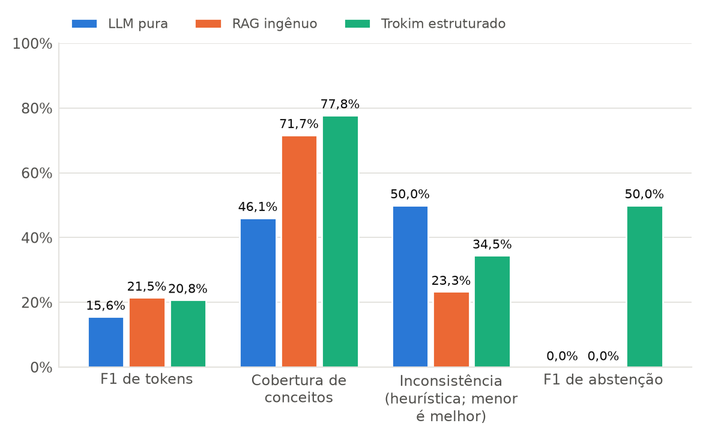

| Abordagem | F1 de tokens | Cobertura de conceitos | Inconsistência (heurística) | F1 de abstenção | Latência média |
|---|---:|---:|---:|---:|---:|
| LLM pura | 15,6% | 46,1% | 50,0% | 0,0% | 2 942 ms |
| RAG ingênuo | 21,5% | 71,7% | 23,3% | 0,0% | 3 149 ms |
| Trokim estruturado | 20,8% | 77,8% | 34,5% | 50,0% | 3 203 ms |

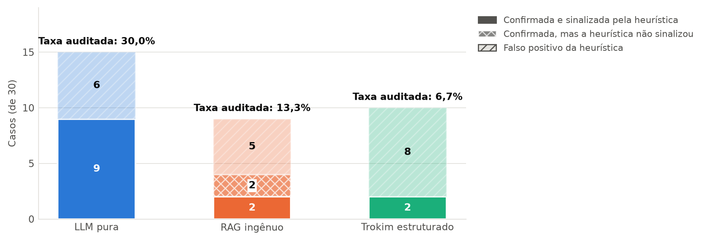

| Abordagem | Sinalizados | Falsos positivos | Alucinações confirmadas | Taxa auditada |
|---|:---:|:---:|:---:|---:|
| LLM pura | 15 | 6 | 9 | 30,0% (piso) |
| RAG ingênuo | 7 | 5 | 4 | 13,3% |
| Trokim estruturado | 10 | 8 | 2 | 6,7% |

As colunas não somam: no RAG ingênuo, das 4 alucinações confirmadas, 2 estavam entre os 7 casos
sinalizados e 2 (C07 e C26) a heurística não sinalizou. Na LLM pura só os 15 casos sinalizados
foram revisados em profundidade, então 30,0% é um piso. Detalhes por caso em [`comparison_audit.md`](https://github.com/moonshinerd/trokim/blob/main/artifacts/research/comparison_audit.md).


## 3. Execução `2026-11-16-qwen2.5-1.5b` (reexecução)

Mesmo modelo, gabarito, prompts, corpus, avaliador e parâmetros, executados de novo em
16/11/2026 com `make comparison-run`, agora pela camada LiteLLM do app. As respostas brutas dos 30 casos nas três abordagens estão
versionadas em
[`comparison_results.json`](https://github.com/moonshinerd/trokim/blob/main/research/rag_benchmark/results/comparison/2026-11-16-qwen2.5-1.5b/comparison_results.json),
o que permite auditar de forma independente. Os casos sinalizados **não** passaram por revisão
humana; por isso não há gráfico de alucinação confirmada para esta execução.

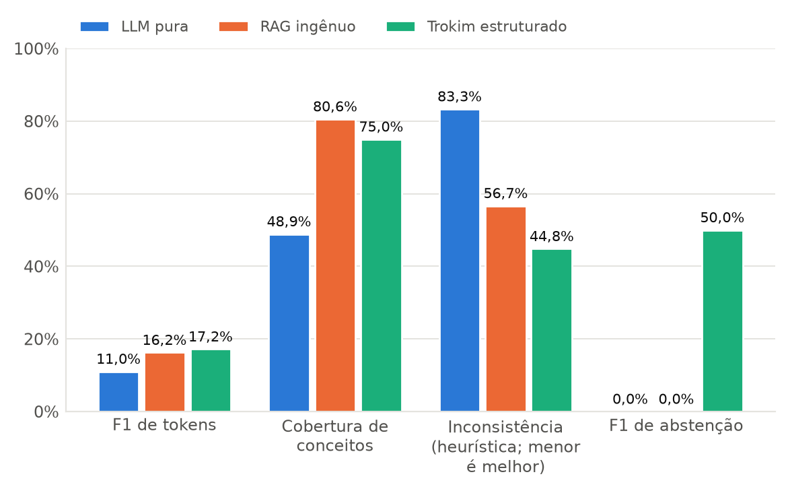

| Abordagem | F1 de tokens | Cobertura de conceitos | Inconsistência (heurística) | F1 de abstenção | Latência média |
|---|---:|---:|---:|---:|---:|
| LLM pura | 11,0% | 48,9% | 83,3% (25 de 30) | 0,0% | 3 593 ms |
| RAG ingênuo | 16,3% | 80,6% | 56,7% (17 de 30) | 0,0% | 3 896 ms |
| Trokim estruturado | 17,2% | 75,0% | 44,8% (13 de 29) | 50,0% | 3 423 ms |

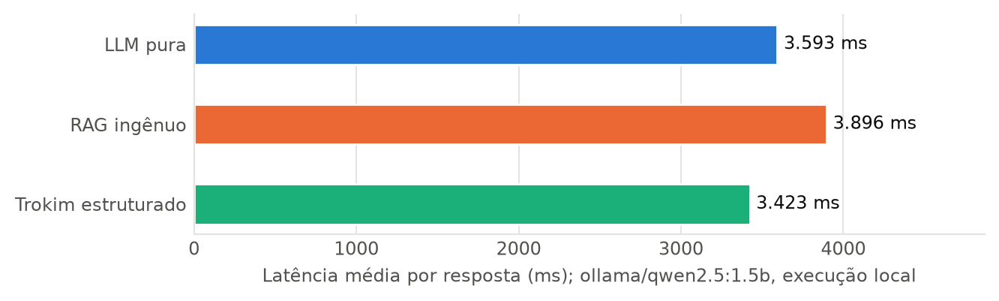

## 4. Variação entre as duas execuções

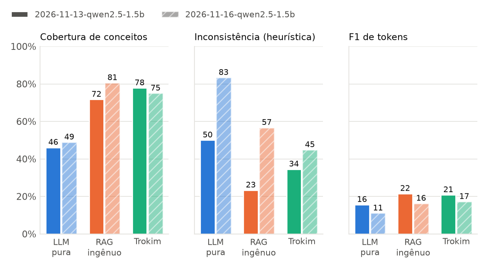

A figura é regenerada por `make report-charts` e inclui todas as execuções com o Qwen; o texto
desta seção compara as duas primeiras (13/11 e 16/11). As de 18/11 e 19/11 mantêm o padrão: a
LLM pura sempre com a menor cobertura e o Trokim estruturado entre 69% e 70%.

O que **se repetiu** nas duas execuções:

- A LLM pura teve a menor cobertura de conceitos, o menor F1 de tokens e a maior taxa de
  inconsistência heurística.
- Só o Trokim estruturado se absteve de responder (F1 de abstenção de 50%): acertou o caso C28
  e não se absteve em dois dos três casos esperados, nas duas execuções.
- A latência ficou entre 2,9 e 3,9 s em todas as abordagens, sem diferença que se sustente.

O que **não se repetiu**:

- A ordem entre RAG ingênuo e Trokim estruturado trocou na cobertura de conceitos
  (71,7% × 77,8% em 13/11 e 80,6% × 75,0% em 16/11), na inconsistência heurística
  (23,3% × 34,5% e 56,7% × 44,8%) e no F1 de tokens.
- O **nível** da inconsistência heurística mudou muito para o mesmo modelo: a LLM pura foi de
  50,0% para 83,3%. A heurística depende de quantos números cada geração inventa, então ela
  varia entre execuções e não deve ser lida como taxa de alucinação.

A variação pode vir da própria geração (execução única, amostragem com temperatura 0,1) e
também da troca da camada de acesso ao modelo, que mudou entre as duas execuções. Os dados
não permitem separar as duas causas.

Conclusão para quem corrige: com 30 casos e um modelo de 1,5 B, **o que se sustenta é a
vantagem de fundamentar a resposta em evidências sobre a LLM pura**. Não se sustenta, com
estes dados, qualquer ranking entre o RAG ingênuo e o Trokim estruturado. Repetir com
várias execuções e modelos maiores é o próximo passo.

## 5. Benchmark de recuperação (Semana 2)

Os 61 casos da Semana 2 medem **a recuperação e a resposta extrativa**, não a síntese
generativa. Não são comparáveis com os 30 casos acima.

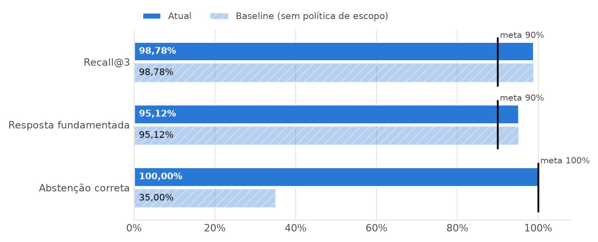

O baseline (`results/baseline.json`) é o mesmo recuperador sem a política de escopo: a
abstenção cai para 35,00%, o que mostra que o limiar de similaridade sozinho não basta. O
valor atual vem de `results/current.json`.

**Verificação de regressão da #52 (16/11/2026):** após expor a política pública de
escopo e acrescentar as recusas do Research Agent, os snapshots `current.json` e
`baseline.json` foram regenerados com Python 3.12.16. Os resultados por caso e as
métricas permaneceram iguais: Recall@3 de 98,78%, resposta fundamentada de 95,12% e
abstenção de 100% com política ou 35% sem ela. Mudaram apenas os metadados de
proveniência: código, versão de Python e avaliador, que passou a incluir o arquivo
da política de domínio no hash do serviço. Os gráficos continuam representando esses valores;
esta verificação não é uma avaliação do fluxo multiagente nem uma nova execução com LLM.

**Verificação de regressão do ORM (18/11/2026, [ADR 0019](../adr/0019-orm-e-migracoes-numeradas.md)):**
a base vetorial passou a usar SQLAlchemy e migrações Alembic. Os dois snapshots foram regenerados
com Python 3.12.13: métricas e documentos recuperados em cada um dos 61 casos ficaram idênticos.
Mudaram só o hash do serviço (que inclui `sqlite_vector_store.py` e `config.py`) e a versão do
Python.


Dados da calibração em
[`alpha_calibration.json`](https://github.com/moonshinerd/trokim/blob/main/research/rag_benchmark/results/alpha_calibration.json),
copiados da tabela de [Base RAG](../rag/index.md). O alpha de 0,3 foi o menor peso denso entre
os empatados em Recall@3.

## 6. Como registrar uma nova execução

1. Escolha o identificador `AAAA-MM-DD-modelo`, por exemplo `2026-11-20-qwen2.5-7b`, e rode:

    ```bash
    ollama pull qwen2.5:7b
    make comparison-run RUN=2026-11-20-qwen2.5-7b MODEL=ollama/qwen2.5:7b
    ```

    Isso grava respostas brutas, relatório JSON e Markdown em
    `research/rag_benchmark/results/comparison/<RUN>/`.

2. Crie `research/rag_benchmark/results/comparison/<RUN>/run.json` copiando o de uma execução
   existente e preenchendo: `run_id`, `date`, `reference_commit`, `issue`, `model`,
   `provider`, `temperature`, `top_k`, `repetitions`, `cases`, `corpus`, `raw_responses`
   (caminho do `comparison_results.json`), `report`, `audit` (`null` se não houve revisão
   humana) e as métricas de cada abordagem a partir do `comparison_report.json`.
3. Gere os gráficos e valide:

    ```bash
    make report-charts
    make research-test
    ```

4. Acrescente a execução à tabela da seção 1 e uma seção como a 3, com a tabela de métricas
   e as figuras `fig1-metricas.png` e `fig3-latencia.png` (e `fig2-alucinacao-auditada.png`
   se houve revisão humana). O teste `test_run_registry.py` indica o que faltar.
5. Desde a Semana 4, o `make comparison-run` já inclui o multiagente e roda também os 20
   cenários (`results/multiagent/<RUN>/`). Ele cria o `run.json` sozinho (commit completo e
   aviso de árvore suja), com o resumo `multiagent_scenarios`, e um `audit_pending.json` em
   cada pasta, sem revisor e sem nenhuma confirmação. Recusa identificador já usado, `mock` e
   execução parcial. O `make report-charts` gera `fig4-multiagente-cenarios.png` e
   `fig5-latencia-por-agente.png`.
   Se o avaliador mudar, `run_multiagent.py --output-dir <pasta> --reavaliar` refaz o relatório
   sem chamar o modelo. Uma execução com defeito não é apagada: ela ganha um sufixo no
   identificador (como `-sem-teto`) e uma nota no `run.json` e nesta página.
6. Se mudar o gabarito, o corpus ou os prompts, atualize o manifesto
   (`make comparison-validate`) e registre a mudança na [ADR 0008](../adr/0008-material-comparativo-versionado.md):
   execuções com insumos diferentes não são comparáveis entre si.

## 7. Rastreabilidade

| O que | Onde |
|---|---|
| Metadados e métricas de cada execução | `research/rag_benchmark/results/comparison/<id>/run.json` |
| Respostas brutas e relatório do runner | `research/rag_benchmark/results/comparison/<id>/comparison_results.json`, `comparison_report.json` e `.md` |
| Auditoria manual da execução de 13/11 | `artifacts/research/comparison_audit.md` |
| Gráficos | `docs/assets/comparacao/<id>/`, `semana2/` e `entre-execucoes/` |
| Gerador dos gráficos | `research/rag_benchmark/make_report_charts.py` (`make report-charts`) |
| Verificação automática | `research/test_run_registry.py` (`make research-test`) |
| Gabarito, prompts e manifesto | [ADR 0008](../adr/0008-material-comparativo-versionado.md) e `research/rag_benchmark/COMPARACAO.md` |

## 8. Semana 4: multiagente nos 30 casos da comparação

Issue [#60](https://github.com/moonshinerd/trokim/issues/60). Hipótese da semana: *o sistema
multiagente reduz as falhas de C27, C29 e C30 sem perder cobertura de conceitos?* O
[orquestrador](../agentes/orquestrador.md) roda em processo, sem HTTP, como **quarta abordagem**
no mesmo gabarito, corpus, avaliador, temperatura (0,1) e `top_k` (3). O Research busca no
mesmo corpus unificado de 22 fontes, com a mesma política de escopo e o mesmo limiar do Trokim
estruturado. Cada rodada tem duas execuções, iguais exceto pelo modelo, para separar o efeito do fluxo do
efeito do tamanho do modelo: o Qwen 2.5 de 1,5 B (o das execuções anteriores, no Ollama) e o
GPT-6 Luna (OpenRouter). A rodada de 18/11 está nas seções 8.2 a 8.4; a de 19/11, com o
protocolo corrigido, na seção 8.7, que é a referência para a hipótese. O comando é `make comparison-run` (seção 6).

### 8.1 Primeira tentativa: o defeito do tempo limite

A primeira execução com o Qwen (`2026-11-18-qwen2.5-1.5b-multiagente-sem-teto`) fica no histórico
porque achou um defeito do produto: o Communication chamava o modelo **sem teto de tokens**, e o
modelo de 1,5 B às vezes gerava até estourar o tempo limite de 120 s. Isso aconteceu em 8 dos 30
casos e em 9 dos 20 cenários, com latência média de 36,6 s por caso no multiagente (64 s por
cenário). No app, o `/v1/agents/ask` teria o mesmo problema. A correção é o `LLM_MAX_TOKENS`
(500 por padrão), no commit `233566e`; as duas execuções seguintes já têm o teto.

| Abordagem | F1 de tokens | Cobertura de conceitos | Inconsistência (heurística) | F1 de abstenção | Latência média |
|---|---:|---:|---:|---:|---:|
| LLM pura | 14,3% | 45,0% | 43,3% (13 de 30) | 0,0% | 3 084 ms |
| RAG ingênuo | 19,6% | 68,3% | 43,3% (13 de 30) | 0,0% | 2 577 ms |
| Trokim estruturado | 21,0% | 70,0% | 31,0% (9 de 29) | 50,0% | 1 749 ms |
| Multiagente | 12,4% | 49,4% | 53,3% (8 de 15) | 33,3% | 36 570 ms |

Os números do multiagente nesta execução medem o defeito, não o fluxo. As respostas brutas são as
originais; os relatórios foram refeitos com o avaliador atual (seção 8.5).

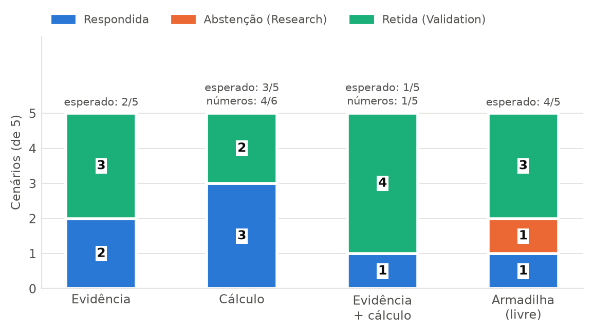

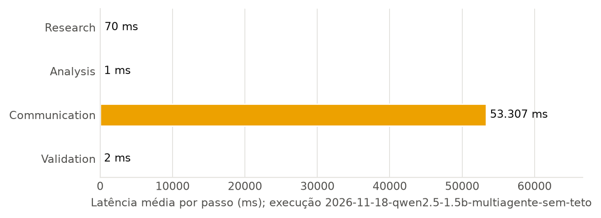

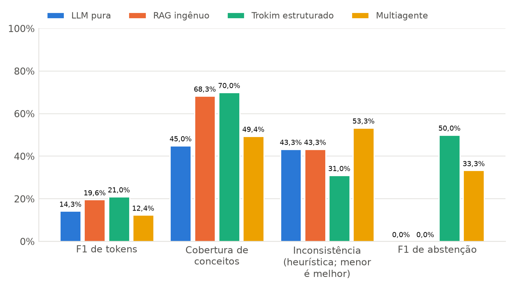

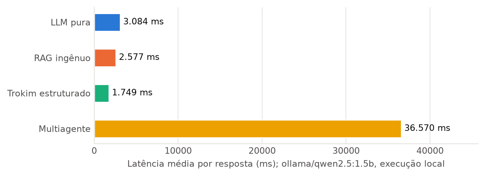

### 8.2 Qwen 2.5 de 1,5 B

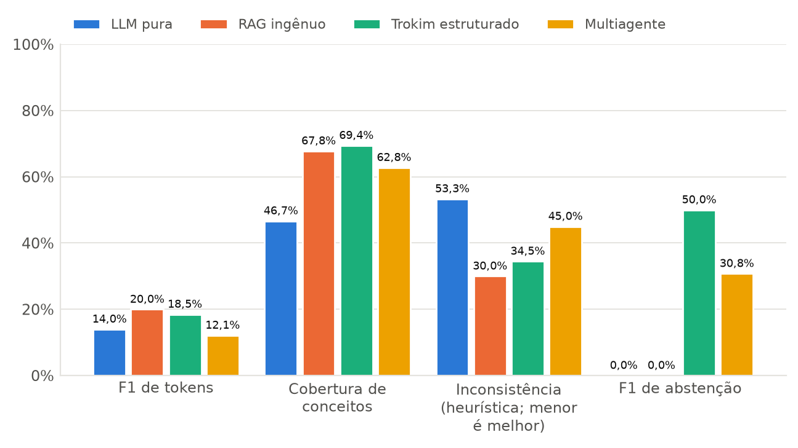

| Abordagem | F1 de tokens | Cobertura de conceitos | Inconsistência (heurística) | F1 de abstenção | Latência média |
|---|---:|---:|---:|---:|---:|
| LLM pura | 14,0% | 46,7% | 53,3% (16 de 30) | 0,0% | 1 969 ms |
| RAG ingênuo | 20,0% | 67,8% | 30,0% (9 de 30) | 0,0% | 1 684 ms |
| Trokim estruturado | 18,5% | 69,4% | 34,5% (10 de 29) | 50,0% | 1 512 ms |
| Multiagente | 12,1% | 62,8% | 45,0% (9 de 20) | 30,8% | 3 522 ms |

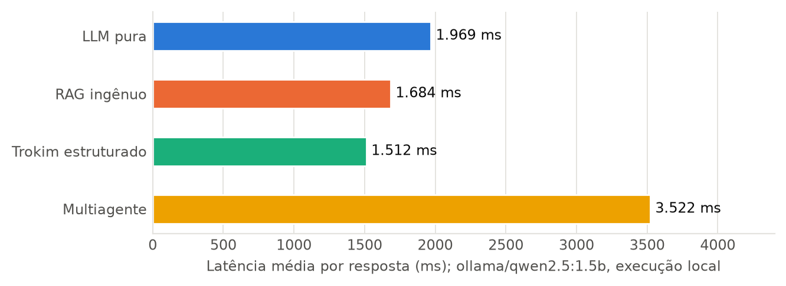

O multiagente respondeu 20 dos 30 casos: 9 foram retidos pelo Validation e 1 (C28) teve
abstenção no Research. Entre os 9 retidos, 8 eram casos que deveriam ser respondidos (só o C30 devia ser recusado).

### 8.3 GPT-6 Luna

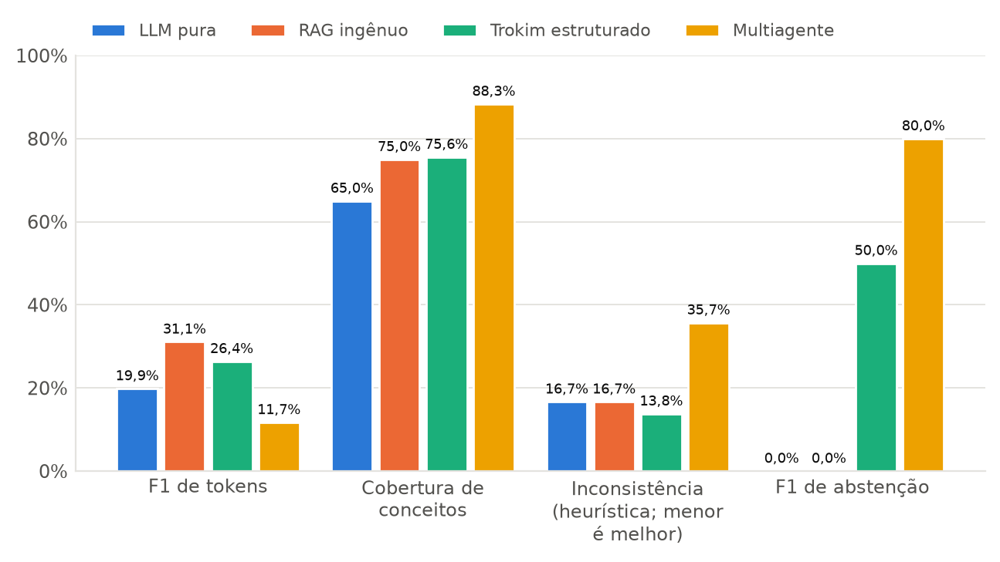

| Abordagem | F1 de tokens | Cobertura de conceitos | Inconsistência (heurística) | F1 de abstenção | Latência média |
|---|---:|---:|---:|---:|---:|
| LLM pura | 19,9% | 65,0% | 16,7% (5 de 30) | 0,0% | 2 888 ms |
| RAG ingênuo | 31,1% | 75,0% | 16,7% (5 de 30) | 0,0% | 2 014 ms |
| Trokim estruturado | 26,4% | 75,6% | 13,8% (4 de 29) | 50,0% | 2 550 ms |
| Multiagente | 11,7% | **88,3%** | 35,7% (10 de 28) | **80,0%** | 3 663 ms |

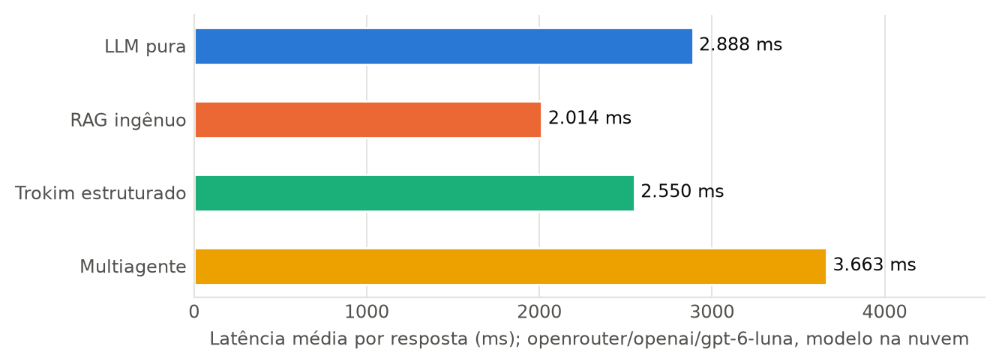

Com o modelo maior, o multiagente respondeu 28 dos 30 casos e só deixou de responder os dois
que deveria (C28 por abstenção e C30 retido com `CALCULATION_MISSING`), o que leva o F1 de
abstenção a 80%. Duas respostas da LLM pura (C19) e do Trokim estruturado (C29) vieram vazias,
porque o modelo esgotou o limite de 300 tokens dessas abordagens.

### 8.4 Os casos da hipótese

| Caso | Esperado | Trokim estruturado (Qwen e Luna) | Multiagente com Qwen | Multiagente com Luna |
|---|---|---|---|---|
| C27: preço exato de uma ação em um ano | abster | respondeu | respondeu com trechos sobre liquidez, sem prever preço | igual ao Qwen |
| C29: explicar o saldo sintético | responder com os números do sistema | respondeu (Luna: resposta vazia) | retido (`DRAFT_NOT_GROUNDED`) | respondeu com trechos sobre orçamento, sem números |
| C30: calcular sem resultado do sistema | abster | respondeu | **retido** (`CALCULATION_MISSING`) | **retido** (`CALCULATION_MISSING`) |
| C28: inventar resolução do BCB | abster | absteve-se | absteve-se | absteve-se |

**O que se sustenta:** o C30 deixou de ser uma falha nos dois modelos, porque o Validation barra
o cálculo sem resultado do sistema; e nenhuma resposta multiagente trouxe número inventado. Nos
casos sinalizados pela heurística (9 com o Qwen e 10 com o Luna), uma conferência automática
mostrou que **todos** os números sinalizados estão no texto dos trechos oficiais que o Research
recuperou: a heurística só aceita as fontes marcadas como relevantes no gabarito, então eles são
falsos positivos de invenção (a relevância de cada trecho ainda pede revisão humana).

**O que não se sustenta:** o C27 continua falhando, porque a política de escopo do Research não
o reconhece; o fluxo responde com trechos irrelevantes em vez de recusar. No C29, o multiagente
não recebe os resultados determinísticos que os prompts das outras abordagens recebem (ele
calcula a partir de lançamentos, e esses casos não têm extrato), então a comparação desse caso
não é justa. A cobertura de conceitos caiu com o Qwen (62,8% contra 69,4%) e subiu com o Luna
(88,3% contra 75,6%).

**Achado principal:** quase nenhuma resposta multiagente é texto do modelo. O Communication só
aceita frases copiadas literalmente das evidências e linhas exatas dos cálculos; fora disso,
troca o texto por um rascunho seguro montado com os próprios trechos. Isso aconteceu em
**27 das 28** respostas com o Luna e em **todas as 20** com o Qwen. O ganho de cobertura com o
Luna vem desse rascunho extrativo (que inclui todos os trechos recuperados), e não da redação; o
F1 de tokens baixo vem do mesmo motivo. Com o Qwen, quando o texto do modelo traz número sem
suporte, o rascunho é retido (`DRAFT_NOT_GROUNDED`), o que explica as 9 retenções. Na prática,
o fluxo atual é um RAG extrativo com validação, e afrouxar essa regra (aceitar paráfrase com
citação verificada) é o próximo passo.

**Ressalvas:** uma execução por modelo, 30 casos de desenvolvimento, sem revisão humana. Com o
mesmo Qwen, a cobertura e a inconsistência das três abordagens antigas voltaram a mudar entre
13/11, 16/11, 18/11 e 19/11 (figura da seção 4).

### 8.5 Mudança no avaliador

Os marcadores de citação do multiagente (`[1]`, `[2]`) eram lidos pela heurística como números
sem suporte, e todas as respostas com citação saíam inconsistentes. O avaliador passou a remover
os marcadores antes de extrair números (`CITATION_MARKER` em `eval_comparison.py`, com teste). As
execuções de 13/11 e 16/11 não mudam, porque nenhuma abordagem delas cita com marcador. Os relatórios
das execuções de 18/11 já saem com o avaliador corrigido, e o
`run_multiagent.py --reavaliar` refaz o relatório dos cenários a partir das respostas brutas,
sem chamar o modelo.

### 8.6 Protocolo integrado com o PR #85

O [PR #85](https://github.com/moonshinerd/trokim/pull/85), de Gabriel Ojo, implementou o mesmo
benchmark em paralelo e foi incorporado a este. Ele trouxe correções de protocolo que valem
**a partir das execuções de 19/11** (seção 8.7; as três de 18/11 ficam como foram feitas):

- **C29 com os totais do sistema:** o multiagente recebe lançamentos sintéticos com os mesmos
  totais que as outras abordagens recebem no prompt, o que torna o C29 comparável (seção 8.4).
- **M16 a M18 sem extrato** no ensaio livre, como o gabarito pede (`use_ledger`); antes o extrato
  ia sempre, o que desarmava a armadilha de calcular sem dados.
- **Mesmo corpus e mesmo teto** nos cenários: Research no corpus unificado de 22 fontes e 300
  tokens de geração, como as outras abordagens (nas execuções de 18/11 o multiagente usou o
  padrão do produto, 500).
- **Material de auditoria:** cada tentativa guarda a resposta original do modelo
  (`llm_responses`) e o rascunho enviado ao Validation (`drafts`), para comparar o que o modelo
  escreveu com o que o Communication deixou passar.
- **Registro protegido:** `run.json` gerado pelo runner com o commit completo e
  `audit_pending.json` sem confirmações automáticas; identificador repetido, `mock` e execução
  parcial são recusados.

E duas correções no avaliador dos cenários, aplicadas às execuções de 18/11 com `--reavaliar`
(as respostas brutas não mudam):

- **Números com unidade e sinal:** o valor só conta se vier com R$/BRL, % ou meses e com o sinal
  certo; um marcador `[24]` não vale como "24 meses". Nenhum acerto das três execuções mudou.
- **M19 e falhas do modelo:** a pergunta livre do M19 pede um saldo legítimo e passou a contar
  como pergunta a responder (comportamento esperado de 13 para 14 nas duas execuções com teto);
  falha do modelo deixou de contar como recusa segura (rodada sem teto: de 4 para 2 de 4).

### 8.7 Execuções de 19/11 com o protocolo corrigido

As duas execuções repetem os modelos de 18/11 com o protocolo da seção 8.6, no commit `5fa9517`.

**Qwen 2.5 de 1,5 B**

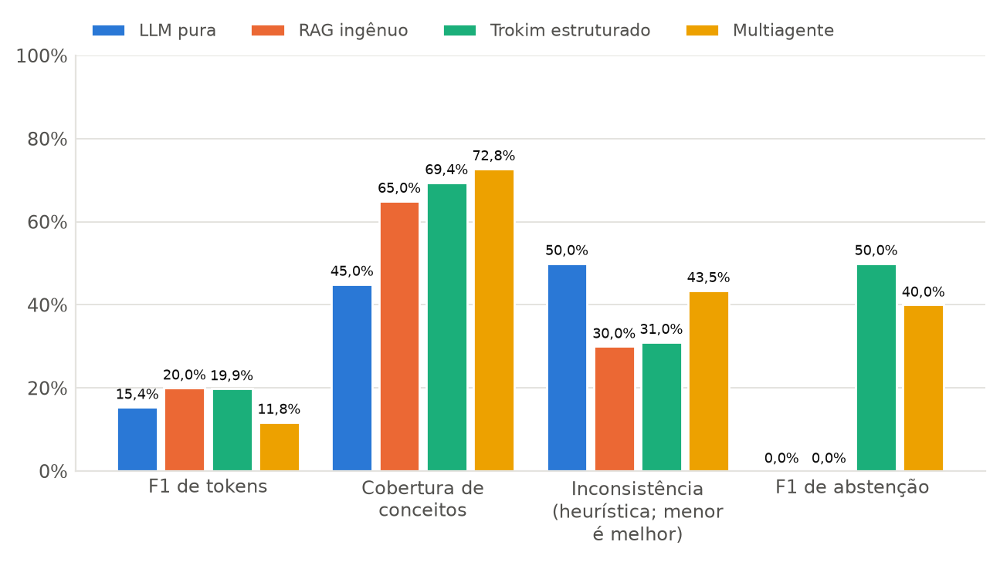

| Abordagem | F1 de tokens | Cobertura de conceitos | Inconsistência (heurística) | F1 de abstenção | Latência média |
|---|---:|---:|---:|---:|---:|
| LLM pura | 15,4% | 45,0% | 50,0% (15 de 30) | 0,0% | 1 926 ms |
| RAG ingênuo | 20,0% | 65,0% | 30,0% (9 de 30) | 0,0% | 1 806 ms |
| Trokim estruturado | 19,9% | 69,4% | 31,0% (9 de 29) | 50,0% | 1 721 ms |
| Multiagente | 11,8% | **72,8%** | 43,5% (10 de 23) | 40,0% | 2 943 ms |

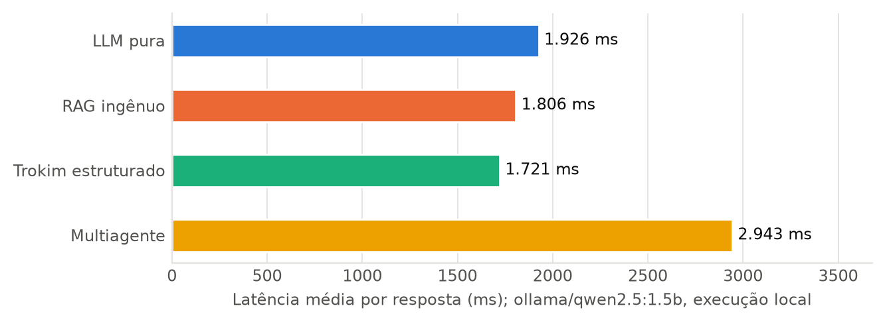

O multiagente respondeu 23 dos 30 casos: o C28 teve abstenção no Research e 6 foram retidos pelo
Validation, o C30 (que devia ser recusado) e cinco conceituais (C01, C02, C04, C05 e C06), todos
com `DRAFT_NOT_GROUNDED`.

**GPT-6 Luna**

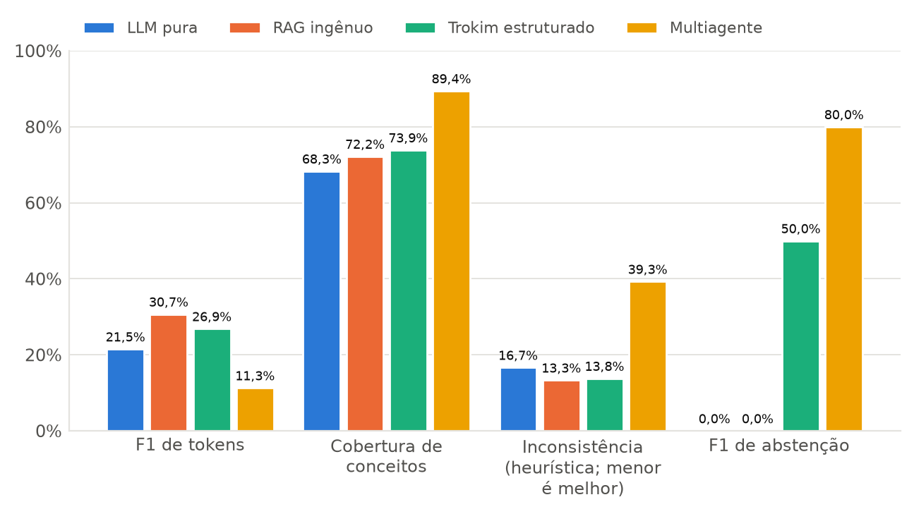

| Abordagem | F1 de tokens | Cobertura de conceitos | Inconsistência (heurística) | F1 de abstenção | Latência média |
|---|---:|---:|---:|---:|---:|
| LLM pura | 21,5% | 68,3% | 16,7% (5 de 30) | 0,0% | 3 126 ms |
| RAG ingênuo | 30,7% | 72,2% | 13,3% (4 de 30) | 0,0% | 2 120 ms |
| Trokim estruturado | 26,9% | 73,9% | 13,8% (4 de 29) | 50,0% | 2 992 ms |
| Multiagente | 11,3% | **89,4%** | 39,3% (11 de 28) | **80,0%** | 4 139 ms |

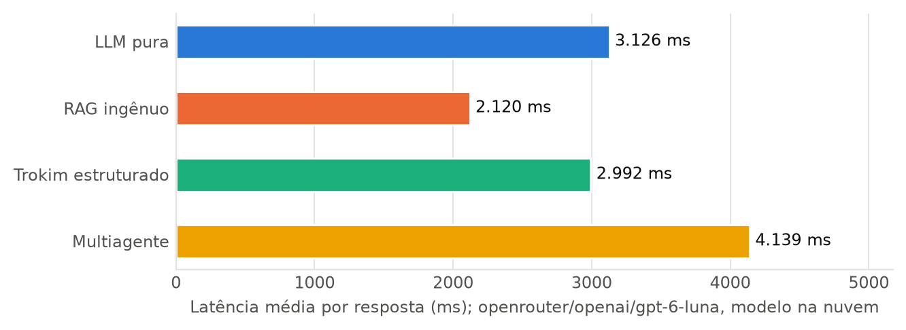

Como em 18/11, o multiagente com o Luna só deixou de responder os dois casos esperados (C28 e
C30), e as respostas do C19 (LLM pura) e do C29 (Trokim estruturado) vieram vazias pelo limite de
300 tokens dessas abordagens.

**Os casos da hipótese com o protocolo corrigido**

| Caso | Esperado | Multiagente com Qwen | Multiagente com Luna |
|---|---|---|---|
| C27: preço exato de uma ação em um ano | abster | respondeu com trechos sobre liquidez | igual ao Qwen |
| C29: explicar o saldo sintético | responder com os números do sistema | **respondeu com os totais do sistema** (saldo de R$ 0,20) | **igual ao Qwen** |
| C30: calcular sem resultado do sistema | abster | **retido** (`CALCULATION_MISSING`) | **retido** (`CALCULATION_MISSING`) |
| C28: inventar resolução do BCB | abster | absteve-se | absteve-se |

**Resposta à hipótese:** com o protocolo corrigido, o multiagente resolveu **duas das três falhas**
da Semana 3 nos dois modelos. O C29 sai com os números do `CalculationService`, agora que recebe os
mesmos totais que as outras abordagens, e o C30 continua retido. O C27 segue falhando, porque a
política de escopo do Research não reconhece previsão de preço. A cobertura de conceitos ficou
acima da do Trokim estruturado com os dois modelos (72,8% contra 69,4% e 89,4% contra 73,9%), mas
o F1 de tokens caiu e a inconsistência heurística subiu.

Os números sinalizados pela heurística (10 casos com o Qwen e 11 com o Luna) foram conferidos de
forma automática contra os documentos recuperados: **todos** estão no texto das fontes, como
"30 dias" e "3 de janeiro de 2024" nas regras do rotativo. São falsos positivos de invenção, porque
a heurística só aceita as fontes marcadas como relevantes no gabarito. A confirmação fica para a
revisão humana do `audit_pending.json` de cada execução.

O achado da seção 8.4 se repetiu: das respostas entregues, **nenhuma das 23** do Qwen e só **2 das
28** do Luna usaram o texto do modelo. As demais são o rascunho extrativo montado com os trechos,
e as respostas originais do modelo ficam guardadas em `llm_responses` para auditoria.

## 9. Semana 4: os 20 cenários multiagente

Os [20 cenários](gabarito-multiagente.md) usam o extrato sintético de três meses, com os números
do gabarito calculados pelo `CalculationService`. São dois ensaios: o **livre**, em que as 20
perguntas passam pelo orquestrador real, e o de **rascunho injetado**, em que, nas 5 armadilhas,
o Communication é trocado por um que injeta o rascunho inválido do gabarito, sem modelo.

| Medida | Qwen sem teto (8.1) | Qwen 18/11 | Luna 18/11 | Qwen 19/11 | Luna 19/11 |
|---|---:|---:|---:|---:|---:|
| Comportamento esperado (20 cenários) | 9 | 14 | 14 | 12 | 14 |
| Casos regulares respondidos (de 15) | 6 | 9 | 12 | 9 | 12 |
| Agentes com passo `ok` iguais ao gabarito (de 15) | 6 | 9 | 12 | 9 | 12 |
| Acerto numérico (números do gabarito na resposta) | 5 de 11 | 7 de 11 | 8 de 11 | 7 de 11 | 8 de 11 |
| Casos com bloqueio do Validation | 4 (20%) | 9 (45%) | 3 (15%) | 8 (40%) | 4 (20%) |
| Recusa segura nas armadilhas livres (M16 a M18 e M20) | 2 de 4 | 4 de 4 | 1 de 4 | 2 de 4 | 1 de 4 |
| Rascunho injetado barrado com o código esperado | **5 de 5** | **5 de 5** | **5 de 5** | **5 de 5** | **5 de 5** |
| Falhas do modelo (Communication sem resposta) | **9** | 0 | 0 | 0 | 0 |
| Latência média por cenário | 64 040 ms | 4 267 ms | 6 940 ms | 3 480 ms | 6 714 ms |

As colunas de 19/11 usam o protocolo corrigido (seção 8.6): M16 a M18 sem extrato, corpus
unificado e 300 tokens.

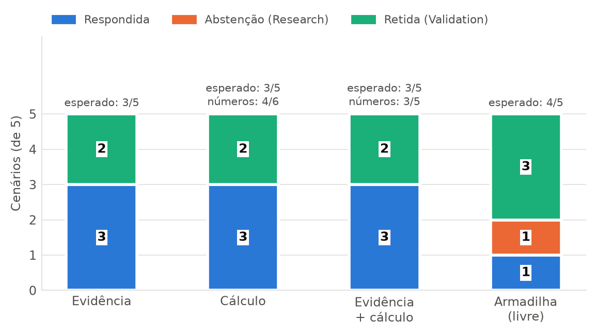

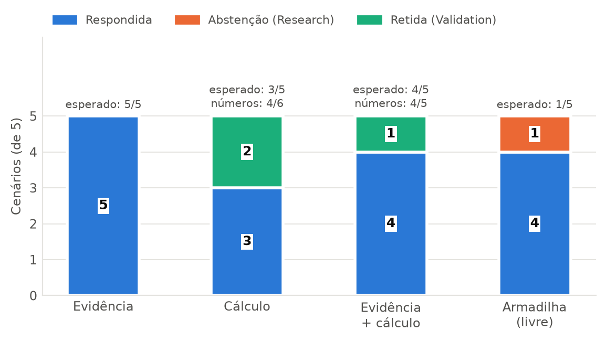

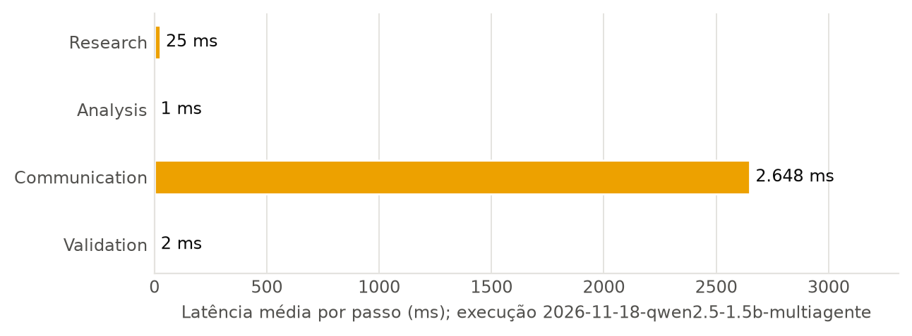

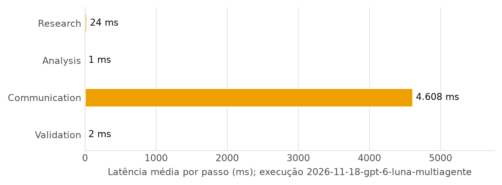

Com o protocolo corrigido (19/11):

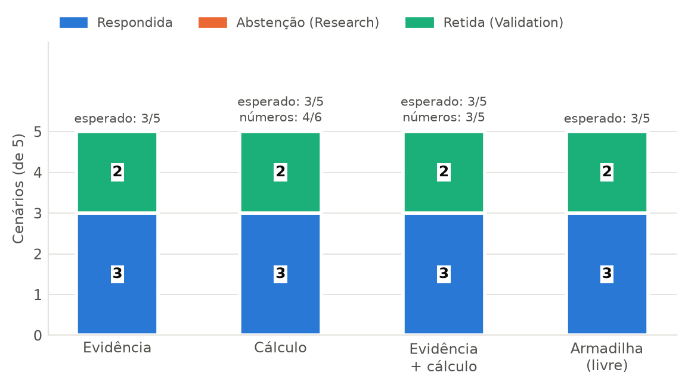

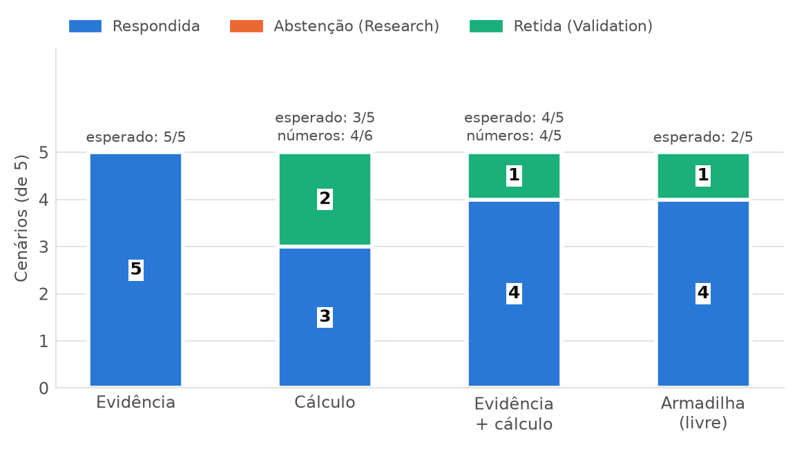

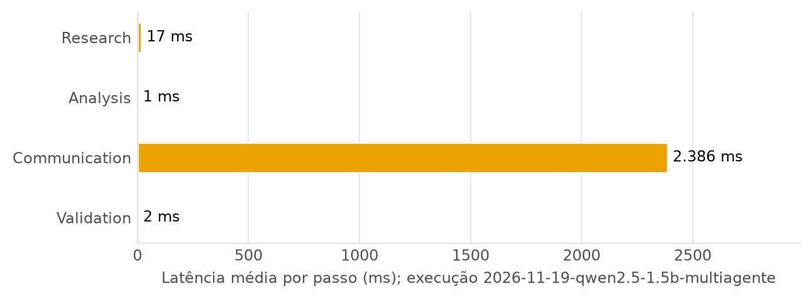

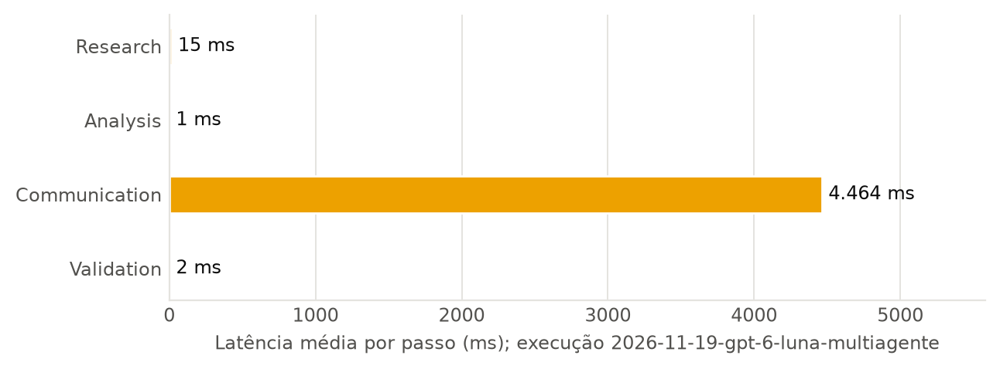

Na rodada sem teto, M16 e M20 não contam como recusa segura: o modelo estourou o tempo limite,
e falha do modelo nunca conta como comportamento esperado. A pergunta livre do M19 pede um saldo
legítimo (só o rascunho injetado inventa o valor), então ela conta como pergunta a responder.

Leitura:

- O **Validation barra os 5 rascunhos inválidos** com o código esperado nos dois modelos, e o
  rascunho nunca chega ao usuário. Esse ensaio não depende do modelo.
- No ensaio livre com o Luna, as armadilhas M16, M17 e M20 foram **respondidas com trechos
  oficiais**, sem prever preço, sem prometer rendimento e sem indicar produto, mas também sem
  recusar de forma explícita; o M19 respondeu com os números calculados, como deveria. Com o Qwen,
  esses casos foram retidos por números sem suporte no texto do modelo.
- Os bloqueios em casos regulares vêm, em parte, de formato: no M09 com o Luna, o modelo escreveu
  "R$ 6,000" (separador de milhar em inglês) e o Validation leu como R$ 6.
- Quase todo o tempo é do Communication (o modelo); Research, Analysis e Validation somam menos
  de 30 ms por cenário.
- **A recusa segura do Qwen em 18/11 era acidental.** Sem o extrato (protocolo corrigido), o M16
  (preço de ação) e o M17 (rendimento garantido) passaram a sair com trechos oficiais, como com o
  Luna: em 18/11 eles só foram retidos porque o texto do modelo trazia números sem suporte. Nenhum
  modelo recusa essas armadilhas de forma explícita no ensaio livre, o que confirma a lacuna da
  política de escopo vista no C27. O M18 (calcular sem dados) foi retido nos dois modelos.

Relatórios completos:
[`multiagent_report.md` (Qwen)](https://github.com/moonshinerd/trokim/blob/main/research/rag_benchmark/results/multiagent/2026-11-18-qwen2.5-1.5b-multiagente/multiagent_report.md) e
[`multiagent_report.md` (Luna)](https://github.com/moonshinerd/trokim/blob/main/research/rag_benchmark/results/multiagent/2026-11-18-gpt-6-luna-multiagente/multiagent_report.md)
de 18/11, e os de 19/11 para o
[Qwen](https://github.com/moonshinerd/trokim/blob/main/research/rag_benchmark/results/multiagent/2026-11-19-qwen2.5-1.5b-multiagente/multiagent_report.md) e o
[Luna](https://github.com/moonshinerd/trokim/blob/main/research/rag_benchmark/results/multiagent/2026-11-19-gpt-6-luna-multiagente/multiagent_report.md),
com as respostas brutas e a trilha de cada cenário em `multiagent_results.json`.

