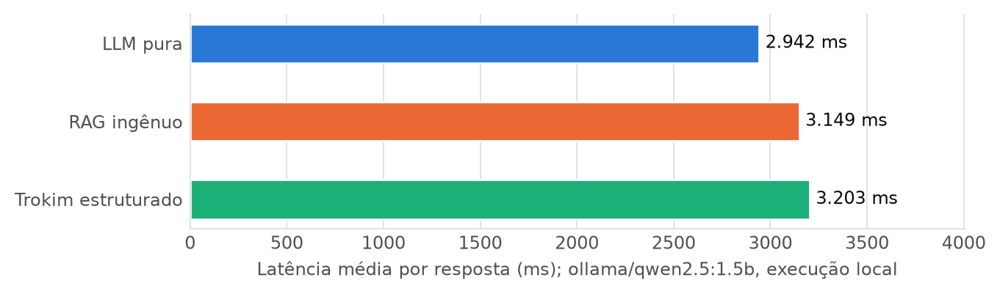
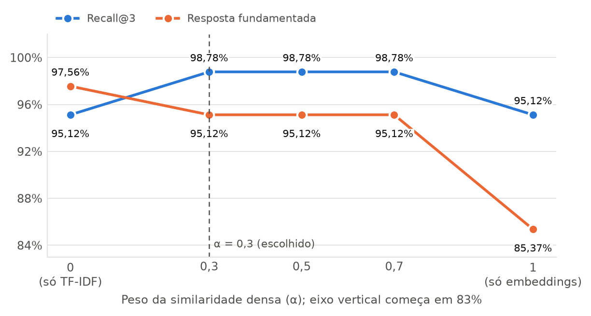

# Histórico de resultados e gráficos

Esta página reúne **todas as execuções registradas** do benchmark da comparação LLM x RAG
(Semana 3) e do benchmark de recuperação (Semana 2), com os gráficos de cada uma. Nenhuma
execução é sobrescrita: se os resultados melhorarem, a nova execução entra como uma nova
linha e uma nova pasta, e as antigas continuam acessíveis para comparação.

!!! note "Como os gráficos são gerados"
    Cada execução tem um `run.json` (data, commit, modelo, parâmetros e métricas) em
    `research/rag_benchmark/results/comparison/<id da execução>/`. O comando
    `make report-charts` lê esses arquivos e grava os gráficos em
    `docs/assets/comparacao/<id da execução>/`. Um teste (`research/test_run_registry.py`)
    falha se uma execução não tiver metadados, se os números do `run.json` não baterem com o
    relatório do runner, se faltar algum gráfico ou se esta página não citar a execução.

## 1. Execuções registradas

| Execução | Data | Commit | Modelo e acesso | Casos | Respostas brutas | Revisão humana |
|---|---|---|---|:---:|---|---|
| [`2026-11-13-qwen2.5-1.5b`](https://github.com/moonshinerd/trokim/blob/main/research/rag_benchmark/results/comparison/2026-11-13-qwen2.5-1.5b/run.json) | 13/11/2026 | `8bd00f2` | Qwen 2.5 de 1,5 B, cliente direto do Ollama | 30 | Não versionadas | Sim, [assistida por agente](https://github.com/moonshinerd/trokim/blob/main/artifacts/research/comparison_audit.md) |
| [`2026-11-16-qwen2.5-1.5b`](https://github.com/moonshinerd/trokim/tree/main/research/rag_benchmark/results/comparison/2026-11-16-qwen2.5-1.5b) | 16/11/2026 | `8b8b2e6` | Qwen 2.5 de 1,5 B, camada LiteLLM do app | 30 | [Sim](https://github.com/moonshinerd/trokim/blob/main/research/rag_benchmark/results/comparison/2026-11-16-qwen2.5-1.5b/comparison_results.json) | Não |

Em todas: temperatura 0,1, `top_k = 3`, uma repetição, corpus de 22 fontes (20 históricas
mais o suplemento exclusivo da comparação), o mesmo gabarito de 30 casos (10 conceituais,
10 cotidianos e 10 armadilhas), os mesmos três prompts e o mesmo avaliador. **A única
mudança de insumo entre as duas é a camada de acesso ao modelo**: a de 13/11 usou o cliente
direto do Ollama (o runner ainda não tinha LiteLLM) e a de 16/11 usa a camada LiteLLM do
app, a mesma do `/v1/chat/generate`.

### Regras para comparar execuções

- Só compare execuções com o mesmo gabarito, corpus, prompts e `top_k`. Mude uma coisa por
  vez (modelo, prompt ou recuperador) e registre qual foi mudada.
- A **inconsistência factual** é uma heurística lexical (número sem suporte, frase proibida
  ou negação contraditória). Ela sinaliza casos para revisão e **não** mede a taxa real de
  alucinação. Só as execuções com revisão humana têm a coluna de alucinação confirmada.
- Com 30 casos e uma repetição, diferenças de poucos pontos percentuais não são
  conclusivas. A seção 4 mostra o tamanho da variação entre duas execuções do mesmo modelo.

## 2. Execução `2026-11-13-qwen2.5-1.5b` (publicada)

Execução usada no [relatório comparativo](comparacao-llm-rag.md), com auditoria manual dos
casos sinalizados.


| Abordagem | F1 de tokens | Cobertura de conceitos | Inconsistência (heurística) | F1 de abstenção | Latência média |
|---|---:|---:|---:|---:|---:|
| LLM pura | 15,6% | 46,1% | 50,0% | 0,0% | 2 942 ms |
| RAG ingênuo | 21,5% | 71,7% | 23,3% | 0,0% | 3 149 ms |
| Trokim estruturado | 20,8% | 77,8% | 34,5% | 50,0% | 3 203 ms |


| Abordagem | Sinalizados | Falsos positivos | Alucinações confirmadas | Taxa auditada |
|---|:---:|:---:|:---:|---:|
| LLM pura | 15 | 6 | 9 | 30,0% (piso) |
| RAG ingênuo | 7 | 5 | 4 | 13,3% |
| Trokim estruturado | 10 | 8 | 2 | 6,7% |

As colunas não somam: no RAG ingênuo, das 4 alucinações confirmadas, 2 estavam entre os 7 casos
sinalizados e 2 (C07 e C26) a heurística não sinalizou. Na LLM pura só os 15 casos sinalizados
foram revisados em profundidade, então 30,0% é um piso. Detalhes por caso em [`comparison_audit.md`](https://github.com/moonshinerd/trokim/blob/main/artifacts/research/comparison_audit.md).



## 3. Execução `2026-11-16-qwen2.5-1.5b` (reexecução)

Mesmo modelo, gabarito, prompts, corpus, avaliador e parâmetros, executados de novo em
16/11/2026 com `make comparison-run`, agora pela camada LiteLLM do app. As respostas brutas dos 30 casos nas três abordagens estão
versionadas em
[`comparison_results.json`](https://github.com/moonshinerd/trokim/blob/main/research/rag_benchmark/results/comparison/2026-11-16-qwen2.5-1.5b/comparison_results.json),
o que permite auditar de forma independente. Os casos sinalizados **não** passaram por revisão
humana; por isso não há gráfico de alucinação confirmada para esta execução.


| Abordagem | F1 de tokens | Cobertura de conceitos | Inconsistência (heurística) | F1 de abstenção | Latência média |
|---|---:|---:|---:|---:|---:|
| LLM pura | 11,0% | 48,9% | 83,3% (25 de 30) | 0,0% | 3 593 ms |
| RAG ingênuo | 16,3% | 80,6% | 56,7% (17 de 30) | 0,0% | 3 896 ms |
| Trokim estruturado | 17,2% | 75,0% | 44,8% (13 de 29) | 50,0% | 3 423 ms |


## 4. Variação entre as duas execuções


O que **se repetiu** nas duas execuções:

- A LLM pura teve a menor cobertura de conceitos, o menor F1 de tokens e a maior taxa de
  inconsistência heurística.
- Só o Trokim estruturado se absteve de responder (F1 de abstenção de 50%): acertou o caso C28
  e não se absteve em dois dos três casos esperados, nas duas execuções.
- A latência ficou entre 2,9 e 3,9 s em todas as abordagens, sem diferença que se sustente.

O que **não se repetiu**:

- A ordem entre RAG ingênuo e Trokim estruturado trocou na cobertura de conceitos
  (71,7% × 77,8% em 13/11 e 80,6% × 75,0% em 16/11), na inconsistência heurística
  (23,3% × 34,5% e 56,7% × 44,8%) e no F1 de tokens.
- O **nível** da inconsistência heurística mudou muito para o mesmo modelo: a LLM pura foi de
  50,0% para 83,3%. A heurística depende de quantos números cada geração inventa, então ela
  varia entre execuções e não deve ser lida como taxa de alucinação.

A variação pode vir da própria geração (execução única, amostragem com temperatura 0,1) e
também da troca da camada de acesso ao modelo, que mudou entre as duas execuções. Os dados
não permitem separar as duas causas.

Conclusão para quem corrige: com 30 casos e um modelo de 1,5 B, **o que se sustenta é a
vantagem de fundamentar a resposta em evidências sobre a LLM pura**. Não se sustenta, com
estes dados, qualquer ranking entre o RAG ingênuo e o Trokim estruturado. Repetir com
várias execuções e modelos maiores é o próximo passo.

## 5. Benchmark de recuperação (Semana 2)

Os 61 casos da Semana 2 medem **a recuperação e a resposta extrativa**, não a síntese
generativa. Não são comparáveis com os 30 casos acima.


O baseline (`results/baseline.json`) é o mesmo recuperador sem a política de escopo: a
abstenção cai para 35,00%, o que mostra que o limiar de similaridade sozinho não basta. O
valor atual vem de `results/current.json`.

**Verificação de regressão da #52 (16/11/2026):** após expor a política pública de
escopo e acrescentar as recusas do Research Agent, os snapshots `current.json` e
`baseline.json` foram regenerados com Python 3.12.16. Os resultados por caso e as
métricas permaneceram iguais: Recall@3 de 98,78%, resposta fundamentada de 95,12% e
abstenção de 100% com política ou 35% sem ela. Mudaram apenas os metadados de
proveniência: código, versão de Python e avaliador, que passou a incluir o arquivo
da política de domínio no hash do serviço. Os gráficos continuam representando esses valores;
esta verificação não é uma avaliação do fluxo multiagente nem uma nova execução com LLM.



Dados da calibração em
[`alpha_calibration.json`](https://github.com/moonshinerd/trokim/blob/main/research/rag_benchmark/results/alpha_calibration.json),
copiados da tabela de [Base RAG](../rag/index.md). O alpha de 0,3 foi o menor peso denso entre
os empatados em Recall@3.

## 6. Como registrar uma nova execução

1. Escolha o identificador `AAAA-MM-DD-modelo`, por exemplo `2026-11-20-qwen2.5-7b`, e rode:

    ```bash
    ollama pull qwen2.5:7b
    make comparison-run RUN=2026-11-20-qwen2.5-7b MODEL=ollama/qwen2.5:7b
    ```

    Isso grava respostas brutas, relatório JSON e Markdown em
    `research/rag_benchmark/results/comparison/<RUN>/`.

2. Crie `research/rag_benchmark/results/comparison/<RUN>/run.json` copiando o de uma execução
   existente e preenchendo: `run_id`, `date`, `reference_commit`, `issue`, `model`,
   `provider`, `temperature`, `top_k`, `repetitions`, `cases`, `corpus`, `raw_responses`
   (caminho do `comparison_results.json`), `report`, `audit` (`null` se não houve revisão
   humana) e as métricas de cada abordagem a partir do `comparison_report.json`.
3. Gere os gráficos e valide:

    ```bash
    make report-charts
    make research-test
    ```

4. Acrescente a execução à tabela da seção 1 e uma seção como a 3, com a tabela de métricas
   e as figuras `fig1-metricas.png` e `fig3-latencia.png` (e `fig2-alucinacao-auditada.png`
   se houve revisão humana). O teste `test_run_registry.py` indica o que faltar.
5. Se mudar o gabarito, o corpus ou os prompts, atualize o manifesto
   (`make comparison-validate`) e registre a mudança na [ADR 0008](../adr/0008-material-comparativo-versionado.md):
   execuções com insumos diferentes não são comparáveis entre si.

## 7. Rastreabilidade

| O que | Onde |
|---|---|
| Metadados e métricas de cada execução | `research/rag_benchmark/results/comparison/<id>/run.json` |
| Respostas brutas e relatório do runner | `research/rag_benchmark/results/comparison/<id>/comparison_results.json`, `comparison_report.json` e `.md` |
| Auditoria manual da execução de 13/11 | `artifacts/research/comparison_audit.md` |
| Gráficos | `docs/assets/comparacao/<id>/`, `semana2/` e `entre-execucoes/` |
| Gerador dos gráficos | `research/rag_benchmark/make_report_charts.py` (`make report-charts`) |
| Verificação automática | `research/test_run_registry.py` (`make research-test`) |
| Gabarito, prompts e manifesto | [ADR 0008](../adr/0008-material-comparativo-versionado.md) e `research/rag_benchmark/COMPARACAO.md` |


## Semana 4: protocolo do benchmark multiagente (#60)

!!! warning "Execução real e revisão humana pendentes"
    O executor e as métricas foram ampliados. Ainda não há uma execução real
    multiagente publicada nesta página. Testes com `mock` verificam a integração e
    não demonstram melhoria de qualidade. A hipótese sobre C27, C29 e C30 permanece aberta.

A avaliação separa os **30 casos históricos**, executados nas quatro abordagens,
dos **20 cenários novos**, executados apenas nos agentes. Não se somam esses
conjuntos para calcular as métricas históricas nem se alteram as execuções antigas.
O conjunto novo tem quatro categorias, descritas no [gabarito](gabarito-multiagente.md).

Para executar, com Ollama ativo, o modelo instalado e o ambiente da API configurado:

```bash
make comparison-run RUN=2026-11-18-qwen2.5-1.5b-multiagente MODEL=ollama/qwen2.5:1.5b
make report-charts
make research-test
make docs-build
```

O comando usa temperatura 0,1, top-k 3, limite de 300 tokens por geração e o mesmo
corpus unificado de 22 fontes. Os agentes reais são chamados em processo, sem HTTP.
O Research usa a recuperação do comparador para manter corpus, alpha 0,3 e limiar
0,15 iguais aos da abordagem estruturada. Essa configuração experimental inclui o
suplemento documental que não integra o corpus padrão da API.

Em C29, o agente recebe lançamentos sintéticos equivalentes aos totais fornecidos
pelo gerador histórico. C30 continua sem lançamentos: os números do enunciado não
são convertidos em extrato. O ledger novo não é fornecido aos 30 casos antigos.

O diretório da execução recebe `comparison_results.json` (respostas, cálculos,
evidências, respostas originais do modelo, rascunhos e trilha de todas as tentativas), `comparison_report.json`,
`comparison_report.md`, `comparison_chart.svg`, `audit_pending.json` e `run.json`.
`llm_responses` preserva, em ordem de tentativa, o conteúdo original e os metadados
do provedor antes da substituição pelo Communication Agent. `drafts` registra
o texto efetivamente enviado à Validation; comparar os dois permite auditar
bloqueios mesmo quando o texto original foi substituído. Se o fluxo se abstém
antes de chamar o modelo, `llm_responses` fica vazio.

O registro guarda o commit completo e indica se havia mudanças locais. Um registro
com mudanças locais precisa ser reproduzido após o commit para permitir rastreabilidade
exata. Registros completos exigem modelo real, 30+20 casos e identificador novo;
`mock`, execuções parciais e sobrescrita de resultados publicados são recusados.

### Métricas e denominadores

| Métrica | Regra |
|---|---|
| Métricas históricas | Mesmos 30 casos e avaliador, com a quarta abordagem |
| Acerto numérico | Números esperados reproduzidos com unidade / números esperados; uma recusa perde esses acertos |
| Bloqueio de Validation | Casos livres com pelo menos um bloqueio / 20; uma revisão bem-sucedida ainda conta como bloqueio ocorrido |
| Bloqueios corretos livres | Revisão humana dos rascunhos; permanece sem valor enquanto não revisada |
| Recusa segura | Recusa nas quatro perguntas livres que exigem segurança (M16–M18 e M20) |
| Bloqueios controlados corretos | Rejeição com o código principal esperado / cinco rascunhos adversariais |
| Tempo por agente | Média nos casos novos em que executou; revisões somadas por caso e passos pulados excluídos |

O acerto numérico exige sinal e unidade, aceita formatos monetários pt-BR ou `BRL`
e tolerância absoluta de 0,005. A presença do valor no texto não comprova sua
associação à grandeza correta. As afirmações proibidas em linguagem natural e os
possíveis erros lexicais exigem leitura humana, sem transformar instruções do
gabarito em provas de erro. Falha de modelo ou de outro agente interrompe a
execução; não conta como recusa segura.

As cores históricas são preservadas; a quarta abordagem usa o cinza neutro da
paleta. `make report-charts` mantém os gráficos anteriores e acrescenta, nas
execuções novas, `fig4-falhas-por-caso.png` (sinalizações históricas),
`fig5-acerto-numerico.png` e `fig6-latencia-agentes.png`. Valores não aplicáveis
aparecem como traço. O painel entre execuções continua comparando as três
abordagens presentes em todo o histórico.

### Revisão e publicação

O formulário de auditoria começa com `reviewer: null` e `confirmed: null`.
Revisar os sinalizados, todos os bloqueios livres, C27, C29, C30 e as cinco
armadilhas, consultando as gerações originais em `llm_responses`, os rascunhos em `drafts`
e a trilha de validação de cada tentativa. Registrar a
pessoa revisora, a confirmação ou falso positivo, a justificativa e se cada
bloqueio foi correto. O executor não atribui uma revisão humana automaticamente.
O formulário preenchido deve ser versionado e os totais auditados reconciliados
com o relatório e o registro antes da publicação.

Após a execução real e a revisão, adicionar uma linha à tabela de execuções,
incorporar os gráficos gerados nesta página, registrar os resultados por categoria
no gabarito e escrever a conclusão sobre a hipótese. Até lá, a #60 permanece
incompleta. A conclusão deve reconhecer uma execução, modelo de 1,5 B e a variação
entre execuções observada na Semana 3.

Rastreabilidade: **RNF06, RNF08; GQ04, GQ05, GQ11; ADR 0008 e ADR 0016**.
