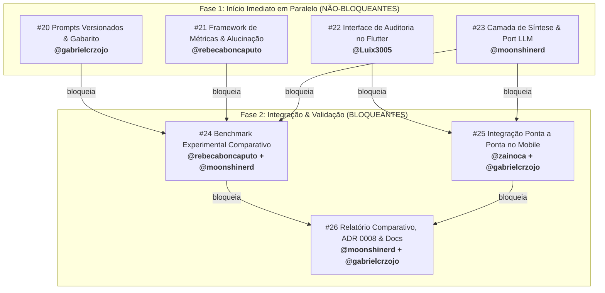

# Planejamento e Roadmap do Projeto

O desenvolvimento do **Trokim** segue a metodologia **Challenge Based Learning (CBL)** ao longo de 7 semanas, alinhado à disciplina TIC-IA 2026.

---

## 1. Roadmap Oficial das 7 Semanas

| Semana | Foco Temático | Entregável Oficial | Status no Trokim | Período |
|:---:|---|---|:---:|:---:|
| **Semana 1** | Problema, stakeholders, riscos e métricas | Pacote de definição do projeto (cenário, personas, requisitos v1.0.0, riscos, premissas e EQ) | Concluído | 26/10 a 30/10 |
| **Semana 2** | Base de conhecimento e recuperação | **Base de conhecimento + protótipo de recuperação:** Base curada com 20 documentos-fonte; chunking semântico; embeddings FastEmbed 384d; banco SQLite-Vec; chat Flutter e benchmark (98,78% Recall@3) | Concluído | 02/11 a 06/11 |
| **Semana 3** | **Comparação LLM x RAG** | **Assistente baseado em evidências + relatório comparativo:** Avaliação empírica estruturada (LLM pura vs. LLM + RAG ingênuo vs. LLM + RAG estruturado do Trokim), métricas de alucinação e síntese generativa | Sprint Ativa | **09/11 a 13/11** |
| **Semana 4** | Sistema multiagentes | Primeiro protótipo multiagente (Research, Analysis, Validation e Communication Agent) | Previsto | 16/11 a 20/11 |
| **Semana 5** | Multimodalidade | Assistente multimodal (leitura de faturas PDF, extratos e comprovantes em imagem) | Previsto | 23/11 a 27/11 |
| **Semana 6** | Integração completa | Aplicação funcional ponta a ponta (Flutter + FastAPI + RAG + Banco Vetorial + Multiagente) | Previsto | 30/11 a 04/12 |
| **Semana 7** | Testes e refinamento | Apresentação final e entrega consolidada do projeto e repositório | Previsto | 07/12 a 11/12 |

---

## 2. Detalhamento da Semana 3 (Sprint Ativa — Foco Atual)

Conforme a ementa oficial do Challenge 2, o entregável da **Semana 3 (09/11 a 13/11)** é:

> **ENTREGA DA SEMANA 3:** *Comparação LLM x RAG — Respostas baseadas em evidências: Assistente baseado em evidências + relatório comparativo avaliando LLM pura vs. LLM com RAG ingênuo vs. LLM com RAG estruturado do Trokim, com métricas de alucinação factual, relevância e abstenção ética.*

### Checklist de Cobertura da Entrega 3 (Prazo: Sexta-feira, 13/11/2026)

- [ ] **Prompts Versionados da Semana 3:** Templates estruturados em `api/app/prompts/` cobrindo LLM pura (`prompt_llm_pure_v1.txt`), RAG ingênuo (`prompt_naive_rag_v1.txt`) e Trokim estruturado (`prompt_trokim_grounded_v1.txt`).
- [ ] **Gabarito Empírico de 30 Perguntas:** Dataset `questions_comparison.json` contendo dúvidas conceituais, cenários cotidianos e armadilhas deliberadas de alucinação financeira.
- [ ] **Framework de Métricas de Alucinação:** Script `eval_comparison.py` com cálculo de Token-level F1 (SQuAD), Concept Coverage Recall, Factual Inconsistency Rate (%) e Abstention F1.
- [ ] **Camada de Síntese Generativa Local-First:** Port abstrato `LLMProvider` com adaptadores para Ollama local e Mock para testes determinísticos (ADR 0008).
- [ ] **Endpoint REST Tipado:** `POST /v1/chat/generate` retornando resposta sintetizada, evidências citadas e status de fundamentação.
- [ ] **Interface Mobile com Cartões de Evidência:** Módulo no Flutter com visualização nativa de citações, score de confiança e links governamentais clicáveis.
- [ ] **Relatório Comparativo Formal:** Publicação em `docs/pesquisa/comparacao-llm-rag.md` com tabelas, gráficos de dispersão e análise de casos de alucinação.
- [ ] **ADR 0008:** Registro formal da decisão de síntese generativa, controle de alucinação e fallback local.

### Entregas de Interface (fora do checklist da ementa)

Redesenho da identidade visual do app e do MkDocs, centralizado no PR #43: paleta Champagne, Tidewater e Fortuna Gold com tema claro/escuro pelo sistema ([#38](https://github.com/moonshinerd/trokim/issues/38)), aba de Ajustes ([#39](https://github.com/moonshinerd/trokim/issues/39)), abertura com moeda 3D e mascote onça-pintada ([#40](https://github.com/moonshinerd/trokim/issues/40)), rolagem sem esticar e toolchain Android ([#41](https://github.com/moonshinerd/trokim/issues/41)) e MkDocs repaginado ([#42](https://github.com/moonshinerd/trokim/issues/42)). Registradas nas ADRs 0009 a 0012 e nos requisitos RF15, RNF10 e RNF11. O histórico de conversas com título gerado pelo LLM local (RF16, [#45](https://github.com/moonshinerd/trokim/issues/44)) está planejado.

---

## 3. Planejamento Operacional: Estratégia de Não-Ociosidade

Para garantir que nenhum membro da equipe fique ocioso aguardando entregas de terceiros, a sprint da Semana 3 foi estruturada em **duas fases estritas**:

1. **Fase 1 (Início Imediato em Paralelo — Tarefas Não-Bloqueantes):** Cada um dos 4 membros da equipe possui uma tarefa independente atribuída no GitHub, podendo iniciar a implementação simultaneamente na segunda-feira.
2. **Fase 2 (Integração e Fechamento — Tarefas Bloqueantes):** Conforme as bases de prompts, métricas, UI mobile e backend são concluídas, a equipe integra o benchmark experimental, a conexão ponta a ponta e a documentação final.

---

## 4. Matriz de Tarefas, Responsabilidades e Issues (Milestone 2)

Todas as tarefas estão formalizadas no GitHub e vinculadas à **Milestone "Semana 3 — Comparação LLM x RAG (Respostas Baseadas em Evidências)"**, com prazo fatal até **13/11/2026**:

| Issue | Escopo / Título no GitHub | Responsável Primário | Tipo de Precedência | Dependência Técnica | Status |
|:---:|---|:---:|:---:|---|:---:|
| [#20](https://github.com/moonshinerd/trokim/issues/20) | Curadoria do gabarito comparativo e prompts versionados da semana 3 | @gabrielcrzojo | **Não-bloqueante** | Nenhuma (Início imediato) | Aberta |
| [#21](https://github.com/moonshinerd/trokim/issues/21) | Framework de avaliação de alucinação e métricas comparativas | @rebecaboncaputo | **Não-bloqueante** | Nenhuma (Início imediato) | Aberta |
| [#22](https://github.com/moonshinerd/trokim/issues/22) | Interface de auditoria de evidências e comparador de respostas no Flutter | @Luix3005 | **Não-bloqueante** | Nenhuma (Início imediato) | Aberta |
| [#23](https://github.com/moonshinerd/trokim/issues/23) | Camada de síntese generativa (port LLMProvider, Ollama/Mock e endpoint) | @moonshinerd | **Não-bloqueante** | Nenhuma (Início imediato) | Aberta |
| [#24](https://github.com/moonshinerd/trokim/issues/24) | Benchmark experimental comparativo (LLM pura vs. Naive RAG vs. Trokim) | @rebecaboncaputo, @moonshinerd | **Bloqueante** | **Bloqueada por #20, #21 e #23** | Aguardando Fase 1 |
| [#25](https://github.com/moonshinerd/trokim/issues/25) | Integração ponta a ponta do chat generativo fundamentado com o backend | @zainoca, @gabrielcrzojo | **Bloqueante** | **Bloqueada por #22 e #23** | Aguardando Fase 1 |
| [#26](https://github.com/moonshinerd/trokim/issues/26) | Relatório comparativo LLM x RAG, ADR 0008 e atualização no MkDocs | @moonshinerd, @gabrielcrzojo | **Bloqueante** | **Bloqueada por #24 e #25** | Aguardando Fase 2 |

---

## 5. Histórico e Entregáveis Concluídos (Semanas 1 e 2)

### Semana 2 — Base de Conhecimento e Primeiro RAG (Concluída em 06/11/2026)
- [x] Curadoria de 20 documentos oficiais regulatórios (BCB, CVM, CFPB, ANPD) com catálogo e hashes SHA-256 ([ADR 0006](adr/0006-curadoria-benchmark.md)).
- [x] Banco vetorial local com `sqlite-vec` (tabela virtual `vec0`) e embeddings FastEmbed multilíngues de 384 dimensões ([ADR 0007](adr/0007-banco-vetorial-embeddings.md)).
- [x] Busca híbrida densa/léxica com calibração $\alpha = 0,3$ atingindo 98,78% de Recall@3 e 100% de abstenção ética.
- [x] Endpoint `POST /v1/chat/ask` tipado e interface conversacional inicial no Flutter.
- [x] Gerador sintético de extratos OFX e faturas PDF aderente à LGPD em `research/synthetic_data/`.

### Semana 1 — Concepção e Fundamentos (Concluída em 30/10/2026)
- [x] Definição da Essential Question e 10 Guiding Questions (GQ01 a GQ10).
- [x] Matriz de riscos e mitigação, requisitos MoSCoW e modelagem C4 Model (Nível 2).
- [x] Formalização das ADRs 0001 a 0005.
