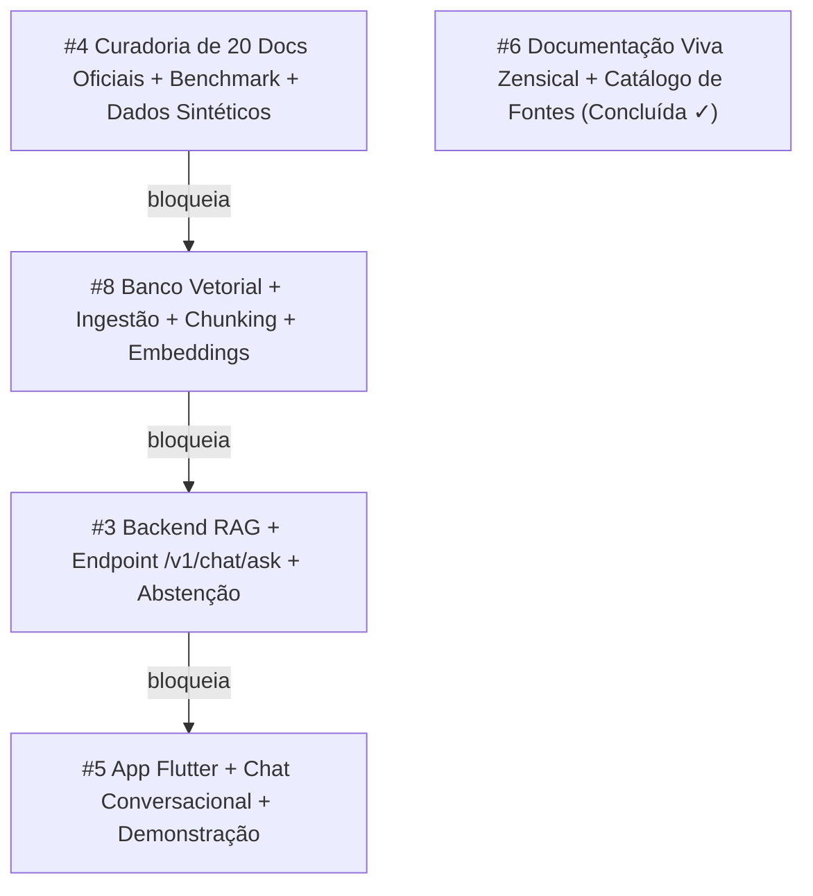

# Planejamento e Roadmap do Projeto

O desenvolvimento do **Trokim** segue a metodologia **Challenge Based Learning (CBL)** ao longo de 7 semanas, alinhado à disciplina TIC-IA 2026.

---

## 1. Roadmap Oficial das 7 Semanas

| Semana | Foco Temático | Entregável Oficial | Status no Trokim |
|---|---|---|---|
| **Semana 1** | Problema, stakeholders, riscos e métricas | Pacote de definição do projeto (cenário, personas, requisitos, riscos, premissas e EQ) | Concluído |
| **Semana 2** | Base de conhecimento e recuperação | **Base de conhecimento + protótipo de recuperação:** Base curada com pelo menos 20 documentos-fonte; estratégias de chunking e embeddings; banco vetorial; diagrama de arquitetura e ingestão. Consulta recuperando trechos relevantes | Em Execução |
| **Semana 3** | Comparação LLM x RAG | Assistente baseado em evidências + relatório comparativo (LLM puro vs LLM+RAG vs LLM+RAG estruturado) | Previsto |
| **Semana 4** | Sistema multiagentes | Primeiro protótipo multiagente (Research, Analysis, Validation e Communication Agent) | Previsto |
| **Semana 5** | Multimodalidade | Assistente multimodal (leitura de faturas PDF, extratos e comprovantes em imagem) | Previsto |
| **Semana 6** | Integração completa | Aplicação funcional ponta a ponta (Flutter + FastAPI + RAG + Banco Vetorial + Multiagente) | Previsto |
| **Semana 7** | Testes e refinamento | Apresentação final e entrega consolidada do projeto e repositório | Previsto |

---

## 2. Detalhamento e Entregáveis da Semana 2 (Foco Atual)

Conforme a ementa oficial do Challenge 2, o entregável da **Semana 2 (02/11 a 06/11)** é:

> **ENTREGA DA SEMANA 2:** *Base de conhecimento + protótipo de recuperação: Base curada com pelo menos 20 documentos-fonte; descrição das estratégias de chunking e embeddings; banco vetorial implementado; diagrama de arquitetura e pipeline de ingestão. Na demonstração, uma consulta deve recuperar trechos relevantes.*

### Checklist de Cobertura da Entrega

- [x] **Base Curada com >= 20 Documentos:** 20 passagens estruturadas de órgãos oficiais ([BCB](https://www.bcb.gov.br), [CVM](https://www.gov.br/investidor), [CFPB](https://www.consumerfinance.gov), [ANPD/LGPD](https://www.gov.br/anpd/pt-br)) em `research/knowledge_base/` com metadados de fonte e citação direta.
- [x] **Estratégias de Chunking e Embeddings:** Documentação em [rag/index.md](rag/index.md) detalhando chunking semântico com preservação de metadados e vetorização.
- [x] **Banco Vetorial Implementado:** Armazenamento vetorial local-first indexado para buscas por proximidade de cosseno.
- [x] **Diagrama de Ingestão e Arquitetura:** Diagramas Mermaid do pipeline de ingestão e recuperação em [rag/index.md](rag/index.md) e [arquitetura/index.md](arquitetura/index.md).
- [x] **Consulta e Demonstração Funcional:** Endpoint `/v1/chat/ask` e interface Flutter exibindo respostas fundamentadas com cartões de fonte oficial e recusa ativa para perguntas fora de escopo.
- [x] **Dados Sintéticos e LGPD:** Gerador sintético em `research/synthetic_data/` produzindo extratos `.ofx` e faturas `.pdf` para validação sem expor dados reais.

---

## 3. Grafo de Precedência Técnica (*Blocked By*)

A execução da Semana 2 é dividida em duplas especializadas com dependências técnicas formalizadas nativamente no GitHub:

---

## 4. Matriz de Tarefas, Responsabilidades e Dependências

| Issue | Escopo / Título | Responsáveis | Precedência Técnica | Status |
|---|---|---|---|---|
| [#6](https://github.com/moonshinerd/trokim/issues/6) | Documentação Viva e Fontes Clicáveis | @moonshinerd | Nenhuma | Concluída (PR #7) |
| [#4](https://github.com/moonshinerd/trokim/issues/4) | Curadoria de 20 Documentos Oficiais e Benchmark | @rebecaboncaputo, @gabrielcrzojo | **Nenhuma** (Ponto de partida) | Em Execução |
| [#8](https://github.com/moonshinerd/trokim/issues/8) | Banco Vetorial e Pipeline de Ingestão | @rebecaboncaputo, @moonshinerd | **Bloqueada por #4** | Em Execução |
| [#3](https://github.com/moonshinerd/trokim/issues/3) | Pipeline de Recuperação e Endpoint `/v1/chat/ask` | @Luix3005, @moonshinerd | **Bloqueada por #8 e #4** | Em Execução |
| [#5](https://github.com/moonshinerd/trokim/issues/5) | Interface Conversacional e Demonstração no Flutter | @Luix3005, @gabrielcrzojo | **Bloqueada por #3** | Em Execução |
