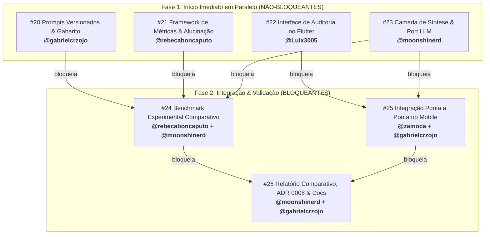
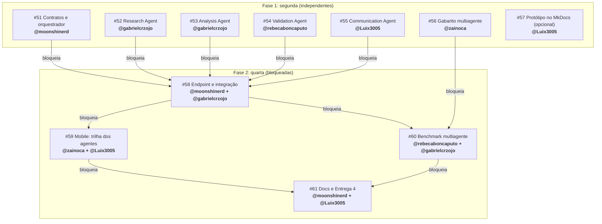
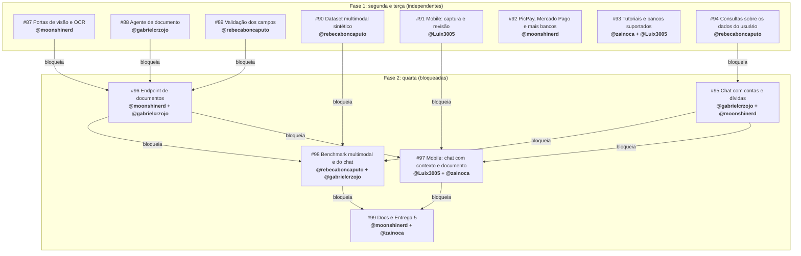

# Planejamento e Roadmap do Projeto

O desenvolvimento do **Trokim** segue a metodologia **Challenge Based Learning (CBL)** ao longo de 7 semanas, alinhado à disciplina TIC-IA 2026.

---

## 1. Roadmap Oficial das 7 Semanas

| Semana | Foco Temático | Entregável Oficial | Status no Trokim | Período |
|:---:|---|---|:---:|:---:|
| **Semana 1** | Problema, stakeholders, riscos e métricas | Pacote de definição do projeto (cenário, personas, requisitos v1.0.0, riscos, premissas e EQ) | Concluído | 26/10 a 30/10 |
| **Semana 2** | Base de conhecimento e recuperação | **Base de conhecimento + protótipo de recuperação:** Base curada com 20 documentos-fonte; chunking semântico; embeddings FastEmbed 384d; banco SQLite-Vec; chat Flutter e benchmark (98,78% Recall@3) | Concluído | 02/11 a 06/11 |
| **Semana 3** | **Comparação LLM x RAG** | **Assistente baseado em evidências + relatório comparativo:** Avaliação empírica estruturada (LLM pura vs. LLM + RAG ingênuo vs. LLM + RAG estruturado do Trokim), métricas de alucinação e síntese generativa | Concluído | **09/11 a 13/11** |
| **Semana 4** | Sistema multiagentes | Primeiro protótipo multiagente (Research, Analysis, Validation e Communication Agent) | Concluída | 16/11 a 20/11 |
| **Semana 5** | Multimodalidade | Assistente multimodal (leitura de faturas PDF, extratos e comprovantes em imagem) | Sprint Ativa | 23/11 a 27/11 |
| **Semana 6** | Integração completa | Aplicação funcional ponta a ponta (Flutter + FastAPI + RAG + Banco Vetorial + Multiagente) | Previsto | 30/11 a 04/12 |
| **Semana 7** | Testes e refinamento | Apresentação final e entrega consolidada do projeto e repositório | Previsto | 07/12 a 11/12 |

---

## 2. Detalhamento da Semana 3 (Concluída em 16/11/2026)

Conforme a ementa oficial do Challenge 2, o entregável da **Semana 3 (09/11 a 13/11)** é:

> **ENTREGA DA SEMANA 3:** *Comparação LLM x RAG — Respostas baseadas em evidências: Assistente baseado em evidências + relatório comparativo avaliando LLM pura vs. LLM com RAG ingênuo vs. LLM com RAG estruturado do Trokim, com métricas de alucinação factual, relevância e abstenção ética.*

### Checklist de Cobertura da Entrega 3 (Prazo: Sexta-feira, 13/11/2026)

- [x] **Prompts Versionados da Semana 3:** Templates estruturados em `api/app/prompts/` cobrindo LLM pura (`prompt_llm_pure_v1.txt`), RAG ingênuo (`prompt_naive_rag_v1.txt`) e Trokim estruturado (`prompt_trokim_grounded_v1.txt`).
- [x] **Gabarito Empírico de 30 Perguntas:** Dataset `questions_comparison.json` contendo dúvidas conceituais, cenários cotidianos e armadilhas deliberadas de alucinação financeira.
- [x] **Framework de Métricas de Alucinação:** Script `eval_comparison.py` com cálculo de Token-level F1 (SQuAD), Concept Coverage Recall, Factual Inconsistency Rate (%) e Abstention F1.
- [x] **Camada de Síntese Generativa Local-First:** Port abstrato `LLMProvider` com adaptadores LiteLLM (padrão), Ollama local e Mock para testes determinísticos ([ADR 0009](adr/0009-sintese-generativa-local.md)).
- [x] **Endpoint REST Tipado:** `POST /v1/chat/generate` retornando resposta sintetizada, evidências citadas e status de fundamentação.
- [x] **Interface Mobile com Cartões de Evidência:** Módulo no Flutter com visualização nativa de citações, score de confiança e links governamentais clicáveis.
- [x] **Relatório Comparativo Formal:** Publicação em `docs/pesquisa/comparacao-llm-rag.md` com tabelas, gráficos e análise de casos de alucinação, e resultados auditáveis em `research/rag_benchmark/results/comparison/`.
- [x] **ADRs 0008 e 0009:** Material comparativo versionado ([0008](adr/0008-material-comparativo-versionado.md)) e síntese generativa local com limites de fundamentação ([0009](adr/0009-sintese-generativa-local.md)).

**Pendências assumidas da Semana 3** (não bloqueiam a entrega, mas não estão concluídas):

- Homologação ponta a ponta do chat generativo em aparelho Android real, com o roteiro de `mobile/VALIDACAO_CHAT_GENERATIVO.md`.
- Revisão humana independente e cega das respostas do experimento comparativo e repetição com modelos maiores e várias execuções.
- Persistência em SQLite dos lançamentos importados (hoje ficam na memória da API; [ADR 0015](adr/0015-dados-reais-importacao-e-endereco-da-api.md)).
- Ata 04 só será criada quando houver reunião de validação efetivamente realizada.

### Entregas de Interface (fora do checklist da ementa)

Redesenho da identidade visual do app e do MkDocs, centralizado no PR #43: paleta Champagne, Tidewater e Fortuna Gold com tema claro/escuro pelo sistema ([#38](https://github.com/moonshinerd/trokim/issues/38)), aba de Ajustes ([#39](https://github.com/moonshinerd/trokim/issues/39)), abertura com moeda 3D e mascote onça-pintada ([#40](https://github.com/moonshinerd/trokim/issues/40)), rolagem sem esticar e toolchain Android ([#41](https://github.com/moonshinerd/trokim/issues/41)) e MkDocs repaginado ([#42](https://github.com/moonshinerd/trokim/issues/42)). Registradas nas ADRs 0009 a 0012 e nos requisitos RF15, RNF10 e RNF11. O histórico de conversas com título gerado pelo LLM local (RF16, [#45](https://github.com/moonshinerd/trokim/issues/44)) está planejado.

---

## 3. Planejamento Operacional: Estratégia de Não-Ociosidade

Para garantir que nenhum membro da equipe fique ocioso aguardando entregas de terceiros, a sprint da Semana 3 foi estruturada em **duas fases estritas**:

1. **Fase 1 (Início Imediato em Paralelo — Tarefas Não-Bloqueantes):** Cada um dos 4 membros da equipe possui uma tarefa independente atribuída no GitHub, podendo iniciar a implementação simultaneamente na segunda-feira.
2. **Fase 2 (Integração e Fechamento — Tarefas Bloqueantes):** Conforme as bases de prompts, métricas, UI mobile e backend são concluídas, a equipe integra o benchmark experimental, a conexão ponta a ponta e a documentação final.

---

## 4. Matriz de Tarefas, Responsabilidades e Issues (Milestone 2)

Todas as tarefas estão formalizadas no GitHub e vinculadas à **Milestone "Semana 3 — Comparação LLM x RAG (Respostas Baseadas em Evidências)"**, com prazo original em **13/11/2026**. A milestone foi encerrada em 16/11/2026, com todas as issues fechadas:

| Issue | Escopo / Título no GitHub | Responsável Primário | Tipo de Precedência | Dependência Técnica | Status |
|:---:|---|:---:|:---:|---|:---:|
| [#20](https://github.com/moonshinerd/trokim/issues/20) | Curadoria do gabarito comparativo e prompts versionados da semana 3 | @gabrielcrzojo | **Não-bloqueante** | Nenhuma (Início imediato) | Concluída |
| [#21](https://github.com/moonshinerd/trokim/issues/21) | Framework de avaliação de alucinação e métricas comparativas | @rebecaboncaputo | **Não-bloqueante** | Nenhuma (Início imediato) | Concluída |
| [#22](https://github.com/moonshinerd/trokim/issues/22) | Interface de auditoria de evidências e comparador de respostas no Flutter | @Luix3005 | **Não-bloqueante** | Nenhuma (Início imediato) | Concluída |
| [#23](https://github.com/moonshinerd/trokim/issues/23) | Camada de síntese generativa (port LLMProvider, Ollama/Mock e endpoint) | @moonshinerd | **Não-bloqueante** | Nenhuma (Início imediato) | Concluída |
| [#24](https://github.com/moonshinerd/trokim/issues/24) | Benchmark experimental comparativo (LLM pura vs. Naive RAG vs. Trokim) | @rebecaboncaputo, @moonshinerd | **Bloqueante** | **Bloqueada por #20, #21 e #23** | Concluída |
| [#25](https://github.com/moonshinerd/trokim/issues/25) | Integração ponta a ponta do chat generativo fundamentado com o backend | @zainoca, @gabrielcrzojo | **Bloqueante** | **Bloqueada por #22 e #23** | Concluída |
| [#26](https://github.com/moonshinerd/trokim/issues/26) | Relatório comparativo LLM x RAG, ADR 0008 e atualização no MkDocs | @moonshinerd, @gabrielcrzojo | **Bloqueante** | **Bloqueada por #24 e #25** | Concluída |

---

## 5. Histórico e Entregáveis Concluídos (Semanas 1 a 3)

### Semana 3 — Comparação LLM x RAG (Concluída em 16/11/2026)
- [x] Gabarito de 30 casos, três prompts versionados, framework de métricas e camada de síntese generativa (`LLMProvider` com LiteLLM, Ollama e mock) com os endpoints `/v1/chat/generate` e `/v1/chat/title` ([ADR 0008](adr/0008-material-comparativo-versionado.md), [ADR 0009](adr/0009-sintese-generativa-local.md)).
- [x] Benchmark das três abordagens: alucinações confirmadas de 30,0% (piso, LLM pura) para 13,3% (RAG ingênuo) e 6,7% (Trokim estruturado); uma segunda execução mudou os números, então o ranking entre RAG ingênuo e Trokim não se sustenta ([Histórico de Resultados](pesquisa/resultados.md)).
- [x] App com chat generativo, fontes clicáveis, histórico de conversas, resumo e extratos com dados reais e importação de OFX e PDF ([ADR 0014](adr/0014-historico-de-conversas-e-titulos.md), [ADR 0015](adr/0015-dados-reais-importacao-e-endereco-da-api.md)).
- [x] Pendências assumidas: homologação em aparelho Android físico, revisão humana cega, persistência dos lançamentos em SQLite.

### Semana 2 — Base de Conhecimento e Primeiro RAG (Concluída em 06/11/2026)
- [x] Curadoria de 20 documentos oficiais regulatórios (BCB, CVM, CFPB, ANPD) com catálogo e hashes SHA-256 ([ADR 0006](adr/0006-curadoria-benchmark.md)).
- [x] Banco vetorial local com `sqlite-vec` (tabela virtual `vec0`) e embeddings FastEmbed multilíngues de 384 dimensões ([ADR 0007](adr/0007-banco-vetorial-embeddings.md)).
- [x] Busca híbrida densa/léxica com calibração α = 0,3 atingindo 98,78% de Recall@3 e 100% de abstenção ética.
- [x] Endpoint `POST /v1/chat/ask` tipado e interface conversacional inicial no Flutter.
- [x] Gerador sintético de extratos OFX e faturas PDF aderente à LGPD em `research/synthetic_data/`.

### Semana 1 — Concepção e Fundamentos (Concluída em 30/10/2026)
- [x] Definição da Essential Question e 10 Guiding Questions (GQ01 a GQ10).
- [x] Matriz de riscos e mitigação, requisitos MoSCoW e modelagem C4 Model (Nível 2).
- [x] Formalização das ADRs 0001 a 0005.

---

## 6. Semana 4 — Sistema Multiagentes (Concluída)

O entregável oficial da **Semana 4 (16/11 a 20/11)** é o *primeiro protótipo multiagente* (Research, Analysis, Validation e Communication Agent). A equipe entrega na **quarta-feira, 18/11/2026**. Todas as tarefas estão na milestone **"Semana 4 — Sistema Multiagentes (Primeiro Protótipo)"**, com o épico [#50](https://github.com/moonshinerd/trokim/issues/50) e o contrato de mensagens dos agentes; a decisão arquitetural está na [ADR 0016](adr/0016-arquitetura-multiagente.md) e a especificação, em [Agentes](agentes/index.md).

**Hipótese a testar:** o sistema multiagente reduz as falhas dos casos C27, C29 e C30 da Semana 3 sem perder cobertura de conceitos. A medição entra no [Histórico de Resultados](pesquisa/resultados.md) como uma nova execução versionada.

### 6.1 Cronograma

| Quando | O que | Issues |
|---|---|---|
| **Segunda 16/11** | **Fase 1:** tarefas independentes, todas em paralelo | [#51](https://github.com/moonshinerd/trokim/issues/51), [#52](https://github.com/moonshinerd/trokim/issues/52), [#53](https://github.com/moonshinerd/trokim/issues/53), [#54](https://github.com/moonshinerd/trokim/issues/54), [#55](https://github.com/moonshinerd/trokim/issues/55), [#56](https://github.com/moonshinerd/trokim/issues/56) e (opcional) [#57](https://github.com/moonshinerd/trokim/issues/57) |
| **Terça 17/11** | Revisão cruzada e merge dos PRs da Fase 1; quem estiver desbloqueado adianta a Fase 2 | revisão dos PRs |
| **Quarta 18/11** | **Fase 2:** tarefas bloqueadas, integração, benchmark, documentação e **entrega** | [#58](https://github.com/moonshinerd/trokim/issues/58), [#59](https://github.com/moonshinerd/trokim/issues/59), [#60](https://github.com/moonshinerd/trokim/issues/60), [#61](https://github.com/moonshinerd/trokim/issues/61) |

### 6.2 Matriz de tarefas e responsabilidades

| Issue | Escopo | Responsável | Fase | Precedência | Estimativa |
|:---:|---|:---:|:---:|---|:---:|
| [#51](https://github.com/moonshinerd/trokim/issues/51) | Contratos dos agentes e orquestrador | @moonshinerd | 1 | **Não-bloqueante** | 3 h |
| [#52](https://github.com/moonshinerd/trokim/issues/52) | Research Agent (evidências e abstenção) | @gabrielcrzojo | 1 | Contratos da **#51** necessários; dependência atendida | 1,5 h |
| [#53](https://github.com/moonshinerd/trokim/issues/53) | Analysis Agent (cálculos determinísticos) | @gabrielcrzojo | 1 | **Não-bloqueante** | 3 h |
| [#54](https://github.com/moonshinerd/trokim/issues/54) | Validation Agent (números, citações, escopo) | @rebecaboncaputo | 1 | **Não-bloqueante** | 3 h |
| [#55](https://github.com/moonshinerd/trokim/issues/55) | Communication Agent (redação com prompt versionado) | @Luix3005 | 1 | **Não-bloqueante** | 2,5 h |
| [#56](https://github.com/moonshinerd/trokim/issues/56) | Gabarito multiagente de 20 cenários | @zainoca | 1 | **Não-bloqueante** | 3 h |
| [#57](https://github.com/moonshinerd/trokim/issues/57) | Protótipo visual do app no MkDocs (opcional) | @Luix3005 | 1 | **Não-bloqueante**, P2 | 4 h |
| [#58](https://github.com/moonshinerd/trokim/issues/58) | Endpoint `POST /v1/agents/ask` e integração | @moonshinerd, @gabrielcrzojo | 2 | **Bloqueada por [#51](https://github.com/moonshinerd/trokim/issues/51) a [#55](https://github.com/moonshinerd/trokim/issues/55)** | 3 h |
| [#59](https://github.com/moonshinerd/trokim/issues/59) | Mobile: modo multiagente e trilha dos agentes | @zainoca, @Luix3005 | 2 | **Bloqueada por [#58](https://github.com/moonshinerd/trokim/issues/58)** | 4 h |
| [#60](https://github.com/moonshinerd/trokim/issues/60) | Benchmark multiagente contra o Trokim estruturado | @rebecaboncaputo, @gabrielcrzojo | 2 | **Bloqueada por [#56](https://github.com/moonshinerd/trokim/issues/56) e [#58](https://github.com/moonshinerd/trokim/issues/58)** | 4 h |
| [#61](https://github.com/moonshinerd/trokim/issues/61) | Docs, ADR 0016 final e guia da Entrega 4 | @moonshinerd, @Luix3005 | 2 | **Bloqueada por [#59](https://github.com/moonshinerd/trokim/issues/59) e [#60](https://github.com/moonshinerd/trokim/issues/60)** | 4 h |

**Revisão cruzada** (1 aprovação de outro membro por PR): [#51](https://github.com/moonshinerd/trokim/issues/51) por @rebecaboncaputo, [#52](https://github.com/moonshinerd/trokim/issues/52) por @moonshinerd, [#53](https://github.com/moonshinerd/trokim/issues/53) por @zainoca, [#54](https://github.com/moonshinerd/trokim/issues/54) por @Luix3005, [#55](https://github.com/moonshinerd/trokim/issues/55) por @zainoca, [#56](https://github.com/moonshinerd/trokim/issues/56) por @rebecaboncaputo e [#57](https://github.com/moonshinerd/trokim/issues/57) por @zainoca.

O [Research Agent](agentes/research-agent.md) depende dos contratos da #51, apesar da
classificação inicial de tarefa não bloqueante. Essa dependência foi atendida pela
PR #65: a #52 usa os modelos e o orquestrador reais, sem duplicá-los nem suspender
seus testes. Consultas de gastos pessoais mantêm a recusa atual até o alinhamento
com Analysis e orquestrador na integração (#50/#58).

### 6.3 MkDocs sempre atualizado

Cada issue exige a atualização do MkDocs **no mesmo PR**, e o PR não é mergeado sem isso (regra no `AGENTS.md`, no template de PR e no de tarefa). Para não haver conflito, cada issue edita só as suas páginas:

| Issue | Páginas do MkDocs que ela atualiza |
|:---:|---|
| [#51](https://github.com/moonshinerd/trokim/issues/51) | [Orquestrador](agentes/orquestrador.md), [Mapa do Sistema](arquitetura/mapa-do-sistema.md) (fluxo multiagente), [ADR 0016](adr/0016-arquitetura-multiagente.md) (se o contrato mudar) |
| [#52](https://github.com/moonshinerd/trokim/issues/52) | [Research Agent](agentes/research-agent.md), [Base RAG](rag/index.md) (se tocar a política de escopo) |
| [#53](https://github.com/moonshinerd/trokim/issues/53) | [Analysis Agent](agentes/analysis-agent.md), [ADR 0004](adr/0004-calculos-deterministicos.md) (nota) |
| [#54](https://github.com/moonshinerd/trokim/issues/54) | [Validation Agent](agentes/validation-agent.md), [Comparação LLM × RAG](pesquisa/comparacao-llm-rag.md) (se a heurística diferir) |
| [#55](https://github.com/moonshinerd/trokim/issues/55) | [Communication Agent](agentes/communication-agent.md), [Guia de Uso](guia-de-uso.md) (se criar variável de configuração) |
| [#56](https://github.com/moonshinerd/trokim/issues/56) | [Gabarito Multiagente](pesquisa/gabarito-multiagente.md), [ADR 0008](adr/0008-material-comparativo-versionado.md) (nota) |
| [#57](https://github.com/moonshinerd/trokim/issues/57) | `docs/prototipo.md` (nova) e o menu |
| [#58](https://github.com/moonshinerd/trokim/issues/58) | [Agentes](agentes/index.md) (endpoint), [Guia de Uso](guia-de-uso.md) (seção da API), [Arquitetura](arquitetura/index.md) |
| [#59](https://github.com/moonshinerd/trokim/issues/59) | [Guia de Uso](guia-de-uso.md) (seção do app), `mobile/README.md` |
| [#60](https://github.com/moonshinerd/trokim/issues/60) | [Histórico de Resultados](pesquisa/resultados.md) (nova execução e gráficos), [Gabarito Multiagente](pesquisa/gabarito-multiagente.md) |
| [#61](https://github.com/moonshinerd/trokim/issues/61) | **Varredura final de todo o MkDocs**: ADR 0016 aceita, requisitos, planejamento, glossário, apresentação e atas |

### 6.4 Situação ao fim da semana (18/11)

As da Fase 1 e as #58 e #59 entraram nos PRs de cada responsável; o PR da Entrega 4
([#84](https://github.com/moonshinerd/trokim/pull/84)), que também incorporou o PR
[#85](https://github.com/moonshinerd/trokim/pull/85) com as correções do protocolo do benchmark,
fecha as restantes:

| Issue | Situação |
|:---:|---|
| [#51](https://github.com/moonshinerd/trokim/issues/51) a [#59](https://github.com/moonshinerd/trokim/issues/59) | Concluídas e mergeadas |
| [#60](https://github.com/moonshinerd/trokim/issues/60) | Concluída: multiagente como quarta abordagem nos 30 casos e nos 20 cenários, em cinco execuções versionadas com dois modelos, duas delas com o protocolo corrigido do PR #85 ([Histórico de Resultados](pesquisa/resultados.md)) |
| [#61](https://github.com/moonshinerd/trokim/issues/61) | Concluída: ADR 0016 aceita, varredura do MkDocs e guia "Entrega 4" |
| [#80](https://github.com/moonshinerd/trokim/issues/80) | Concluída: importação de várias contas (PR #81) e categorização por formatos de vários bancos e por atividade econômica ([ADR 0020](adr/0020-categorizacao-por-cnae.md)) |
| [#50](https://github.com/moonshinerd/trokim/issues/50) | Épico encerrado com a milestone |

Na mesma entrega, os bancos SQLite passaram a usar ORM e migrações numeradas
([ADR 0019](adr/0019-orm-e-migracoes-numeradas.md)), e o índice de CNPJs passou a ser versionado
comprimido e preparado por `make build` ([ADR 0020](adr/0020-categorizacao-por-cnae.md)).

**Pendências assumidas para a Semana 5:**

- revisão humana dos casos sinalizados de cada execução (formulários `audit_pending.json`, ainda
  sem revisor);
- política de escopo que reconheça previsões de preço (C27) e redação que aceite paráfrase com
  citação verificada, em vez de só frases literais;
- ~~persistência dos lançamentos em SQLite (hoje ficam em memória na API)~~: resolvida em 23/11 pela [ADR 0024](adr/0024-persistencia-local-e-backup-criptografado.md) ([#102](https://github.com/moonshinerd/trokim/issues/102));
- homologação do app em aparelho Android físico.

---

## 7. Semana 5 — Multimodalidade (Sprint Ativa)

O entregável oficial da **Semana 5 (23/11 a 27/11)** é o *agente multimodal*: o Trokim passa a ler **foto ou PDF escaneado** de fatura, comprovante de Pix e boleto, extrai os campos, valida por código e **mostra ao usuário para revisão antes de virar lançamento**. A equipe deixa **tudo pronto na quarta-feira, 25/11/2026** e **entrega até a segunda-feira, 30/11, às 8h00**, na pasta da equipe no Teams (canal "Segundo Desafio"). O texto da entrega pede, no mínimo, **duas modalidades** (aqui, texto no chat e imagem ou PDF no agente de documento), a documentação de **modalidades suportadas, limitações conhecidas e casos de falha com mitigação**, e uma **demonstração** de um fluxo com duas modalidades que mostre como a informação vira resposta. As tarefas estão na milestone **"Semana 5 — Multimodalidade (Agente Multimodal)"**, com o épico [#86](https://github.com/moonshinerd/trokim/issues/86) e o contrato do documento extraído.

Além do entregável, a semana leva duas frentes do projeto: **suporte a mais bancos, com tutorial** (PicPay e Mercado Pago testados com arquivos reais; Inter, C6 e Itaú como **experimentais**) e o **chat respondendo sobre as contas, parcelas e dívidas** que o usuário importou.

**Hipóteses a medir:** (1) acerto por campo de pelo menos 90% em documentos legíveis; (2) abstenção em 100% das imagens ilegíveis, sem campo inventado; (3) comparação entre OCR local, VLM local e VLM via OpenRouter (nuvem só com dado sintético); (4) o chat acerta os números de conta, parcela e dívida contra o `CalculationService`, sem número inventado.

**Decisões de projeto:** motores de leitura **modulares** atrás de portas (`OcrProvider` e `VisionProvider`, no padrão do `LLMProvider`), OCR local por padrão, VLM opcional pela camada LiteLLM (Ollama local ou OpenRouter) e **provedor remoto só com consentimento explícito**. ADRs previstas: 0021 (visão e OCR modulares), 0022 (registro de perfis de banco e níveis de suporte) e 0023 (contexto do usuário no chat).

### 7.1 Cronograma

| Quando | O que | Issues |
|---|---|---|
| **Segunda 23/11** | **Fase 1:** tarefas independentes, todas em paralelo | [#87](https://github.com/moonshinerd/trokim/issues/87), [#88](https://github.com/moonshinerd/trokim/issues/88), [#89](https://github.com/moonshinerd/trokim/issues/89), [#90](https://github.com/moonshinerd/trokim/issues/90), [#91](https://github.com/moonshinerd/trokim/issues/91), [#92](https://github.com/moonshinerd/trokim/issues/92), [#93](https://github.com/moonshinerd/trokim/issues/93), [#94](https://github.com/moonshinerd/trokim/issues/94) |
| **Terça 24/11** | Revisão cruzada e merge da Fase 1; quem estiver desbloqueado adianta a Fase 2 | revisão dos PRs |
| **Quarta 25/11** | **Fase 2:** integração, benchmark, documentação e **tudo pronto** (corte às 18h) | [#95](https://github.com/moonshinerd/trokim/issues/95), [#96](https://github.com/moonshinerd/trokim/issues/96), [#97](https://github.com/moonshinerd/trokim/issues/97), [#98](https://github.com/moonshinerd/trokim/issues/98), [#99](https://github.com/moonshinerd/trokim/issues/99) |
| **Quinta 26/11** | Homologação em aparelho Android real, correções e ensaio | [#100](https://github.com/moonshinerd/trokim/issues/100) |
| **Sexta 27/11 a domingo 29/11** | Margem de segurança: ensaio, correção do que quebra a demonstração e conferência do envio (sem funcionalidade nova) | — |
| **Segunda 30/11, 8h00** | **Entrega** no Teams | — |

### 7.2 Matriz de tarefas e responsabilidades

| Issue | Escopo | Responsável | Fase | Precedência | Estimativa |
|:---:|---|:---:|:---:|---|:---:|
| [#87](https://github.com/moonshinerd/trokim/issues/87) | Portas `OcrProvider` e `VisionProvider`, adaptadores e ADR 0021 | @moonshinerd | 1 | **Não-bloqueante** | 3,5 h |
| [#88](https://github.com/moonshinerd/trokim/issues/88) | Agente de documento (extração, qualidade e abstenção) | @gabrielcrzojo | 1 | Contrato do épico; **não-bloqueante** | 4 h |
| [#89](https://github.com/moonshinerd/trokim/issues/89) | Validação dos campos extraídos e conciliação | @rebecaboncaputo | 1 | **Não-bloqueante** | 3 h |
| [#90](https://github.com/moonshinerd/trokim/issues/90) | Dataset multimodal sintético e gabarito de campos | @rebecaboncaputo | 1 | **Não-bloqueante** | 4 h |
| [#91](https://github.com/moonshinerd/trokim/issues/91) | Mobile: captura e revisão dos campos | @Luix3005 | 1 | Contrato do épico; **não-bloqueante** | 4 h |
| [#92](https://github.com/moonshinerd/trokim/issues/92) | PicPay e Mercado Pago (reais) e Inter, C6 e Itaú (experimentais) | @moonshinerd | 1 | **Não-bloqueante** | 4,5 h |
| [#93](https://github.com/moonshinerd/trokim/issues/93) | Tutoriais por banco e tela de bancos suportados | @zainoca, @Luix3005 | 1 | Lista de bancos da [#92](https://github.com/moonshinerd/trokim/issues/92) | 3 h |
| [#94](https://github.com/moonshinerd/trokim/issues/94) | Consultas determinísticas sobre os dados do usuário | @rebecaboncaputo | 1 | **Não-bloqueante** | 4 h |
| [#95](https://github.com/moonshinerd/trokim/issues/95) | Chat com contas, parcelas e dívidas | @gabrielcrzojo, @moonshinerd | 2 | **Bloqueada por [#94](https://github.com/moonshinerd/trokim/issues/94)** | 4 h |
| [#96](https://github.com/moonshinerd/trokim/issues/96) | Endpoint de documentos, orquestração e importação | @moonshinerd, @gabrielcrzojo | 2 | **Bloqueada por [#87](https://github.com/moonshinerd/trokim/issues/87), [#88](https://github.com/moonshinerd/trokim/issues/88) e [#89](https://github.com/moonshinerd/trokim/issues/89)** | 3 h |
| [#97](https://github.com/moonshinerd/trokim/issues/97) | Mobile: chat com contexto e documento ponta a ponta | @Luix3005, @zainoca | 2 | **Bloqueada por [#91](https://github.com/moonshinerd/trokim/issues/91), [#95](https://github.com/moonshinerd/trokim/issues/95) e [#96](https://github.com/moonshinerd/trokim/issues/96)** | 4 h |
| [#98](https://github.com/moonshinerd/trokim/issues/98) | Benchmark multimodal e do chat com os dados do usuário | @rebecaboncaputo, @gabrielcrzojo | 2 | **Bloqueada por [#90](https://github.com/moonshinerd/trokim/issues/90), [#95](https://github.com/moonshinerd/trokim/issues/95) e [#96](https://github.com/moonshinerd/trokim/issues/96)** | 4 h |
| [#99](https://github.com/moonshinerd/trokim/issues/99) | Docs, ADRs, resultados e documento da Entrega 5 | @moonshinerd, @zainoca | 2 | **Bloqueada por [#97](https://github.com/moonshinerd/trokim/issues/97) e [#98](https://github.com/moonshinerd/trokim/issues/98)** | 4 h |
| [#100](https://github.com/moonshinerd/trokim/issues/100) | Homologação em aparelho real e congelamento | todos | 3 | Depende da Fase 2 | 3 h |

**Revisão cruzada** (1 aprovação de outro membro por PR): [#87](https://github.com/moonshinerd/trokim/issues/87) por @gabrielcrzojo, [#88](https://github.com/moonshinerd/trokim/issues/88) por @moonshinerd, [#89](https://github.com/moonshinerd/trokim/issues/89) por @zainoca, [#90](https://github.com/moonshinerd/trokim/issues/90) por @gabrielcrzojo, [#91](https://github.com/moonshinerd/trokim/issues/91) por @zainoca, [#92](https://github.com/moonshinerd/trokim/issues/92) por @Luix3005, [#93](https://github.com/moonshinerd/trokim/issues/93) por @moonshinerd e [#94](https://github.com/moonshinerd/trokim/issues/94) por @gabrielcrzojo.

### 7.3 MkDocs sempre atualizado

Cada issue exige a atualização do MkDocs **no mesmo PR** (regra do `AGENTS.md`). Para não haver conflito, cada uma edita só as suas páginas:

| Issue | Páginas do MkDocs que ela atualiza |
|:---:|---|
| [#87](https://github.com/moonshinerd/trokim/issues/87) | ADR 0021 (nova), [Mapa do Sistema](arquitetura/mapa-do-sistema.md), [Guia de Uso](guia-de-uso.md) (variáveis `OCR_PROVIDER` e `VISION_*`), [Requisitos](requisitos.md) (RNF12) |
| [#88](https://github.com/moonshinerd/trokim/issues/88) | [Agentes](agentes/index.md), `agentes/document-agent.md` (nova), [Mapa do Sistema](arquitetura/mapa-do-sistema.md), [ADR 0016](adr/0016-arquitetura-multiagente.md) (nota) |
| [#89](https://github.com/moonshinerd/trokim/issues/89) | [Validation Agent](agentes/validation-agent.md) (códigos novos) |
| [#90](https://github.com/moonshinerd/trokim/issues/90) | `pesquisa/gabarito-multimodal.md` (nova), [Gabarito Multiagente](pesquisa/gabarito-multiagente.md), [ADR 0008](adr/0008-material-comparativo-versionado.md) (nota) |
| [#91](https://github.com/moonshinerd/trokim/issues/91) | [Guia de Uso](guia-de-uso.md) (importar por foto), `mobile/README.md`, [Protótipo](prototipo.md) |
| [#92](https://github.com/moonshinerd/trokim/issues/92) | ADR 0022 (nova), [Categorias](arquitetura/categorias.md), [Guia de Uso](guia-de-uso.md) (bancos suportados), [Requisitos](requisitos.md) (RF29), [ADR 0017](adr/0017-perfis-de-banco-e-natureza-do-lancamento.md) (nota) |
| [#93](https://github.com/moonshinerd/trokim/issues/93) | [Guia de Uso](guia-de-uso.md) (tutorial por banco), [Protótipo](prototipo.md), `mobile/README.md` |
| [#94](https://github.com/moonshinerd/trokim/issues/94) | [Analysis Agent](agentes/analysis-agent.md), [ADR 0004](adr/0004-calculos-deterministicos.md) (nota) |
| [#95](https://github.com/moonshinerd/trokim/issues/95) | [Analysis](agentes/analysis-agent.md), [Communication](agentes/communication-agent.md) e [Validation](agentes/validation-agent.md), [Orquestrador](agentes/orquestrador.md), ADR 0023 (nova), [Requisitos](requisitos.md) (RF30) |
| [#96](https://github.com/moonshinerd/trokim/issues/96) | `agentes/document-agent.md`, [Agentes](agentes/index.md), [Guia de Uso](guia-de-uso.md) (API), [Arquitetura](arquitetura/index.md), [Requisitos](requisitos.md) (RF27 e RF28) |
| [#97](https://github.com/moonshinerd/trokim/issues/97) | [Guia de Uso](guia-de-uso.md) (chat com contas e importação por foto), `mobile/README.md`, [Protótipo](prototipo.md) |
| [#98](https://github.com/moonshinerd/trokim/issues/98) | [Histórico de Resultados](pesquisa/resultados.md) (nova execução e gráficos), `pesquisa/gabarito-multimodal.md`, [Gabarito Multiagente](pesquisa/gabarito-multiagente.md) |
| [#99](https://github.com/moonshinerd/trokim/issues/99) | **Varredura final de todo o MkDocs**: ADRs 0021 a 0023 aceitas, requisitos, planejamento, glossário, apresentação e atas |
| [#100](https://github.com/moonshinerd/trokim/issues/100) | [Planejamento](planejamento.md) (homologação e pendências) |

**Revisão do MkDocs do início da semana** (regra do `AGENTS.md`): o MkDocs foi conferido contra o código; os números de testes da API (418) batem com a execução, os links internos estão sem quebra e o `make docs-build` passa. A lacuna encontrada foi a referência dos endpoints, que não listava as rotas de contas, arquivos, parcelas, transferências, regras de categoria e cenários; ela entrou no [Guia de Uso](guia-de-uso.md). Não foi possível reexecutar os testes de pesquisa e do app Flutter neste ambiente, então esses dois números seguem como informados na Entrega 4. As issues da semana foram abertas **antes** desta revisão, o que contraria a ordem do `AGENTS.md`, e o desvio fica registrado aqui.

**Persistência e backup (já em `main` antes da Fase 1):** a biblioteca do usuário passou a ser gravada no SQLite local e restaurada ao iniciar a API, com backup criptografado `.trokim` ([#102](https://github.com/moonshinerd/trokim/issues/102), [ADR 0024](adr/0024-persistencia-local-e-backup-criptografado.md)). Por isso as issues da semana já nascem sobre dados duráveis. As telas de backup já estão em Ajustes; o armazenamento no aparelho e a API sem estado foram incorporados na #104, conforme a ADR 0025.

**Backend em contêiner (já em `main`):** `deploy/Dockerfile` e o `docker-compose.yml` sobem só a API com o OCR local e os embeddings já baixados, como usuário sem privilégios, com os dados em volume ([ADR 0021](adr/0021-visao-e-ocr-modulares.md), [#87](https://github.com/moonshinerd/trokim/issues/87)). O app Flutter segue instalado no aparelho.

**Armazenamento no aparelho e API sem estado (já em `main`):** o aparelho guarda a biblioteca cifrada e a API a mantém só em memória ([ADR 0025](adr/0025-armazenamento-no-aparelho-e-api-sem-estado.md), [#104](https://github.com/moonshinerd/trokim/issues/104)).

**Encaminhado para a Semana 6** (milestone "Semana 6 — Integração Completa"): as pendências herdadas da Semana 4, que são redação com paráfrase verificada, política de escopo para previsão de preço (C27) e revisão humana dos casos sinalizados ([#105](https://github.com/moonshinerd/trokim/issues/105)).

### Recorte acordado da #88 — agente de documento

Implementação iniciada com três layouts sintéticos rotulados, perfil PDF textual existente,
limite de 10 páginas, extração parcial e abstenção sem preenchimento por palpite.
O código tem contexto próprio e trilha sanitizada; não expõe endpoint nem persiste lançamento.
As portas e fábricas da #87 já estão integradas. A #90 acrescenta 40 documentos, manifesto,
gabarito de recuperabilidade, calibração/verificação por família e runner de OCR real no CI.
Os limites visuais foram mantidos após o ensaio sintético. O ensaio de extração já foi registrado, com
limitações de transcrição; o fechamento exige conferir o CI e o ensaio com OCR real; a #89 aplica a validação financeira. Consulte o [escopo e as pendências](agentes/document-agent.md).
