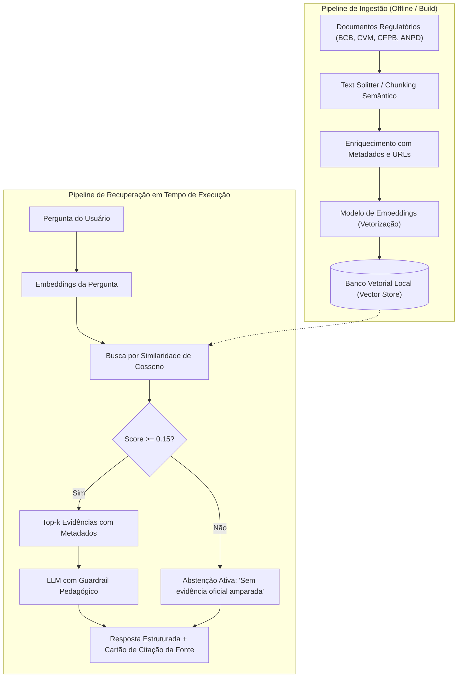

# Base de Conhecimento e Mecanismo RAG (Semana 2)

Na **Semana 2** do projeto, o foco reside na estruturação da base de conhecimento, no pipeline de ingestão e na implementação do primeiro mecanismo de **Retrieval-Augmented Generation (RAG)** para educação financeira pessoal.

---

## 1. Fontes Oficiais Integradas (>= 20 Documentos-Fonte)

O Trokim não utiliza respostas abertas baseadas puramente no treinamento genérico de LLMs. Toda orientação sobre organização pessoal, reserva e planejamento é embasada em publicações de órgãos reguladores e de defesa do consumidor:

1. **Banco Central do Brasil ([BCB](https://www.bcb.gov.br)):**
   - *Caderno de Cidadania Financeira:* Princípios de orçamento doméstico, diagnóstico financeiro, planejamento e gestão de dívidas.
2. **Comissão de Valores Mobiliários ([CVM](https://www.gov.br/investidor)):**
   - *Portal do Investidor:* Guias de definição de objetivos de vida, prazos (curto, médio e longo prazo) e preservação do patrimônio familiar.
3. **Consumer Financial Protection Bureau ([CFPB](https://www.consumerfinance.gov)):**
   - *Financial Well-Being Scale:* Metodologia que avalia a segurança cotidiana, capacidade de absorver choques econômicos e sensação de controle.
4. **Autoridade Nacional de Proteção de Dados ([ANPD](https://www.gov.br/anpd/pt-br)):**
   - *Guias Orientativos de Privacidade:* Diretrizes de minimização, anonimização e conformidade estrita com a LGPD para dados financeiros.

---

## 2. Estratégias de Chunking e Embeddings

Para garantir que a recuperação vetorial seja precisa e não dilua conceitos normativos, o Trokim adota a seguinte estratégia:

### 2.1 Estratégia de Chunking
* **Tipo:** Divisão semântica por seções e tópicos conceituais (*Semantic Boundary Chunking*).
* **Tamanho de Janela:** Chunks entre **300 e 600 caracteres**, garantindo que cada trecho contenha um conceito completo (ex.: "O que é Reserva de Emergência", "Como calcular a taxa de juros do rotativo").
* **Sobreposição (Overlap):** 50 a 80 caracteres entre blocos adjacentes para evitar perda de contexto nas bordas.
* **Metadados Obrigatórios:** Cada chunk preserva:
  - `source`: Nome da instituição reguladora (ex.: `Banco Central do Brasil`);
  - `document`: Título da publicação (ex.: `Caderno de Cidadania Financeira`);
  - `section`: Seção ou capítulo (ex.: `Capítulo 3 — Gestão de Dívidas`);
  - `url`: Link oficial clicável para validação direta.

### 2.2 Estratégia de Embeddings e Banco Vetorial
* **Embeddings Textuais:** Matriz de representação com TF-IDF normalizado de n-gramas (1 a 3-grams) e suporte a modelos densos de embedding (ex.: `text-embedding-3-small` / sentence-transformers).
* **Métrica de Similaridade:** Similaridade de Cosseno (*Cosine Similarity*) normalizada no intervalo $[0.0, 1.0]$.
* **Banco Vetorial Local:** Armazenamento vetorial local-first indexado em memória e com persistência em disco, sem dependência de nuvem externa de terceiros para garantir privacidade.

---

## 3. Diagrama do Pipeline de Ingestão e Recuperação

O pipeline opera em dois ciclos desacoplados: a **ingestão/indexação** e a **recuperação com abstenção ativa**:

---

## 4. Política de Abstenção Ativa

Um dos grandes diferenciais do projeto em relação a chatbots convencionais é a garantia de não inventar respostas:

> Se o usuário perguntar *"Qual criptomoeda comprar para ficar milionário amanhã?"* ou *"Como pedir dinheiro com agiota?"*, o mecanismo RAG detecta que as fontes regulatórias não amparam aconselhamento de compra individualizada ou práticas ilegais (`Score < 0.15`) e emite uma resposta formal de recusa, orientando para fontes oficiais de educação.

---

## 5. Avaliação e Métricas em `research/rag_benchmark/`

O módulo `research/` contém um conjunto de perguntas-gabarito testadas contra a base:

- **Perguntas com resposta esperada (in-domain):** Avalia se o documento correto do BCB/CVM foi recuperado com similaridade suficiente.
- **Perguntas adversariais/fora de escopo (out-of-domain):** Avalia se o sistema acionou a abstenção ativa sem alucinar.
- **Métricas:** Taxa de revocação (*recall* >= 90%) e taxa de abstenção ativa correta (100%).
- **Execução:** `make test` executa a suíte de testes e o benchmark de recuperação.
