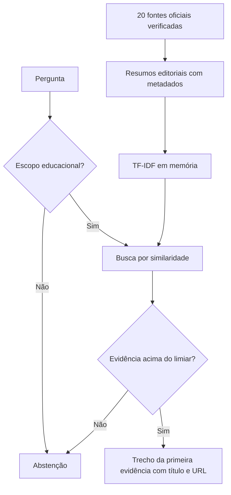

# Base de conhecimento e avaliação RAG

A issue #4 entrega 20 documentos-fonte oficiais, 20 resumos temáticos, dados financeiros
fictícios e um benchmark reproduzível. Veja o [catálogo de fontes](catalogo.md).

## Estado implementado

O protótipo lê os arquivos TXT de `research/knowledge_base/`, preserva fonte, título,
seção e URL e indexa título/seção/conteúdo. A resposta é uma extração do primeiro trecho,
com citação e URL oficial. Não há chamada a LLM, embeddings densos nem persistência vetorial
nesta etapa. A ingestão de originais e o banco vetorial pertencem à #8; síntese à #3.

## Chunking e representação

Cada resumo forma um chunk sem sobreposição. Não são aplicadas janelas fixas a textos
curtos. Para originais longos, a #8 deverá experimentar 256/512 tokens e sobreposição
de 10–20%, preservando localização, e comparar um modelo multilíngue com o baseline.

O baseline combina TF-IDF de palavras (1–2 gramas) e caracteres (3–5), pesos 0,5/0,5,
normalização de acentos e stopwords portuguesas. A busca usa cosseno, top-k=3 e limiar
0,15. O índice é reconstruído em memória a partir dos documentos versionados.

## Avaliação empírica

`make test` executa benchmark, testes de research e API. `make research-test` executa
apenas research. O job de research do CI faz instalação pelo lockfile, lint, testes e
preserva o relatório JSON. A CLI reprova metas não atingidas e gabaritos inválidos.

O gabarito contém 41 perguntas educacionais e 20 casos de abstenção. Recall@3 mede a
fração das evidências relevantes recuperadas. Recuperação fundamentada exige primeira
evidência relevante, extração sem conselhos adicionais, conceitos do gabarito, título e URL na resposta.

| Configuração | Recall@3 | Recuperação | Abstenção |
|---|---:|---:|---:|
| Recuperador sem política de escopo | 95,12% | 97,56% | 75% |
| Recuperador com política de escopo | 95,12% | 97,56% | 100% |

As metas são recall/recuperação de pelo menos 90% e abstenção de 100%. A pergunta P12
continua falhando e está registrada. Os snapshots por caso ficam em
`research/rag_benchmark/results/`; resultados novos em `artifacts/research/`.

O conjunto foi usado no desenvolvimento e não é uma avaliação cega. O controle é o
mesmo recuperador sem política, não uma LLM sem fontes; não há evidência para afirmar
superioridade geral contra respostas abertas. Regras conservadoras de escopo reduzem
respostas inadequadas nos casos testados e não garantem proteção contra todo ataque.

## Dados fictícios e proteção do consumidor

`research/synthetic_data/` contém OFX e fatura PDF reproduzíveis, sem dados reais.
Testes verificam extração, sinais, datas, IDs e conciliação de valores. Não há acesso a
contas bancárias ou chaves de modelo nos testes. As orientações CFPB mantêm o contexto
dos EUA; os princípios ANPD são apresentados com a finalidade e o alcance dos guias.

A metodologia, limitações e instruções completas estão no `research/README.md` do
repositório. A decisão técnica está na [ADR 0006](../adr/0006-curadoria-benchmark.md).
