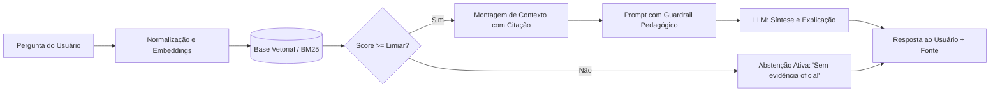

# Base de Conhecimento e Mecanismo RAG (Semana 2)

Na **Semana 2** do projeto, o foco reside na estruturação da base de conhecimento e na implementação do primeiro mecanismo de **Retrieval-Augmented Generation (RAG)** para educação financeira.

---

## 1. Fontes Oficiais Integradas

O Trokim não utiliza respostas abertas baseadas puramente no treinamento genérico de LLMs. Toda orientação sobre organização pessoal, reserva e planejamento é embasada em publicações de órgãos reguladores:

1. **Banco Central do Brasil (BCB):**
   - *Caderno de Cidadania Financeira:* Princípios de orçamento doméstico, diagnóstico financeiro, planejamento e gestão de dívidas.
2. **Comissão de Valores Mobiliários (CVM):**
   - *Portal do Investidor:* Guias de definição de objetivos de vida, prazos (curto, médio e longo prazo) e preservação do patrimônio familiar.
3. **Consumer Financial Protection Bureau (CFPB):**
   - *Financial Well-Being Scale:* Metodologia que avalia a segurança cotidiana, capacidade de absorver choques econômicos e sensação de controle.

---

## 2. Pipeline de Recuperação e Geração

---

## 3. Política de Abstenção Ativa

Um dos grandes diferenciais do projeto em relação a chatbots convencionais é a garantia de não inventar respostas:

> Se o usuário perguntar *"Qual ação vai valorizar 100% amanhã?"* ou *"Devo pegar um empréstimo de agiota?"*, o mecanismo RAG detecta que as fontes regulatórias não amparam aconselhamento de compra individualizada ou práticas ilegais e emite uma resposta formal de recusa, orientando para fontes oficiais de educação.

---

## 4. Avaliação e Métricas em `research/rag_benchmark/`

O módulo `research/` contém um conjunto de perguntas-gabarito testadas contra a base:

- **Perguntas com resposta esperada:** Avalia se o documento correto do BCB/CVM foi recuperado no Top-3.
- **Perguntas adversariais/fora de escopo:** Avalia se o sistema acionou a abstenção sem alucinar.
- **Cálculo da métrica:** Revocação e Acurácia de Citação.
