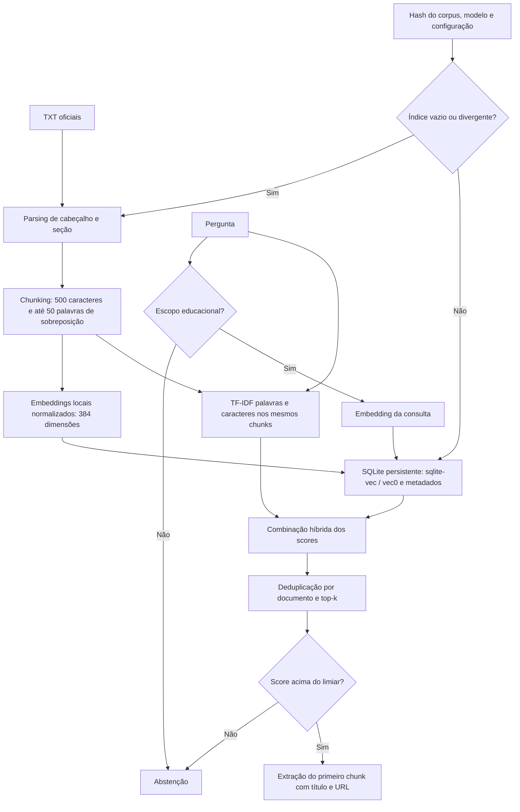

# Base de conhecimento e avaliação RAG

A base contém 20 documentos-fonte oficiais e 20 resumos temáticos de BCB, CVM, CFPB
e ANPD. Veja o [catálogo de fontes](catalogo.md). As issues #8 e #3 acrescentam
persistência vetorial, ingestão e o contrato tipado de consulta.

## Estado implementado

O pipeline lê os TXT de `research/knowledge_base/`, preserva instituição, título,
seção, URL e `document_id`. A ingestão atual gera **21 chunks para 20 documentos**.
`make ingest` grava embeddings locais em `api/data/vector_store.db`, ignorado pelo Git.
O serviço reingere quando o índice está vazio ou mudam corpus, modelo ou chunking;
caso contrário reutiliza os vetores. O modelo ONNX tem cache por processo e arquivos
em `~/.cache/fastembed` (configurável por `FASTEMBED_CACHE_PATH`), com cache no CI.

`POST /v1/chat/ask` aceita `{"message":"..."}` com 1–1000 caracteres e responde com
`query`, `answered`, `status`, `answer` e `evidences` tipadas, incluindo `document_id`.
A resposta continua sendo uma extração do primeiro trecho, com citação e URL oficial.
Não há chamada a LLM nem síntese generativa; a comparação generativa é trabalho posterior.

## Chunking e representação

Cada seção é segmentada por frases em janelas de até **500 caracteres**, sem cortar
palavras. Frases maiores que a janela são divididas entre palavras; uma palavra maior
que o limite é rejeitada. Cabeçalhos nunca entram no conteúdo dos chunks. As frases
finais são repetidas no início da janela seguinte até **50 palavras**, reduzindo a
sobreposição quando necessário para acomodar conteúdo novo no limite. Token é uma
aproximação por palavra separada por espaço, não tokenização do modelo. Texto curto
forma um único chunk. IDs seguem `<arquivo>_<n>`, começando em 1 por documento.

O modelo `sentence-transformers/paraphrase-multilingual-MiniLM-L12-v2`, suportado pelo
FastEmbed instalado, gera vetores multilíngues de **384 dimensões**, normalizados.
SQLite com extensão **sqlite-vec** usa tabela virtual `vec0` e distância de cosseno;
a similaridade é `1 - distância`, equivalente ao produto interno de vetores unitários.
A escolha mantém o armazenamento local-first da ADR 0002.

A busca híbrida usa `alpha * cosseno_denso + (1 - alpha) * cosseno_tfidf`.
O componente lexical mantém TF-IDF de palavras (1–2 gramas) e caracteres (3–5), pesos
0,5/0,5, normalização de acentos e stopwords portuguesas. Ambos indexam título, seção
e conteúdo dos mesmos chunks. O índice lexical é reconstruído em memória, não os
embeddings persistidos. O ranking combina os scores antes de selecionar o top-k e
mantém apenas o chunk de maior score de cada documento. Configuração final:
**alpha=0,3**, **limiar=0,15**, **top-k=3**.

## Avaliação empírica

`make test` executa benchmark, testes de research e API. `make research-test` executa
apenas research. A CLI reprova metas não atingidas e gabaritos inválidos; o CI preserva
o relatório por caso. O primeiro uso baixa o modelo; depois a execução é local.

O gabarito contém 41 perguntas educacionais e 20 casos de abstenção. A relevância é
por **documento**; houve somente remapeamento mecânico de `.txt_1` para `.txt` nos IDs.
Recall@3 mede a fração dos documentos relevantes recuperados. Recuperação fundamentada
exige documento da primeira evidência relevante, resposta byte a byte igual à extração
daquele chunk, conceitos esperados, título e URL. Não basta acertar uma fonte secundária.

### Calibração de alpha

Modelo, corpus, chunking, top-k=3 e limiar=0,15 fixos; valores medidos localmente:

| Alpha | Recall@3 | Recuperação fundamentada | Abstenção | Cumpre metas |
|---:|---:|---:|---:|:---:|
| 0 | 0,9512195122 | 0,9756097561 | 1,0 | Sim |
| **0,3** | **0,9878048780** | **0,9512195122** | **1,0** | **Sim** |
| 0,5 | 0,9878048780 | 0,9512195122 | 1,0 | Sim |
| 0,7 | 0,9878048780 | 0,9512195122 | 1,0 | Sim |
| 1,0 | 0,9512195122 | 0,8536585366 | 1,0 | Não |

As metas são recall/recuperação de pelo menos 0,90 e abstenção de 1,0. Escolheu-se
alpha=0,3: menor peso denso entre as configurações híbridas medidas empatadas, mantendo
maior contribuição lexical. O denso sozinho não cumpre a meta de recuperação;
a configuração híbrida aumenta recall em relação ao lexical, mas perde um acerto de
resposta. Não se afirma melhora em todas as métricas. Para alpha=0,3, os limiares
0,10, 0,15 e 0,20 produziram as mesmas três métricas; manteve-se 0,15 para preservar
o limiar anterior, sem evidência de vantagem dos extremos medidos.

Os snapshots atuais por caso ficam em `research/rag_benchmark/results/`; resultados
novos em `artifacts/research/`. `baseline.json` é a ablação híbrida sem política de
escopo, não o antigo recuperador apenas lexical. A ablação sem política obteve recall@3=0,9878048780,
recuperação=0,9512195122 e abstenção=0,35; esse resultado reforça a necessidade da
política, não uma capacidade intrínseca do embedding de reconhecer escopo. Perguntas,
conceitos e respostas de referência não foram ajustados para passar. As falhas P12 e
Q14 permanecem registradas: em ambas a primeira evidência não é o documento esperado.

O conjunto foi usado no desenvolvimento e na calibração, não é avaliação cega. O
controle sem política não é uma LLM sem fontes; não há evidência para afirmar
superioridade geral contra respostas abertas. Regras conservadoras de escopo reduzem
respostas inadequadas nos casos testados, sem garantir proteção contra todo ataque.

## Dados fictícios e proteção do consumidor

`research/synthetic_data/` contém OFX e fatura PDF reproduzíveis, sem dados reais.
Testes verificam extração, sinais, datas, IDs e conciliação. As orientações CFPB mantêm
o contexto dos EUA; os princípios ANPD respeitam a finalidade e o alcance dos guias.

A metodologia e os comandos de snapshots estão no `research/README.md` do repositório.
Veja a [ADR 0006](../adr/0006-curadoria-benchmark.md) para a curadoria e a
[ADR 0007](../adr/0007-banco-vetorial-embeddings.md) para armazenamento e embeddings.
