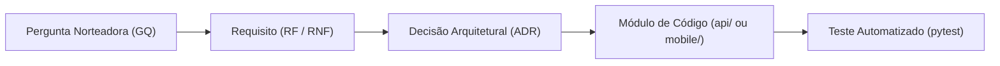

# Engenharia de Requisitos e Matriz de Rastreabilidade

Rastreabilidade bidirecional entre os Requisitos do Sistema (Funcionais e Não Funcionais), priorização MoSCoW, histórico formal de versionamento, Perguntas Norteadoras da Pesquisa (GQ01 a GQ13) e Decisões de Arquitetura (ADRs).

---

## 1. Histórico de Versões e Changelog dos Requisitos

| Versão | Data | Fase CBL | Principais Alterações e Justificativas | Autor / Responsável |
|:---:|:---:|:---:|---|:---:|
| **v1.0.0** | 30/10/2026 | Semana 1 (*Engage*) | Baseline inicial de requisitos do MVP (RF01 a RF10; RNF01 a RNF06). Definição do escopo local-first, cálculo determinístico em Python e premissas de RAG oficial. | Equipe Trokim |
| **v1.1.0** | 07/11/2026 | Semana 2 (*Investigate & Act*) | Refinamento formal da Entrega 2: inclusão de **RF11 a RF14** (busca híbrida, persistência SQLite-Vec, chat mobile e dados sintéticos) e **RNF07 a RNF09** (ports & adapters, determinismo no benchmark e metas empíricas auditadas). Vinculação das ADRs 0006 e 0007. | Equipe Trokim |
| **v1.2.0** | 13/11/2026 | Semana 3 (*Interface*) | Inclusão de **RF15** (aba de Ajustes), **RF16** (histórico de conversas com título automático, planejado), **RNF10** (acessibilidade e conforto visual) e **RNF11** (arte de marca com licença livre). Vinculação das ADRs 0009 a 0014. | Equipe Trokim |
| **v1.3.0** | 16/11/2026 | Semana 3 (*Fechamento*) | **RF07** passa a consumir `/transactions/summary`; **RF01** e **RF02** ganham importação pelo app e reenvio sem duplicar totais; **RF15** passa a incluir a edição do endereço da API. Vinculação da ADR 0015. | Equipe Trokim |
| **v1.3.1** | 16/11/2026 | Semana 3 (*Revisão da documentação*) | **RNF09** alinhado ao benchmark: a meta de resposta fundamentada é 90% (como em `eval_rag.py` e na Entrega 2), e não 85%. | Equipe Trokim |
| **v1.5.0** | 18/11/2026 | Semana 4 (*Implementação*) | Implementação no app do modo multiagente experimental, modelos Dart estritos e trilha por resposta (RF21). | Equipe Trokim |
| **v1.6.0** | 18/11/2026 | Semana 4 (*Importação de várias contas*) | **RF01** e **RF02** ganham os perfis do Banco do Brasil (conta em OFX e fatura Ourocard em PDF); **RF09** passa a implementado com o ajuste de categoria no app e regras por estabelecimento; inclusão de **RF22** (contas e situação do período), **RF23** (parcelamentos), **RF24** (transferências entre contas próprias), **RF25** (visões de caixa e competência por dono) e **RF26** (receber arquivo por "Compartilhar"). Vinculação da ADR 0018. | Equipe Trokim |
| **v1.7.0** | 18/11/2026 | Semana 4 (*Entrega 4*) | **RF18**, **RF19** e **RF20** passam a implementados, medidos no benchmark multiagente (#60). **RF09** ganha a categoria `impostos`, o conjunto de validação por formatos de vários bancos e a categorização pela atividade econômica (CNAE) com os dados abertos do CNPJ. Vinculação das ADRs 0019 (ORM e migrações numeradas) e 0020. | Equipe Trokim |
| **v1.8.0** | 23/11/2026 | Semana 5 (*Persistência e backup*) | Inclusão de **RF31** (persistência local da biblioteca) e **RF32** (backup criptografado), com a [ADR 0024](adr/0024-persistencia-local-e-backup-criptografado.md). A API passa a restaurar a biblioteca ao iniciar. | Equipe Trokim |
| **v1.8.1** | 23/11/2026 | Semana 5 (*Multimodalidade*) | Inclusão de **RF27** (captura e prévia documental) e **RF28** (revisão humana, confiança, bloqueios e abstenção para imagem ilegível), rastreados à ADR 0021. | Equipe Trokim |
| **v1.10.0** | 23/11/2026 | Semana 5 (*Armazenamento no aparelho*) | **RF31** passa a ter o aparelho como fonte da verdade: biblioteca cifrada (AES-256-GCM, chave no Keystore) e API que a mantém só em memória ([ADR 0025](adr/0025-armazenamento-no-aparelho-e-api-sem-estado.md)). | Equipe Trokim |
| **v1.9.0** | 23/11/2026 | Semana 5 (*Leitura de imagem*) | Inclusão de **RNF12** (motores de leitura de imagem intercambiáveis e consentimento para provedor remoto) e das portas de OCR e visão ([ADR 0021](adr/0021-visao-e-ocr-modulares.md)); backend em contêiner com OCR. **RF27** segue em implementação. | Equipe Trokim |
| **v1.11.0** | 23/11/2026 | Semana 5 (*Bancos suportados e tutoriais*) | Inclusão de **RF29** (tutoriais por banco e tela de bancos suportados com selos Validado e Experimental), cobrindo Nubank, Banco do Brasil, PicPay, Mercado Pago, Banco Inter, C6 Bank e Itaú, com vinculação da [ADR 0022](adr/0022-registro-de-perfis-e-niveis-de-suporte.md). | Equipe Trokim |
| **v1.12.0** | 25/11/2026 | Semana 5 (*Consultas determinísticas*) | Inclusão de **RF30** (consultas determinísticas sobre os dados do usuário: por conta, dono, período, fatura aberta e fechada, parcelas, dívidas, ranking, comparação e transferências próprias), com vinculação da [ADR 0004](adr/0004-calculos-deterministicos.md) e da [ADR 0018](adr/0018-contas-periodos-transferencias-e-visoes.md). | Equipe Trokim |

---

## 2. Metodologia de Levantamento e Priorização (MoSCoW)

A engenharia de requisitos do **Trokim** segue duas frentes fundamentais:

1. **Rastreabilidade com Guiding Questions (GQ01 a GQ13):** Todo requisito deriva de uma necessidade diagnosticada na pesquisa com fontes oficiais (BCB, CVM, CFPB, ANPD). Requisitos sem origem em GQ são sumariamente rejeitados para evitar *scope creep*.
2. **Priorização MoSCoW:**
   - Must have: Mandatórios para o fluxo de valor do MVP e integridade do assistente (importação OFX/PDF, cálculos determinísticos com zero alucinação, RAG oficial com abstenção ativa, banco vetorial local e privacidade LGPD).
   - Should have: Funcionalidades essenciais para a experiência de uso (comparação de cenários de orçamento, categorização assistida e baixa latência de recuperação).
   - Could have: Funcionalidades de alto valor agregado previstas para as semanas 4 e 5 (assistente multimodal com visão em comprovantes e orquestração multiagentes; na Semana 4, a orquestração multiagente passou a Must have, nos RF18 a RF20).
   - **Won't have (nesta release)**: Conexões bancárias em nuvem via Open Finance ou agregação de credenciais bancárias (descartadas pela [ADR 0005](adr/0005-importacao-local-ofx-pdf.md)).

---

## 3. Requisitos Funcionais (RF)

| ID | Requisito Funcional | Descrição Detalhada | Priorização | Origem | ADR Relacionada | Status de Implementação |
|:---:|---|---|:---:|:---:|:---:|:---:|
| **RF01** | Importação de extratos OFX | O sistema deve ler e extrair transações financeiras de extratos bancários em formato `.ofx`, com perfil por banco (Nubank: conta e cartão, pessoal e Empresas; Banco do Brasil: conta corrente), natureza do lançamento e remoção de dados pessoais da contraparte. | Must have | [GQ02](pesquisa/guiding-questions.md), [GQ03](pesquisa/guiding-questions.md) | [ADR 0005](adr/0005-importacao-local-ofx-pdf.md) | Implementado |
| **RF02** | Importação de faturas PDF | O sistema deve extrair texto, datas e valores de faturas de cartão de crédito em formato `.pdf`, com acentos, milhar, sinal, parcelas e ano corretos, e perfil próprio para a fatura Ourocard do Banco do Brasil (conferida com o total da fatura). | Must have | [GQ02](pesquisa/guiding-questions.md), [GQ03](pesquisa/guiding-questions.md) | [ADR 0005](adr/0005-importacao-local-ofx-pdf.md) | Implementado |
| **RF03** | Cálculo determinístico de totais | O sistema deve calcular saldos, receitas, despesas e percentual de poupança exclusivamente por código matemático em Python, sem intervenção aritmética de LLMs. | Must have | [GQ04](pesquisa/guiding-questions.md), [GQ07](pesquisa/guiding-questions.md) | [ADR 0004](adr/0004-calculos-deterministicos.md) | Implementado |
| **RF04** | Deduplicação de transações | O sistema deve identificar e sinalizar automaticamente transações repetidas entre extratos bancários e faturas de cartão. | Must have | [GQ02](pesquisa/guiding-questions.md), [GQ07](pesquisa/guiding-questions.md) | [ADR 0004](adr/0004-calculos-deterministicos.md) | Implementado |
| **RF05** | Consulta pedagógica via RAG | O usuário pode enviar perguntas em linguagem natural respondidas com base nas publicações oficiais do BCB, CVM e CFPB. | Must have | [GQ01](pesquisa/guiding-questions.md), [GQ05](pesquisa/guiding-questions.md), [GQ10](pesquisa/guiding-questions.md) | [ADR 0003](adr/0003-rag-fontes-oficiais.md), [ADR 0006](adr/0006-curadoria-benchmark.md), [ADR 0007](adr/0007-banco-vetorial-embeddings.md) | Implementado |
| **RF06** | Abstenção ativa de IA | O sistema deve recusar responder formalmente quando uma pergunta do usuário estiver fora do escopo ou não tiver respaldo oficial comprovado. | Must have | [GQ05](pesquisa/guiding-questions.md), [GQ10](pesquisa/guiding-questions.md) | [ADR 0003](adr/0003-rag-fontes-oficiais.md), [ADR 0006](adr/0006-curadoria-benchmark.md) | Implementado |
| **RF07** | Dashboard consolidado no Android | O aplicativo móvel deve exibir o resumo financeiro, saldo líquido, métricas de poupança e distribuição por categoria. | Must have | [GQ01](pesquisa/guiding-questions.md), [GQ07](pesquisa/guiding-questions.md), [GQ13](pesquisa/guiding-questions.md) | [ADR 0001](adr/0001-flutter-android.md), [ADR 0015](adr/0015-dados-reais-importacao-e-endereco-da-api.md) | Implementado |
| **RF08** | Simulação e comparação de cenários | O sistema deve permitir comparar dois cenários orçamentários (ex.: Cenário Padrão vs. Otimizado com meta de reserva de emergência). | Should have | [GQ06](pesquisa/guiding-questions.md), [GQ08](pesquisa/guiding-questions.md), [GQ12](pesquisa/guiding-questions.md) | [ADR 0004](adr/0004-calculos-deterministicos.md) | Previsto (Semana 4) |
| **RF09** | Categorização automática assistida | O sistema deve inferir a categoria das transações por regras locais e permitir conferência e ajuste no app; a correção vira regra do estabelecimento, aplicada aos lançamentos já importados e aos próximos arquivos. | Should have | [GQ07](pesquisa/guiding-questions.md), [GQ11](pesquisa/guiding-questions.md) | [ADR 0004](adr/0004-calculos-deterministicos.md), [ADR 0017](adr/0017-perfis-de-banco-e-natureza-do-lancamento.md), [ADR 0018](adr/0018-contas-periodos-transferencias-e-visoes.md), [ADR 0020](adr/0020-categorizacao-por-cnae.md) | Implementado |
| **RF10** | Auditoria e citação direta de fontes | Cada orientação gerada pelo assistente deve referenciar explicitamente o órgão oficial (ex.: Banco Central) e a seção documental correspondente. | Must have | [GQ05](pesquisa/guiding-questions.md), [GQ08](pesquisa/guiding-questions.md) | [ADR 0003](adr/0003-rag-fontes-oficiais.md), [ADR 0006](adr/0006-curadoria-benchmark.md), [ADR 0007](adr/0007-banco-vetorial-embeddings.md) | Implementado |
| **RF11** | Busca híbrida de evidências | O motor de recuperação deve combinar vetores densos (FastEmbed) com similaridade esparsa (TF-IDF palavras + n-grams de caracteres) com ponderação calibrada. | Must have | [GQ05](pesquisa/guiding-questions.md), [GQ10](pesquisa/guiding-questions.md) | [ADR 0007](adr/0007-banco-vetorial-embeddings.md) | Implementado |
| **RF12** | Ingestão e persistência vetorial local | O sistema deve armazenar embeddings e metadados na tabela virtual `vec0` do SQLite-Vec, reingerindo automaticamente em caso de alteração no corpus via hash SHA-256. | Must have | [GQ03](pesquisa/guiding-questions.md), [GQ10](pesquisa/guiding-questions.md) | [ADR 0002](adr/0002-fastapi-sqlite-local.md), [ADR 0007](adr/0007-banco-vetorial-embeddings.md), [ADR 0019](adr/0019-orm-e-migracoes-numeradas.md) | Implementado |
| **RF13** | Interface conversacional com cartões de fontes | O app mobile e a API devem disponibilizar canal de diálogo com renderização de cartões destacando a instituição, trecho, score e link do documento governamental. | Must have | [GQ01](pesquisa/guiding-questions.md), [GQ05](pesquisa/guiding-questions.md) | [ADR 0001](adr/0001-flutter-android.md), [ADR 0003](adr/0003-rag-fontes-oficiais.md) | Implementado |
| **RF14** | Gerador sintético de extratos e faturas | O projeto deve conter geradores automatizados de dados financeiros fictícios em formatos OFX e PDF para validação contínua em conformidade com a LGPD. | Must have | [GQ02](pesquisa/guiding-questions.md), [GQ03](pesquisa/guiding-questions.md) | [ADR 0005](adr/0005-importacao-local-ofx-pdf.md), [ADR 0006](adr/0006-curadoria-benchmark.md) | Implementado |
| **RF15** | Ajustes do aplicativo | O app deve permitir escolher o tema (sistema, claro ou escuro), reduzir animações, desligar a abertura animada, editar o endereço da API local e testar a conexão, salvando as preferências apenas no aparelho. | Should have | [GQ01](pesquisa/guiding-questions.md), [GQ03](pesquisa/guiding-questions.md) | [ADR 0013](adr/0013-preferencias-locais-e-aba-de-ajustes.md) | Implementado |
| **RF16** | Histórico de conversas com título automático | O assistente guarda localmente o histórico de conversas e usa o LLM local para dar a cada uma um título curto (3 a 6 palavras), com título determinístico de reserva e título provisório enquanto o modelo trabalha, sem enviar dados a terceiros. | Should have | [GQ01](pesquisa/guiding-questions.md), [GQ03](pesquisa/guiding-questions.md), [GQ05](pesquisa/guiding-questions.md) | [ADR 0014](adr/0014-historico-de-conversas-e-titulos.md) | Implementado |
| **RF17** | Síntese generativa fundamentada | A API e o app devem redigir respostas em linguagem natural com o modelo configurado (LiteLLM/Ollama), ancoradas nas evidências oficiais, com citação por fonte, abstenção ativa fora de escopo ou sem evidência e erro claro (503) se o modelo estiver indisponível. | Must have | [GQ04](pesquisa/guiding-questions.md), [GQ05](pesquisa/guiding-questions.md), [GQ10](pesquisa/guiding-questions.md), [GQ11](pesquisa/guiding-questions.md) | [ADR 0009](adr/0009-sintese-generativa-local.md), [ADR 0008](adr/0008-material-comparativo-versionado.md) | Implementado |
| **RF18** | Orquestração multiagente com trilha | O sistema deve responder por quatro agentes (Research, Analysis, Communication e Validation) coordenados por um orquestrador determinístico e devolver, com a resposta, a trilha de cada passo (agente, estado, resumo e duração). Só o Communication usa LLM. | Must have | [GQ05](pesquisa/guiding-questions.md), [GQ10](pesquisa/guiding-questions.md) | [ADR 0016](adr/0016-arquitetura-multiagente.md) | Implementado |
| **RF19** | Validação determinística antes de responder | Nenhuma resposta multiagente pode sair sem a checagem do Validation Agent (números sem suporte, citações inválidas, conselhos fora de escopo e abstenção inconsistente). Com bloqueio persistente, a resposta é rejeitada de forma segura, sem inventar conteúdo. | Must have | [GQ05](pesquisa/guiding-questions.md), [GQ11](pesquisa/guiding-questions.md) | [ADR 0016](adr/0016-arquitetura-multiagente.md), [ADR 0004](adr/0004-calculos-deterministicos.md) | Implementado |
| **RF20** | Análise determinística de perguntas numéricas | Todo cálculo de uma pergunta (resumo, categorias, meta e cenários) é feito por código pelo Analysis Agent e entregue ao Communication como resultado pronto. Sem dados suficientes, o sistema diz o que falta em vez de estimar. | Must have | [GQ07](pesquisa/guiding-questions.md), [GQ08](pesquisa/guiding-questions.md), [GQ09](pesquisa/guiding-questions.md) | [ADR 0016](adr/0016-arquitetura-multiagente.md), [ADR 0004](adr/0004-calculos-deterministicos.md) | Implementado |
| **RF21** | Trilha dos agentes no app | O app deve mostrar, por resposta, "como cheguei a essa resposta": os passos dos agentes, os cálculos, as evidências e, em abstenção ou rejeição, o motivo em linguagem simples. O modo multiagente é opcional em Ajustes. | Should have | [GQ01](pesquisa/guiding-questions.md), [GQ10](pesquisa/guiding-questions.md) | [ADR 0016](adr/0016-arquitetura-multiagente.md) | Implementado |
| **RF22** | Contas e situação do período | Cada arquivo pertence a uma conta com dono (pessoal ou empresa) perguntado uma vez; o sistema detecta fatura aberta ou fechada e extrato parcial, permite confirmar e ajustar o período, substitui os lançamentos ao reimportar o mesmo período, aponta lacunas e avisa de arquivo no lugar errado antes de importar. | Must have | [GQ02](pesquisa/guiding-questions.md), [GQ03](pesquisa/guiding-questions.md), [GQ13](pesquisa/guiding-questions.md) | [ADR 0018](adr/0018-contas-periodos-transferencias-e-visoes.md) | Implementado |
| **RF23** | Controle de parcelamentos | O sistema agrupa a mesma compra parcelada entre faturas e mostra parcela atual, quanto falta e a projeção mensal do que já está comprometido. | Must have | [GQ07](pesquisa/guiding-questions.md), [GQ09](pesquisa/guiding-questions.md) | [ADR 0018](adr/0018-contas-periodos-transferencias-e-visoes.md) | Implementado |
| **RF24** | Transferências entre contas próprias | O dinheiro que só mudou de conta (inclusive o Pix que paga a fatura de outro banco) sai dos totais: ligação certa pela conta de destino, sugestões por valor e data para o usuário confirmar ou recusar, e desfazer. | Must have | [GQ07](pesquisa/guiding-questions.md), [GQ13](pesquisa/guiding-questions.md) | [ADR 0018](adr/0018-contas-periodos-transferencias-e-visoes.md) | Implementado |
| **RF25** | Visões de caixa e competência por dono | O Resumo alterna entre gastos (competência) e caixa, filtra por dono (Tudo, Pessoal, Empresas) e mostra o total por conta, com os números calculados só no backend. | Should have | [GQ07](pesquisa/guiding-questions.md), [GQ13](pesquisa/guiding-questions.md) | [ADR 0018](adr/0018-contas-periodos-transferencias-e-visoes.md), [ADR 0004](adr/0004-calculos-deterministicos.md) | Implementado |
| **RF26** | Receber arquivo por "Compartilhar" | No Android, o app aceita OFX e PDF enviados por "Compartilhar" ou "Abrir com" e abre o fluxo de importação já com o arquivo, sem enviá-lo a terceiros. | Should have | [GQ01](pesquisa/guiding-questions.md), [GQ03](pesquisa/guiding-questions.md) | [ADR 0018](adr/0018-contas-periodos-transferencias-e-visoes.md) | Implementado |
| **RF27** | Leitura assistida de documentos | O app deve permitir fotografar ou selecionar comprovantes e faturas digitalizadas e apresentar uma prévia antes da leitura. | Must have | [GQ01](pesquisa/guiding-questions.md), [GQ02](pesquisa/guiding-questions.md), [GQ03](pesquisa/guiding-questions.md) | [ADR 0021](adr/0021-visao-e-ocr-modulares.md) | Backend HTTP implementado (#96); mobile com mock até a #97 |
| **RF28** | Revisão humana antes da importação | Os campos extraídos devem ser editáveis, indicar confiança e bloqueios, e só podem ser confirmados por ação explícita; documentos ilegíveis devem pedir nova captura. | Must have | [GQ01](pesquisa/guiding-questions.md), [GQ02](pesquisa/guiding-questions.md), [GQ03](pesquisa/guiding-questions.md) | [ADR 0021](adr/0021-visao-e-ocr-modulares.md) | Backend HTTP implementado (#96); mobile com mock até a #97 |
| **RF29** | Bancos suportados, níveis de suporte e tutoriais | O app lista os bancos suportados com selo **Validado** ou **Experimental**, tutorial de exportação por banco e aviso de que banco experimental ainda não foi conferido com arquivo real. A API expõe a lista em `GET /v1/banks` e reconhece o banco **pelo conteúdo** do arquivo (OFX, PDF ou CSV). Banco novo é um registro e um perfil, sem alterar os demais. | Should have | [GQ01](pesquisa/guiding-questions.md), [GQ03](pesquisa/guiding-questions.md) | [ADR 0022](adr/0022-registro-de-perfis-e-niveis-de-suporte.md), [ADR 0017](adr/0017-perfis-de-banco-e-natureza-do-lancamento.md) | Implementado; PicPay, Mercado Pago, Inter, C6 e Itaú seguem experimentais (sem arquivo real). |
| **RF30** | Consultas determinísticas sobre os dados do usuário | O sistema responde, por código e sem LLM, gasto e saldo por conta e por dono; por período (mês, intervalo, fatura aberta, fechada e próxima); parcelas em aberto; dívidas e compromissos; top estabelecimentos e categorias; comparação entre dois períodos; e o efeito das transferências próprias. Período e conta são resolvidos a partir do texto, e a ambiguidade volta como pergunta de esclarecimento, nunca como palpite. Só saem agregados, rótulo de conta (banco, tipo e dono) e estabelecimento: nunca documento, agência, número da conta ou nome de pessoa física. | Must have | [GQ07](pesquisa/guiding-questions.md), [GQ09](pesquisa/guiding-questions.md), [GQ13](pesquisa/guiding-questions.md) | [ADR 0004](adr/0004-calculos-deterministicos.md), [ADR 0018](adr/0018-contas-periodos-transferencias-e-visoes.md) | Camada de cálculo implementada (#94; prioridade P0); a ligação ao chat é a #95. O vencimento da fatura é guardado quando o PDF o informa (Itaú e PicPay). |
| **RF31** | Persistência local da biblioteca | Lançamentos, contas, arquivos, transferências confirmadas e regras de categoria sobrevivem ao reinício da API e do app. A fonte da verdade é o **aparelho**, que guarda o retrato cifrado (AES-256-GCM, chave no armazenamento seguro do sistema); a API o recebe ao abrir o app e o mantém só em memória. O SQLite local da API, atrás de uma porta de repositório, segue como opção para quem usa a API sem o app. Só mudam quando o usuário altera algo. | Must have | [GQ03](pesquisa/guiding-questions.md), [GQ06](pesquisa/guiding-questions.md) | [ADR 0024](adr/0024-persistencia-local-e-backup-criptografado.md), [0025](adr/0025-armazenamento-no-aparelho-e-api-sem-estado.md) | Implementado |
| **RF32** | Backup criptografado e restauração | O usuário exporta a biblioteca em um arquivo `.trokim` protegido por senha (AES-256-GCM, chave por scrypt) e a restaura em outro aparelho, substituindo ou mesclando sem duplicar. A senha nunca é gravada. | Should have | [GQ03](pesquisa/guiding-questions.md), [GQ06](pesquisa/guiding-questions.md) | [ADR 0024](adr/0024-persistencia-local-e-backup-criptografado.md) | Implementado |

---

## 4. Requisitos Não Funcionais (RNF)

| ID | Requisito Não Funcional | Descrição Detalhada | Priorização | Origem | ADR Relacionada | Status de Implementação |
|:---:|---|---|:---:|:---:|:---:|:---:|
| **RNF01** | Privacidade Local-First (LGPD) | Os extratos bancários e transações devem ser armazenados localmente no dispositivo em SQLite, sem persistência ou transmissão para servidores de terceiros. | Must have | [GQ03](pesquisa/guiding-questions.md), [GQ06](pesquisa/guiding-questions.md) | [ADR 0002](adr/0002-fastapi-sqlite-local.md), [ADR 0005](adr/0005-importacao-local-ofx-pdf.md) | Validado |
| **RNF02** | Explicabilidade e acurácia aritmética | O motor de cálculo determinístico deve possuir 100% de acurácia numérica e cobertura por testes automatizados com `pytest` (0% de erro ou alucinação). | Must have | [GQ04](pesquisa/guiding-questions.md), [GQ11](pesquisa/guiding-questions.md) | [ADR 0004](adr/0004-calculos-deterministicos.md) | Validado |
| **RNF03** | Portabilidade e performance mobile | A interface do app Android deve manter taxa de quadros estável e baixo consumo de memória através da compilação nativa em Flutter. | Must have | [GQ01](pesquisa/guiding-questions.md) | [ADR 0001](adr/0001-flutter-android.md) | Validado |
| **RNF04** | Baixa latência de recuperação | As consultas RAG locais devem recuperar as evidências no banco vetorial e responder em menos de 100 ms em desenvolvimento local (alcançado ~12,4 ms). | Should have | [GQ05](pesquisa/guiding-questions.md), [GQ10](pesquisa/guiding-questions.md) | [ADR 0003](adr/0003-rag-fontes-oficiais.md), [ADR 0007](adr/0007-banco-vetorial-embeddings.md) | Superado |
| **RNF05** | Arquitetura limpa em camadas | O backend deve isolar estritamente o domínio das rotas e adaptadores (`routers → services → domain`), prevenindo acoplamento indevido. | Must have | [GQ03](pesquisa/guiding-questions.md) | [ADR 0002](adr/0002-fastapi-sqlite-local.md) | Validado |
| **RNF06** | Testabilidade com dados sintéticos | Toda a suíte de testes e validação de hipóteses deve rodar com dados sintéticos em `research/synthetic_data/`, sem uso de dados reais de usuários. | Must have | [GQ02](pesquisa/guiding-questions.md), [GQ03](pesquisa/guiding-questions.md) | [ADR 0005](adr/0005-importacao-local-ofx-pdf.md), [ADR 0006](adr/0006-curadoria-benchmark.md) | Validado |
| **RNF07** | Desacoplamento via Ports & Adapters | O pipeline de embeddings e vector store deve adotar interfaces puras (`EmbeddingModel`, `VectorStore`) permitindo substituição de provedores sem alterar o domínio. | Must have | [GQ03](pesquisa/guiding-questions.md), [GQ10](pesquisa/guiding-questions.md) | [ADR 0002](adr/0002-fastapi-sqlite-local.md), [ADR 0007](adr/0007-banco-vetorial-embeddings.md) | Validado |
| **RNF08** | Auditabilidade e determinismo no benchmark | O protocolo de avaliação deve ser estritamente reproduzível com saída JSON padronizada, controle de código de saída (exit code) e hashes de integridade. | Must have | [GQ05](pesquisa/guiding-questions.md), [GQ08](pesquisa/guiding-questions.md) | [ADR 0006](adr/0006-curadoria-benchmark.md) | Validado |
| **RNF09** | Metas empíricas do RAG | O sistema de recuperação deve atingir métricas mínimas auditadas no benchmark: Recall@3 ≥ 90%, resposta fundamentada ≥ 90% e abstenção ética = 100%. | Must have | [GQ05](pesquisa/guiding-questions.md), [GQ08](pesquisa/guiding-questions.md) | [ADR 0006](adr/0006-curadoria-benchmark.md), [ADR 0007](adr/0007-banco-vetorial-embeddings.md) | Superado |
| **RNF10** | Acessibilidade e conforto visual | A interface deve seguir o tema claro/escuro do aparelho, respeitar "reduzir movimento", manter contraste legível, tipografia embarcada e rolagem sem deformação. | Must have | [GQ01](pesquisa/guiding-questions.md), [GQ07](pesquisa/guiding-questions.md) | [ADR 0011](adr/0011-identidade-visual-e-tema-do-sistema.md), [ADR 0013](adr/0013-preferencias-locais-e-aba-de-ajustes.md), [ADR 0021](adr/0021-visao-e-ocr-modulares.md) | Implementado |
| **RNF11** | Arte de marca com licença livre | Toda arte da marca (logo, mascote, fontes) deve ter licença que permita uso comercial (CC0, domínio público, OFL ou paga), com origem registrada e arquivos trocáveis sem alterar código. | Should have | [GQ01](pesquisa/guiding-questions.md), [GQ03](pesquisa/guiding-questions.md) | [ADR 0012](adr/0012-mascote-onca-e-arte-de-marca-livre.md) | Implementado |
| **RNF12** | Motores de visão intercambiáveis e consentimento | OCR e modelo de visão ficam atrás de portas e se trocam só por configuração. O OCR é local por padrão; o modelo de visão vem desligado, e um provedor remoto (que leva a imagem para fora do aparelho) só é usado com consentimento explícito. Imagem, texto lido e resposta do modelo nunca são registrados em log. | Must have | [GQ02](pesquisa/guiding-questions.md), [GQ03](pesquisa/guiding-questions.md) | [ADR 0021](adr/0021-visao-e-ocr-modulares.md) | Implementado |

---

## 5. Matriz de Rastreabilidade Técnica Cruzada

Esta matriz estabelece a correspondência bidirecional ponta a ponta entre a **Pergunta Norteadora (GQ)**, o **Requisito**, a **Decisão de Arquitetura (ADR)**, o **Módulo de Código** no repositório e a **Suíte de Testes Automatizados**:

| Requisito | GQ Origem | ADR | Módulo de Implementação | Suíte de Testes Automatizados |
|:---:|:---:|:---:|---|---|
| **RF01** | GQ02, GQ03 | [ADR 0005](adr/0005-importacao-local-ofx-pdf.md), [ADR 0015](adr/0015-dados-reais-importacao-e-endereco-da-api.md), [ADR 0017](adr/0017-perfis-de-banco-e-natureza-do-lancamento.md) | `api/app/services/parser_service.py`, `api/app/services/statement_profiles.py`, `api/app/services/pdf_profiles.py`, `mobile/lib/features/transactions/`, `mobile/lib/features/import_guide/` | `api/tests/test_parser.py`, `api/tests/test_nubank_profile.py`, `api/tests/test_bb_conta.py`, `api/tests/test_bb_pdf.py`, `api/tests/test_pdf_parser_edge.py`, `api/tests/test_transactions_api.py`, `mobile/test/transactions_screen_test.dart`, `mobile/test/import_flow_test.dart` |
| **RF02** | GQ02, GQ03 | [ADR 0005](adr/0005-importacao-local-ofx-pdf.md), [ADR 0015](adr/0015-dados-reais-importacao-e-endereco-da-api.md), [ADR 0017](adr/0017-perfis-de-banco-e-natureza-do-lancamento.md) | `api/app/services/parser_service.py`, `api/app/services/statement_profiles.py`, `api/app/services/pdf_profiles.py`, `mobile/lib/features/transactions/`, `mobile/lib/features/import_guide/` | `api/tests/test_parser.py`, `api/tests/test_nubank_profile.py`, `api/tests/test_bb_conta.py`, `api/tests/test_bb_pdf.py`, `api/tests/test_pdf_parser_edge.py`, `api/tests/test_transactions_api.py`, `mobile/test/transactions_screen_test.dart`, `mobile/test/import_flow_test.dart` |
| **RF03** | GQ04, GQ07 | [ADR 0004](adr/0004-calculos-deterministicos.md) | `api/app/services/calculation_service.py` | `api/tests/test_calculations.py` |
| **RF04** | GQ02, GQ07 | [ADR 0004](adr/0004-calculos-deterministicos.md) | `api/app/services/parser_service.py` | `api/tests/test_parser.py` |
| **RF05** | GQ01, GQ05, GQ10 | [ADR 0003](adr/0003-rag-fontes-oficiais.md), [0007](adr/0007-banco-vetorial-embeddings.md) | `api/app/services/rag_service.py` | `api/tests/test_rag.py` |
| **RF06** | GQ05, GQ10 | [ADR 0003](adr/0003-rag-fontes-oficiais.md), [0006](adr/0006-curadoria-benchmark.md) | `api/app/services/rag_service.py` | `api/tests/test_rag.py`, `eval_rag.py` |
| **RF07** | GQ01, GQ07, GQ13 | [ADR 0001](adr/0001-flutter-android.md), [ADR 0015](adr/0015-dados-reais-importacao-e-endereco-da-api.md) | `mobile/lib/features/dashboard/`, `mobile/lib/features/finance/` | `mobile/test/dashboard_screen_test.dart`, `mobile/test/finance_test.dart` |
| **RF09** | GQ07, GQ11 | [ADR 0017](adr/0017-perfis-de-banco-e-natureza-do-lancamento.md), [ADR 0018](adr/0018-contas-periodos-transferencias-e-visoes.md), [ADR 0020](adr/0020-categorizacao-por-cnae.md) | `api/app/services/categorization_service.py`, `api/app/services/cnae_categories.py`, `api/app/services/cnpj_index.py`, `api/app/services/statement_profiles.py`, `research/cnpj/`, `mobile/lib/features/categories/` | `api/tests/test_nubank_profile.py`, `api/tests/test_pdf_parser_edge.py`, `api/tests/test_categoria_usuario.py`, `api/tests/test_categorizacao_conjuntos.py`, `api/tests/test_categorizacao_cnpj.py`, `research/test_gerar_indice_cnpj.py`, `mobile/test/category_review_test.dart` |
| **RF10** | GQ05, GQ08 | [ADR 0003](adr/0003-rag-fontes-oficiais.md), [0006](adr/0006-curadoria-benchmark.md) | `api/app/services/rag_service.py` | `api/tests/test_chat_api.py` |
| **RF11** | GQ05, GQ10 | [ADR 0007](adr/0007-banco-vetorial-embeddings.md) | `api/app/services/rag_service.py` | `api/tests/test_rag.py`, `eval_rag.py` |
| **RF12** | GQ03, GQ10 | [ADR 0002](adr/0002-fastapi-sqlite-local.md), [0007](adr/0007-banco-vetorial-embeddings.md) | `api/app/clients/sqlite_vector_store.py` | `api/tests/test_vector_store.py`, `test_ingestion.py` |
| **RF13** | GQ01, GQ05 | [ADR 0001](adr/0001-flutter-android.md), [0003](adr/0003-rag-fontes-oficiais.md) | `mobile/lib/features/chat/`, `routers/v1/chat.py` | `api/tests/test_chat_api.py` |
| **RF15** | GQ01, GQ03 | [ADR 0013](adr/0013-preferencias-locais-e-aba-de-ajustes.md), [ADR 0015](adr/0015-dados-reais-importacao-e-endereco-da-api.md) | `mobile/lib/features/settings/`, `mobile/lib/core/settings/` | `mobile/test/settings_screen_test.dart` |
| **RF16** | GQ01, GQ03, GQ05 | [ADR 0014](adr/0014-historico-de-conversas-e-titulos.md) | `api/app/services/title_service.py`, `mobile/lib/features/chat_assistant/` | `api/tests/test_title.py`, `mobile/test/chat_history_test.dart` |
| **RF17** | GQ04, GQ05, GQ10, GQ11 | [ADR 0009](adr/0009-sintese-generativa-local.md), [0008](adr/0008-material-comparativo-versionado.md) | `api/app/services/generation_service.py`, `api/app/clients/litellm_provider.py`, `api/app/routers/v1/chat.py` | `api/tests/test_generation.py`, `api/tests/test_title.py`, `api/tests/test_request_lifecycle.py`, `mobile/test/chat_repository_test.dart` |
| **RF18** | GQ05, GQ10 | [ADR 0016](adr/0016-arquitetura-multiagente.md) | `api/app/domain/agents.py`, `api/app/services/agents/orchestrator.py`, `api/app/routers/v1/agents.py` | `api/tests/test_orchestrator.py`, `api/tests/test_agents_api.py` |
| **RF19** | GQ05, GQ11 | [ADR 0016](adr/0016-arquitetura-multiagente.md), [0004](adr/0004-calculos-deterministicos.md) | `api/app/services/agents/validation.py` | `api/tests/test_validation_agent.py` |
| **RF20** | GQ07, GQ08, GQ09 | [ADR 0016](adr/0016-arquitetura-multiagente.md), [0004](adr/0004-calculos-deterministicos.md) | `api/app/services/agents/analysis.py`, `api/app/services/calculation_service.py` | `api/tests/test_analysis_agent.py`, `api/tests/test_calculations.py` |
| **RF21** | GQ01, GQ10 | [ADR 0016](adr/0016-arquitetura-multiagente.md) | `mobile/lib/features/agents/`, `mobile/lib/features/chat_assistant/`, `mobile/lib/core/settings/` | `mobile/test/multi_agent_models_test.dart`, `mobile/test/agents_chat_test.dart`, `mobile/test/chat_screen_test.dart` |
| **RF22** | GQ02, GQ03, GQ13 | [ADR 0018](adr/0018-contas-periodos-transferencias-e-visoes.md) | `api/app/services/import_service.py`, `api/app/services/statement_service.py`, `api/app/services/detector_service.py`, `mobile/lib/features/import_guide/`, `mobile/lib/features/transactions/` | `api/tests/test_contas_periodos.py`, `api/tests/test_detector.py`, `mobile/test/import_flow_contas_test.dart`, `mobile/test/library_screens_test.dart` |
| **RF23** | GQ07, GQ09 | [ADR 0018](adr/0018-contas-periodos-transferencias-e-visoes.md) | `api/app/services/installment_service.py`, `mobile/lib/features/installments/` | `api/tests/test_parcelamentos.py`, `mobile/test/library_screens_test.dart` |
| **RF24** | GQ07, GQ13 | [ADR 0018](adr/0018-contas-periodos-transferencias-e-visoes.md) | `api/app/services/transfer_service.py`, `mobile/lib/features/transfers/` | `api/tests/test_transferencias.py`, `api/tests/test_bb_conta.py`, `api/tests/test_bb_pdf.py`, `mobile/test/library_screens_test.dart` |
| **RF25** | GQ07, GQ13 | [ADR 0018](adr/0018-contas-periodos-transferencias-e-visoes.md), [0004](adr/0004-calculos-deterministicos.md) | `api/app/services/calculation_service.py`, `mobile/lib/features/dashboard/` | `api/tests/test_contas_periodos.py`, `mobile/test/library_screens_test.dart` |
| **RF26** | GQ01, GQ03 | [ADR 0018](adr/0018-contas-periodos-transferencias-e-visoes.md) | `mobile/android/app/src/main/kotlin/br/com/trokim/trokim/MainActivity.kt`, `mobile/lib/core/sharing/` | `mobile/test/shared_file_test.dart` |
| **RF27** | GQ01, GQ02, GQ03 | [ADR 0021](adr/0021-visao-e-ocr-modulares.md) | `mobile/lib/features/documents/`, `mobile/lib/features/transactions/` | `mobile/test/document_import_screen_test.dart` |
| **RF28** | GQ01, GQ02, GQ03 | [ADR 0021](adr/0021-visao-e-ocr-modulares.md) | `mobile/lib/features/documents/` | `mobile/test/document_import_screen_test.dart` |
| **RF29** | GQ01, GQ03 | [ADR 0022](adr/0022-registro-de-perfis-e-niveis-de-suporte.md), [0017](adr/0017-perfis-de-banco-e-natureza-do-lancamento.md) | `api/app/services/bank_registry.py`, `bank_profiles.py`, `bank_pdf_profiles.py`, `bank_csv_profiles.py`, `api/app/routers/v1/banks.py`, `mobile/lib/features/import_guide/` | `api/tests/test_bancos_experimentais.py`, `api/tests/test_validar_banco.py`, `mobile/test/supported_banks_test.dart` |
| **RF30** | GQ07, GQ09, GQ13 | [ADR 0004](adr/0004-calculos-deterministicos.md), [0018](adr/0018-contas-periodos-transferencias-e-visoes.md) | `api/app/services/financial_query_service.py`, `api/app/services/calculation_service.py`, `api/app/services/installment_service.py` | `api/tests/test_financial_queries.py` |
| **RF31** | GQ03, GQ06 | [ADR 0024](adr/0024-persistencia-local-e-backup-criptografado.md), [0025](adr/0025-armazenamento-no-aparelho-e-api-sem-estado.md), [0019](adr/0019-orm-e-migracoes-numeradas.md) | `api/app/services/library_store.py`, `api/app/clients/sqlite_library_repository.py`, `api/migrations/app/versions/002_biblioteca_persistente.py`, `api/app/routers/v1/library_snapshot.py`, `mobile/lib/core/storage/` | `api/tests/test_persistencia_e_backup.py`, `api/tests/test_snapshot_do_aparelho.py`, `mobile/test/library_sync_test.dart` |
| **RF32** | GQ03, GQ06 | [ADR 0024](adr/0024-persistencia-local-e-backup-criptografado.md) | `api/app/services/backup_service.py`, `api/app/routers/v1/backup.py`, `mobile/lib/features/backup/` | `api/tests/test_persistencia_e_backup.py` |
| **RF14** | GQ02, GQ03 | [ADR 0005](adr/0005-importacao-local-ofx-pdf.md), [0006](adr/0006-curadoria-benchmark.md) | `research/synthetic_data/` | `research/test_research.py` |
| **RNF01** | GQ03, GQ06 | [ADR 0002](adr/0002-fastapi-sqlite-local.md), [0005](adr/0005-importacao-local-ofx-pdf.md), [0019](adr/0019-orm-e-migracoes-numeradas.md) | `api/app/db/database.py`, `api/migrations/` | `api/tests/test_health.py`, `api/tests/test_migrations.py` |
| **RNF02** | GQ04, GQ11 | [ADR 0004](adr/0004-calculos-deterministicos.md) | `api/app/services/calculation_service.py` | `api/tests/test_calculations.py` |
| **RNF07** | GQ03, GQ10 | [ADR 0002](adr/0002-fastapi-sqlite-local.md), [0007](adr/0007-banco-vetorial-embeddings.md) | `api/app/models/vector_store.py` | `api/tests/test_vector_store.py` |
| **RNF06** | GQ02, GQ03, GQ04, GQ05, GQ11 | [ADR 0005](adr/0005-importacao-local-ofx-pdf.md), [0008](adr/0008-material-comparativo-versionado.md) | `research/synthetic_data/generate_ledger_multiagente.py`, `ledger_multiagente.json` | `research/test_multiagent_cases.py` (reprodução, duplicatas e números determinísticos) |
| **RNF08** | GQ05, GQ08, GQ11 | [ADR 0006](adr/0006-curadoria-benchmark.md), [0008](adr/0008-material-comparativo-versionado.md) | `research/rag_benchmark/eval_rag.py`, `research/rag_benchmark/multiagent.py`, [gabarito multiagente](pesquisa/gabarito-multiagente.md) | `make research-test`, `research/test_multiagent_cases.py` |
| **RNF09** | GQ05, GQ08 | [ADR 0006](adr/0006-curadoria-benchmark.md), [0007](adr/0007-banco-vetorial-embeddings.md) | `research/rag_benchmark/` | CI GitHub Actions / Runner Mac |
| **RNF10** | GQ01, GQ07 | [ADR 0011](adr/0011-identidade-visual-e-tema-do-sistema.md), [0013](adr/0013-preferencias-locais-e-aba-de-ajustes.md), [0021](adr/0021-visao-e-ocr-modulares.md) | `mobile/lib/core/theme/app_theme.dart`, `mobile/lib/core/widgets/app_motion.dart`, `mobile/lib/features/documents/` | `mobile/test/splash_gate_test.dart`, `mobile/test/settings_screen_test.dart`, `mobile/test/document_import_screen_test.dart` |
| **RNF11** | GQ01, GQ03 | [ADR 0012](adr/0012-mascote-onca-e-arte-de-marca-livre.md) | `mobile/assets/brand/`, `docs/referencias.md` | Revisão no PR |
| **RNF12** | GQ02, GQ03 | [ADR 0021](adr/0021-visao-e-ocr-modulares.md) | `api/app/models/vision_provider.py`, `api/app/clients/vision_factory.py`, `api/app/clients/rapidocr_provider.py`, `api/app/clients/litellm_vision_provider.py` | `api/tests/test_vision_ports.py` |

## Rastreabilidade do agente de documento (#88)

| Requisito do épico #86 | Origem | Atendimento nesta implementação |
|---|---|---|
| RF27 — leitura de foto ou PDF escaneado | GQ02 | Componente da #88 integrado às portas; corpus da #90 e limites visuais verificados; runner de OCR real e integração HTTP pela #96 |
| RF28 — revisão humana e abstenção | GQ02, GQ05 | `needs_review=True`, abstenção e leitura parcial; confirmação via API testada em `api/tests/test_documents_api.py`; integração do app na #97 |

O [Agente de documento](agentes/document-agent.md) detalha limites, formatos, proteção dos dados
e testes. Estes requisitos não são declarados concluídos de ponta a ponta nesta entrega parcial.

O [gabarito multimodal](pesquisa/gabarito-multimodal.md) rastreia RF14/RF27/RF28 a GQ02, GQ03 e GQ05.
A política de revisão não autoriza confirmar documentos antes da validação financeira da #89.

Na #96, `api/tests/documents/` cobre conciliação sem conta, reenvio com campos inválidos,
fatura já conciliada, aplicação integral do lote, categorias aprendidas em Pix, caixa versus
competência, procedência após restauração SQLite e validação da consulta com citação.
A consulta local não substitui os filtros por conta, dono e período das #94 e #95.
