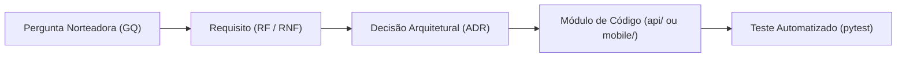

# Engenharia de Requisitos e Matriz de Rastreabilidade

Rastreabilidade bidirecional entre os Requisitos do Sistema (Funcionais e Não Funcionais), priorização MoSCoW, histórico formal de versionamento, Perguntas Norteadoras da Pesquisa (GQ01 a GQ13) e Decisões de Arquitetura (ADRs).

---

## 1. Histórico de Versões e Changelog dos Requisitos

| Versão | Data | Fase CBL | Principais Alterações e Justificativas | Autor / Responsável |
|:---:|:---:|:---:|---|:---:|
| **v1.0.0** | 30/10/2026 | Semana 1 (*Engage*) | Baseline inicial de requisitos do MVP (RF01 a RF10; RNF01 a RNF06). Definição do escopo local-first, cálculo determinístico em Python e premissas de RAG oficial. | Equipe Trokim |
| **v1.1.0** | 07/11/2026 | Semana 2 (*Investigate & Act*) | Refinamento formal da Entrega 2: inclusão de **RF11 a RF14** (busca híbrida, persistência SQLite-Vec, chat mobile e dados sintéticos) e **RNF07 a RNF09** (ports & adapters, determinismo no benchmark e metas empíricas auditadas). Vinculação das ADRs 0006 e 0007. | Equipe Trokim |
| **v1.2.0** | 13/11/2026 | Semana 3 (*Interface*) | Inclusão de **RF15** (aba de Ajustes), **RF16** (histórico de conversas com título automático, planejado), **RNF10** (acessibilidade e conforto visual) e **RNF11** (arte de marca com licença livre). Vinculação das ADRs 0009 a 0012. | Equipe Trokim |

---

## 2. Metodologia de Levantamento e Priorização (MoSCoW)

A engenharia de requisitos do **Trokim** segue duas frentes fundamentais:

1. **Rastreabilidade com Guiding Questions (GQ01 a GQ13):** Todo requisito deriva de uma necessidade diagnosticada na pesquisa com fontes oficiais (BCB, CVM, CFPB, ANPD). Requisitos sem origem em GQ são sumariamente rejeitados para evitar *scope creep*.
2. **Priorização MoSCoW:**
   - Must have: Mandatórios para o fluxo de valor do MVP e integridade do assistente (importação OFX/PDF, cálculos determinísticos com zero alucinação, RAG oficial com abstenção ativa, banco vetorial local e privacidade LGPD).
   - Should have: Funcionalidades essenciais para a experiência de uso (comparação de cenários de orçamento, categorização assistida e baixa latência de recuperação).
   - Could have: Funcionalidades de alto valor agregado previstas para as semanas 4 e 5 (assistente multimodal com visão em comprovantes e orquestração multiagentes).
   - **Won't have (nesta release)**: Conexões bancárias em nuvem via Open Finance ou agregação de credenciais bancárias (descartadas pela [ADR 0005](adr/0005-importacao-local-ofx-pdf.md)).

---

## 3. Requisitos Funcionais (RF)

| ID | Requisito Funcional | Descrição Detalhada | Priorização | Origem | ADR Relacionada | Status de Implementação |
|:---:|---|---|:---:|:---:|:---:|:---:|
| **RF01** | Importação de extratos OFX | O sistema deve ler e extrair transações financeiras de extratos bancários em formato `.ofx`. | Must have | [GQ02](pesquisa/guiding-questions.md), [GQ03](pesquisa/guiding-questions.md) | [ADR 0005](adr/0005-importacao-local-ofx-pdf.md) | Implementado |
| **RF02** | Importação de faturas PDF | O sistema deve extrair texto, datas e valores de faturas de cartão de crédito em formato `.pdf`. | Must have | [GQ02](pesquisa/guiding-questions.md), [GQ03](pesquisa/guiding-questions.md) | [ADR 0005](adr/0005-importacao-local-ofx-pdf.md) | Implementado |
| **RF03** | Cálculo determinístico de totais | O sistema deve calcular saldos, receitas, despesas e percentual de poupança exclusivamente por código matemático em Python, sem intervenção aritmética de LLMs. | Must have | [GQ04](pesquisa/guiding-questions.md), [GQ07](pesquisa/guiding-questions.md) | [ADR 0004](adr/0004-calculos-deterministicos.md) | Implementado |
| **RF04** | Deduplicação de transações | O sistema deve identificar e sinalizar automaticamente transações repetidas entre extratos bancários e faturas de cartão. | Must have | [GQ02](pesquisa/guiding-questions.md), [GQ07](pesquisa/guiding-questions.md) | [ADR 0004](adr/0004-calculos-deterministicos.md) | Implementado |
| **RF05** | Consulta pedagógica via RAG | O usuário pode enviar perguntas em linguagem natural respondidas com base nas publicações oficiais do BCB, CVM e CFPB. | Must have | [GQ01](pesquisa/guiding-questions.md), [GQ05](pesquisa/guiding-questions.md), [GQ10](pesquisa/guiding-questions.md) | [ADR 0003](adr/0003-rag-fontes-oficiais.md), [ADR 0006](adr/0006-curadoria-benchmark.md), [ADR 0007](adr/0007-banco-vetorial-embeddings.md) | Implementado |
| **RF06** | Abstenção ativa de IA | O sistema deve recusar responder formalmente quando uma pergunta do usuário estiver fora do escopo ou não tiver respaldo oficial comprovado. | Must have | [GQ05](pesquisa/guiding-questions.md), [GQ10](pesquisa/guiding-questions.md) | [ADR 0003](adr/0003-rag-fontes-oficiais.md), [ADR 0006](adr/0006-curadoria-benchmark.md) | Implementado |
| **RF07** | Dashboard consolidado no Android | O aplicativo móvel deve exibir o resumo financeiro, saldo líquido, métricas de poupança e distribuição por categoria. | Must have | [GQ01](pesquisa/guiding-questions.md), [GQ07](pesquisa/guiding-questions.md), [GQ13](pesquisa/guiding-questions.md) | [ADR 0001](adr/0001-flutter-android.md) | Implementado |
| **RF08** | Simulação e comparação de cenários | O sistema deve permitir comparar dois cenários orçamentários (ex.: Cenário Padrão vs. Otimizado com meta de reserva de emergência). | Should have | [GQ06](pesquisa/guiding-questions.md), [GQ08](pesquisa/guiding-questions.md), [GQ12](pesquisa/guiding-questions.md) | [ADR 0004](adr/0004-calculos-deterministicos.md) | Previsto (Semana 4) |
| **RF09** | Categorização automática assistida | O sistema deve inferir a categoria das transações com base no histórico do usuário, permitindo conferência e ajuste no app. | Should have | [GQ07](pesquisa/guiding-questions.md), [GQ11](pesquisa/guiding-questions.md) | [ADR 0004](adr/0004-calculos-deterministicos.md) | Previsto (Semana 3) |
| **RF10** | Auditoria e citação direta de fontes | Cada orientação gerada pelo assistente deve referenciar explicitamente o órgão oficial (ex.: Banco Central) e a seção documental correspondente. | Must have | [GQ05](pesquisa/guiding-questions.md), [GQ08](pesquisa/guiding-questions.md) | [ADR 0003](adr/0003-rag-fontes-oficiais.md), [ADR 0006](adr/0006-curadoria-benchmark.md), [ADR 0007](adr/0007-banco-vetorial-embeddings.md) | Implementado |
| **RF11** | Busca híbrida de evidências | O motor de recuperação deve combinar vetores densos (FastEmbed) com similaridade esparsa (TF-IDF palavras + n-grams de caracteres) com ponderação calibrada. | Must have | [GQ05](pesquisa/guiding-questions.md), [GQ10](pesquisa/guiding-questions.md) | [ADR 0007](adr/0007-banco-vetorial-embeddings.md) | Implementado |
| **RF12** | Ingestão e persistência vetorial local | O sistema deve armazenar embeddings e metadados na tabela virtual `vec0` do SQLite-Vec, reingerindo automaticamente em caso de alteração no corpus via hash SHA-256. | Must have | [GQ03](pesquisa/guiding-questions.md), [GQ10](pesquisa/guiding-questions.md) | [ADR 0002](adr/0002-fastapi-sqlite-local.md), [ADR 0007](adr/0007-banco-vetorial-embeddings.md) | Implementado |
| **RF13** | Interface conversacional com cartões de fontes | O app mobile e a API devem disponibilizar canal de diálogo com renderização de cartões destacando a instituição, trecho, score e link do documento governamental. | Must have | [GQ01](pesquisa/guiding-questions.md), [GQ05](pesquisa/guiding-questions.md) | [ADR 0001](adr/0001-flutter-android.md), [ADR 0003](adr/0003-rag-fontes-oficiais.md) | Implementado |
| **RF14** | Gerador sintético de extratos e faturas | O projeto deve conter geradores automatizados de dados financeiros fictícios em formatos OFX e PDF para validação contínua em conformidade com a LGPD. | Must have | [GQ02](pesquisa/guiding-questions.md), [GQ03](pesquisa/guiding-questions.md) | [ADR 0005](adr/0005-importacao-local-ofx-pdf.md), [ADR 0006](adr/0006-curadoria-benchmark.md) | Implementado |
| **RF15** | Ajustes do aplicativo | O app deve permitir escolher o tema (sistema, claro ou escuro), reduzir animações, desligar a abertura animada e testar a conexão com a API local, salvando as preferências apenas no aparelho. | Should have | [GQ01](pesquisa/guiding-questions.md), [GQ03](pesquisa/guiding-questions.md) | [ADR 0012](adr/0012-preferencias-locais-e-aba-de-ajustes.md) | Implementado |
| **RF16** | Histórico de conversas com título automático | O assistente deve guardar localmente o histórico de conversas e usar o LLM local (Ollama) para dar a cada uma um título curto (até 6 palavras), com título determinístico de reserva quando o modelo estiver indisponível, sem enviar dados a terceiros. | Should have | [GQ01](pesquisa/guiding-questions.md), [GQ03](pesquisa/guiding-questions.md), [GQ05](pesquisa/guiding-questions.md) | [ADR 0004](adr/0004-calculos-deterministicos.md), [ADR 0012](adr/0012-preferencias-locais-e-aba-de-ajustes.md) | Planejado |

---

## 4. Requisitos Não Funcionais (RNF)

| ID | Requisito Não Funcional | Descrição Detalhada | Priorização | Origem | ADR Relacionada | Status de Implementação |
|:---:|---|---|:---:|:---:|:---:|:---:|
| **RNF01** | Privacidade Local-First (LGPD) | Os extratos bancários e transações devem ser armazenados localmente no dispositivo em SQLite, sem persistência ou transmissão para servidores de terceiros. | Must have | [GQ03](pesquisa/guiding-questions.md), [GQ06](pesquisa/guiding-questions.md) | [ADR 0002](adr/0002-fastapi-sqlite-local.md), [ADR 0005](adr/0005-importacao-local-ofx-pdf.md) | Validado |
| **RNF02** | Explicabilidade e acurácia aritmética | O motor de cálculo determinístico deve possuir 100% de acurácia numérica e cobertura por testes automatizados com `pytest` (0% de erro ou alucinação). | Must have | [GQ04](pesquisa/guiding-questions.md), [GQ11](pesquisa/guiding-questions.md) | [ADR 0004](adr/0004-calculos-deterministicos.md) | Validado |
| **RNF03** | Portabilidade e performance mobile | A interface do app Android deve manter taxa de quadros estável e baixo consumo de memória através da compilação nativa em Flutter. | Must have | [GQ01](pesquisa/guiding-questions.md) | [ADR 0001](adr/0001-flutter-android.md) | Validado |
| **RNF04** | Baixa latência de recuperação | As consultas RAG locais devem recuperar as evidências no banco vetorial e responder em menos de 100 ms em desenvolvimento local (alcançado ~12,4 ms). | Should have | [GQ05](pesquisa/guiding-questions.md), [GQ10](pesquisa/guiding-questions.md) | [ADR 0003](adr/0003-rag-fontes-oficiais.md), [ADR 0007](adr/0007-banco-vetorial-embeddings.md) | Superado |
| **RNF05** | Arquitetura limpa em camadas | O backend deve isolar estritamente o domínio das rotas e adaptadores (`routers → services → domain`), prevenindo acoplamento indevido. | Must have | [GQ03](pesquisa/guiding-questions.md) | [ADR 0002](adr/0002-fastapi-sqlite-local.md) | Validado |
| **RNF06** | Testabilidade com dados sintéticos | Toda a suíte de testes e validação de hipóteses deve rodar com dados sintéticos em `research/synthetic_data/`, sem uso de dados reais de usuários. | Must have | [GQ02](pesquisa/guiding-questions.md), [GQ03](pesquisa/guiding-questions.md) | [ADR 0005](adr/0005-importacao-local-ofx-pdf.md), [ADR 0006](adr/0006-curadoria-benchmark.md) | Validado |
| **RNF07** | Desacoplamento via Ports & Adapters | O pipeline de embeddings e vector store deve adotar interfaces puras (`EmbeddingModel`, `VectorStore`) permitindo substituição de provedores sem alterar o domínio. | Must have | [GQ03](pesquisa/guiding-questions.md), [GQ10](pesquisa/guiding-questions.md) | [ADR 0002](adr/0002-fastapi-sqlite-local.md), [ADR 0007](adr/0007-banco-vetorial-embeddings.md) | Validado |
| **RNF08** | Auditabilidade e determinismo no benchmark | O protocolo de avaliação deve ser estritamente reproduzível com saída JSON padronizada, controle de código de saída (exit code) e hashes de integridade. | Must have | [GQ05](pesquisa/guiding-questions.md), [GQ08](pesquisa/guiding-questions.md) | [ADR 0006](adr/0006-curadoria-benchmark.md) | Validado |
| **RNF09** | Metas empíricas do RAG | O sistema de recuperação deve atingir métricas mínimas auditadas no benchmark: Recall@3 $\ge 90\%$, Precisão $\ge 85\%$ e Abstenção Ética $= 100\%$. | Must have | [GQ05](pesquisa/guiding-questions.md), [GQ08](pesquisa/guiding-questions.md) | [ADR 0006](adr/0006-curadoria-benchmark.md), [ADR 0007](adr/0007-banco-vetorial-embeddings.md) | Superado |
| **RNF10** | Acessibilidade e conforto visual | A interface deve seguir o tema claro/escuro do aparelho, respeitar "reduzir movimento", manter contraste legível, tipografia embarcada e rolagem sem deformação. | Must have | [GQ01](pesquisa/guiding-questions.md), [GQ07](pesquisa/guiding-questions.md) | [ADR 0010](adr/0010-identidade-visual-e-tema-do-sistema.md), [ADR 0012](adr/0012-preferencias-locais-e-aba-de-ajustes.md) | Implementado |
| **RNF11** | Arte de marca com licença livre | Toda arte da marca (logo, mascote, fontes) deve ter licença que permita uso comercial (CC0, domínio público, OFL ou paga), com origem registrada e arquivos trocáveis sem alterar código. | Should have | [GQ01](pesquisa/guiding-questions.md), [GQ03](pesquisa/guiding-questions.md) | [ADR 0011](adr/0011-mascote-onca-e-arte-de-marca-livre.md) | Implementado |

---

## 5. Matriz de Rastreabilidade Técnica Cruzada

Esta matriz estabelece a correspondência bidirecional ponta a ponta entre a **Pergunta Norteadora (GQ)**, o **Requisito**, a **Decisão de Arquitetura (ADR)**, o **Módulo de Código** no repositório e a **Suíte de Testes Automatizados**:

| Requisito | GQ Origem | ADR | Módulo de Implementação | Suíte de Testes Automatizados |
|:---:|:---:|:---:|---|---|
| **RF01** | GQ02, GQ03 | [ADR 0005](adr/0005-importacao-local-ofx-pdf.md) | `api/app/services/parser_service.py` | `api/tests/test_parser.py` |
| **RF02** | GQ02, GQ03 | [ADR 0005](adr/0005-importacao-local-ofx-pdf.md) | `api/app/services/parser_service.py` | `api/tests/test_parser.py` |
| **RF03** | GQ04, GQ07 | [ADR 0004](adr/0004-calculos-deterministicos.md) | `api/app/services/calculation_service.py` | `api/tests/test_calculations.py` |
| **RF04** | GQ02, GQ07 | [ADR 0004](adr/0004-calculos-deterministicos.md) | `api/app/services/parser_service.py` | `api/tests/test_parser.py` |
| **RF05** | GQ01, GQ05, GQ10 | [ADR 0003](adr/0003-rag-fontes-oficiais.md), [0007](adr/0007-banco-vetorial-embeddings.md) | `api/app/services/rag_service.py` | `api/tests/test_rag.py` |
| **RF06** | GQ05, GQ10 | [ADR 0003](adr/0003-rag-fontes-oficiais.md), [0006](adr/0006-curadoria-benchmark.md) | `api/app/services/rag_service.py` | `api/tests/test_rag.py`, `eval_rag.py` |
| **RF07** | GQ01, GQ07, GQ13 | [ADR 0001](adr/0001-flutter-android.md) | `mobile/lib/features/` | Testes de integração mobile |
| **RF10** | GQ05, GQ08 | [ADR 0003](adr/0003-rag-fontes-oficiais.md), [0006](adr/0006-curadoria-benchmark.md) | `api/app/services/rag_service.py` | `api/tests/test_chat_api.py` |
| **RF11** | GQ05, GQ10 | [ADR 0007](adr/0007-banco-vetorial-embeddings.md) | `api/app/services/rag_service.py` | `api/tests/test_rag.py`, `eval_rag.py` |
| **RF12** | GQ03, GQ10 | [ADR 0002](adr/0002-fastapi-sqlite-local.md), [0007](adr/0007-banco-vetorial-embeddings.md) | `api/app/clients/sqlite_vector_store.py` | `api/tests/test_vector_store.py`, `test_ingestion.py` |
| **RF13** | GQ01, GQ05 | [ADR 0001](adr/0001-flutter-android.md), [0003](adr/0003-rag-fontes-oficiais.md) | `mobile/lib/features/chat/`, `routers/v1/chat.py` | `api/tests/test_chat_api.py` |
| **RF15** | GQ01, GQ03 | [ADR 0012](adr/0012-preferencias-locais-e-aba-de-ajustes.md) | `mobile/lib/features/settings/`, `mobile/lib/core/settings/` | `mobile/test/settings_screen_test.dart` |
| **RF14** | GQ02, GQ03 | [ADR 0005](adr/0005-importacao-local-ofx-pdf.md), [0006](adr/0006-curadoria-benchmark.md) | `research/synthetic_data/` | `research/test_research.py` |
| **RNF01** | GQ03, GQ06 | [ADR 0002](adr/0002-fastapi-sqlite-local.md), [0005](adr/0005-importacao-local-ofx-pdf.md) | `api/app/db/database.py` | `api/tests/test_health.py` |
| **RNF02** | GQ04, GQ11 | [ADR 0004](adr/0004-calculos-deterministicos.md) | `api/app/services/calculation_service.py` | `api/tests/test_calculations.py` |
| **RNF07** | GQ03, GQ10 | [ADR 0002](adr/0002-fastapi-sqlite-local.md), [0007](adr/0007-banco-vetorial-embeddings.md) | `api/app/models/vector_store.py` | `api/tests/test_vector_store.py` |
| **RNF08** | GQ05, GQ08 | [ADR 0006](adr/0006-curadoria-benchmark.md) | `research/rag_benchmark/eval_rag.py` | `make test`, `eval_rag.py` |
| **RNF09** | GQ05, GQ08 | [ADR 0006](adr/0006-curadoria-benchmark.md), [0007](adr/0007-banco-vetorial-embeddings.md) | `research/rag_benchmark/` | CI GitHub Actions / Runner Mac |
| **RNF10** | GQ01, GQ07 | [ADR 0010](adr/0010-identidade-visual-e-tema-do-sistema.md), [0012](adr/0012-preferencias-locais-e-aba-de-ajustes.md) | `mobile/lib/core/theme/app_theme.dart`, `mobile/lib/core/widgets/app_motion.dart` | `mobile/test/splash_gate_test.dart`, `mobile/test/settings_screen_test.dart` |
| **RNF11** | GQ01, GQ03 | [ADR 0011](adr/0011-mascote-onca-e-arte-de-marca-livre.md) | `mobile/assets/brand/`, `docs/referencias.md` | Revisão no PR |
